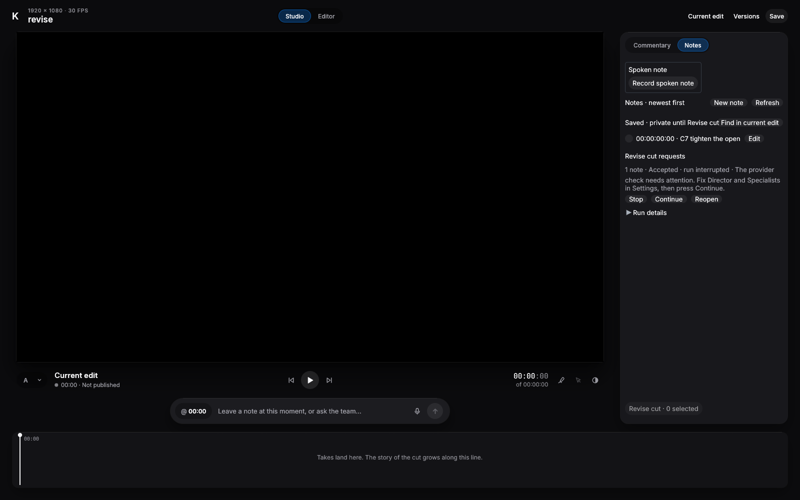

# TE1.5

## TE1.5 Part A

One new local commit directly above `20f2973c`, with no amend, rebase or push. Part B has no implementation changes. Its plan below comes from source inspection, including a fresh fetch of `origin/ja1/s4b`; no merge or provider launch was performed.

1. Media polling retains one 30-second caller budget. `MediaReadPhase` records verification, the decoder's actual start instant, and response assembly. A timeout is non-retryable only while the decoder is active and its own elapsed time reaches a full wait. Certification consuming the caller budget, a shorter decode crossing that boundary, and response assembly remain retryable. This deliberately conservative rule keeps the caller budget and avoids attributing certification or page construction to a full decode overrun. Liveness remains first, then a finished worker is joined before evaluating the deadline. Controlled 600 ms phase-boundary and finished-at-expiry witnesses exercise the production render loop. The retained genuine-decode witness holds polling until its active decoder has actually received the entire shortened wait.
2. `MediaReadStartError` distinguishes a held permit from unavailable liveness. The existing checks and CAS are unchanged. Only Busy gets retry words; revoked, paused, expired and freezing get cancellation words. A real owner/endpoint/PreparedMediaRead witness applies each state between preparation and rendering, including the held-permit control. This witness directly calls production render to reach the race window; it is not an HTTP interleaving claim.
3. Transcript JSON objects now use the same duplicate-rejecting reader. The reader recursively checks objects inside arrays and other objects, including nested freshness bindings. Plain saved voice text keeps its existing path. Real-wire witnesses refuse duplicate `words` and eight Proof/Preview revision variants, including checkpoint SHA duplicates. Raw Reference and child bytes remain unchanged.
4. An empty body now contributes one explicit chunk with `byte_offset:0`, `encoding:"utf8"`, `text:""`, `byte_length:0` and `empty:true`. Real-wire child and Reference witnesses distinguish it from an absent record. No instruction, manifest, prefix, fixture or oracle file changed; the complete Agent run checks the existing goldens.
5. The oversized-record fixture now makes real marker edits whose delta/history force pagination. It verifies first-page continuation, walks through the final page, and requires incomplete coverage there even though no later page is omitted. Removing the global omission contribution now fails `TE14_FIX2_PARTIAL_OMISSION` on that final page. The other omission/reference/isolation assertions remain.

The Model the Domain principle shaped the phase enum and typed start errors: neither elapsed decoder time nor liveness is inferred from a verification Boolean or a string match.

### Exact words

The new `task_context` message is:

`Media evidence preparation exceeded this wait. Retry shortly; no page is charged until a sample is returned.`

Retained bodies are `Media source verification or an earlier read is still running. Retry shortly; no page is charged until a sample is returned.`, `Media decode or seek exceeded the 30-second wait; not retryable. Replan without guessing.`, and `Media read cancelled because the task is no longer live or its source changed.` Duplicate refusals remain `ambiguous or invalid classified evidence object`. Empty records return data, not a refusal.

### Pairs

All 22 pairs reached the named RED assertion and passed GREEN after byte-exact restoration. Six are new and 16 are nearby retained pairs. The required spill witness is the retained omission pair. Each original/restored guard hash matches the final source. Evidence is in `target/te1-5/a/pairs/` and the runnable `scripts/te15-a-mutations.py`. All other retained pairs remain for Part B stage close. The older TE1.4 drivers' changed anchors were retargeted; all 25/32/44 anchors still occur once.

| Pair | Named RED | Restored GREEN |
|---|---|---|
| `begin-liveness` | `TE15_BEGIN_LIVENESS` | PASS |
| `empty-record` | `TE15_EMPTY_CHILD_PRESENT` | PASS |
| `finished-deadline` | `TE15_FINISHED_AT_DEADLINE` | PASS |
| `nested-revision` | `TE15_NESTED_REVISION_DUPLICATES` | PASS |
| `phase-tail` | `TE15_PHASE_TAIL_RETRY` | PASS |
| `retained-busy-retry` | `TE14_FIX2_BUSY_RETRY` | PASS |
| `retained-classified-duplicates` | `TE14_FIX2_AMBIGUOUS_CLASSIFICATION` | PASS |
| `retained-decode-phase` | `TE14_FIX2_MEDIA_WORDS` | PASS |
| `retained-near-cursor-data-binding` | `TE14_CURSOR_BINDS_DATA` | PASS |
| `retained-near-golden-prefix` | `TE14_PREFIX_BYTES_STABLE` | PASS |
| `retained-near-owned-record-bytes` | `TE14_FIX1_RAW_RECORD_EXACT` | PASS |
| `retained-near-reference-usage` | `TE14_FIX1_REFERENCE_USAGE_PROJECTED` | PASS |
| `retained-omitted-acceptance` | `TE14_FIX2_OMITTED_PROOF_UNKNOWN` | PASS |
| `retained-omitted-partial` | `TE14_FIX2_PARTIAL_OMISSION` | PASS |
| `retained-pause-wait` | `TE14_FIX2_MEDIA_WAIT_ENDS` | PASS |
| `retained-preview-classification` | `TE14_CLASSIFICATION_IS_HOST_OWNED` | PASS |
| `retained-proof-classification` | `TE14_CLASSIFICATION_IS_HOST_OWNED` | PASS |
| `retained-reference-bytes` | `TE14_FIX2_ORIGINAL_REFERENCE_BYTES` | PASS |
| `retained-stop-wait` | `TE14_FIX2_MEDIA_WAIT_ENDS` | PASS |
| `retained-verification-phase` | `TE14_FIX2_MEDIA_WORDS` | PASS |
| `retained-wait-deadline` | `TE14_FIX2_MEDIA_WAIT_ENDS` | PASS |
| `transcript-duplicates` | `TE15_TRANSCRIPT_DUPLICATES` | PASS |

### Gates

Full `kinewright-agent` package, including binary, integration and doc tests: **1,455 passed, 0 failed, 129 ignored**, across 28 targets. Nested crash-child summaries are excluded.

test result: ok. 1134 passed; 0 failed; 52 ignored; 0 measured; 0 filtered out; finished in 638.61s

PASS: fmt check, workspace all-target clippy with `-D warnings`, Agent slow-feature all-target clippy, and prescribed Windows workspace/Agent slow-feature clippy. The App architecture scan passed one test; the Agent architecture scan ran in the complete library suite.

slow-test manifest and markers agree: 121 tests, features kinewright-agent/slow-tests,kinewright-app/slow-tests,kinewright-media/slow-tests; 136 allowlist entries well-formed; 27 equipped-session skip sites counted

Slow-runner self-tests: 44 passed.

The six new focused regressions also passed before the pair run. The first cold build found a missing test-only ClipId import; it was corrected before the successful focused build and pair evidence. The first complete Agent run passed, then workspace clippy caught unchecked time subtraction in the expired-authority test. That test now uses checked subtraction; its named pair and the full package/lint gates were repeated. All reported final test summaries are read from completed logs. No benchmark or same-head real-scale timing rerun is claimed: the 30-second limit is unchanged; the new timing tests use controlled shortened waits.

### Deferred and NOT RUN

The maximal fixture is NOT RUN as directed. No production accounting, spending, run-admission budget, claim or recovery logic changed. The read-permit change only classifies its existing failures. Full retained stage-close pairs, workspace test suites and unchanged App/Project suites are NOT RUN here. Windows is compile/lint only. No installed CLI, dry launch, paid/live provider, credential inspection, manual GUI, camera/long-GOP or cold-disk qualification was performed. The existing C6 no-lead-grant negative test runs as part of the package suite, before any dry/provider launch.

Deferred unchanged: oversized-delta acceptance wording, retry pacing, the 2,000-note case, initial/final owner-lock waits, locked row rebuilding, cross-endpoint duplicate hashing, and publication field pinning before a real proof producer. Pre-release old page identities remain an accepted upgrade boundary, without migration. No recommendation or certification claim is made.

### Files

- `crates/kinewright-agent/src/orchestration/tasks.rs`
- `crates/kinewright-agent/src/writer_host/hooks_tests.rs`
- `crates/kinewright-agent/src/writer_host/orchestration.rs`
- `crates/kinewright-agent/src/writer_host/task_context.rs`
- `crates/kinewright-agent/src/writer_host/te14_fix2_tests.rs`
- `crates/kinewright-agent/src/writer_host/te15_a_tests.rs`
- `docs/reports/te1-5.md`
- `scripts/te14-fix1-mutations.py`
- `scripts/te14-fix2-mutations.py`
- `scripts/te15-a-mutations.py`

## Part B plan, not implemented

1. **Launcher.** Freshly fetched `origin/ja1/s4b` is `0fbaabed`, already merged by `904bba3b`; no merge or conflicts remain. The hardened Claude environment already sets `ENABLE_TOOL_SEARCH=false`, empty built-ins and strict MCP configuration, but remains test/test-util-only. Resolve any different intended tip first; otherwise promote the existing recipe explicitly. Any actual merge needs full changed-crate binary suites, Windows clippy and maximal if a listed mechanism changes.

2. **Specialists.** Add bounded, versioned `specialists.json` beside `director.json`, preserving atomic-save and unavailable-choice behavior. Add one Specialists section to Settings, reusing existing model/effort/tier widgets; obtain a visual pass if this grows into new UI. Bind explicit selections only to new non-Director tasks, extending the pinned profile factory to validate chosen model/options. Preserve running tasks and Director choices. Missing or unsupported choices refuse without substitution or silent Director inheritance. Show no recommendation or "qualified" label. Set Codex `enabled_tools` from the durable role manifest; retain host dispatch checks.

3. **Pin.** Commit one measurement record of tool definitions, instructions/prefixes, launcher recipe, fixture/oracle hashes, cases 1/5/6, per-role models/options, limits, order, cache protocol and analysis. Use baseline then candidate per case/provider, fresh logical sessions and matched local preparation; hidden caches stay unobserved. A drift test compares every field. Freeze equal-weight inclusive input plus output over all tasks/attempts, every pair, per-provider mean AND median improvement, correctness and all stop rules. This is a measurement pin, not certification.

4. **Baseline.** Recommend an evaluation-only old-surface adapter on the hardened launcher and TE1.1 observer; an old executable lacks those counters. Byte-pin actual `b4e9abc8` provider-specific behavior and translate only the fixture contract through current authority checks. Claude had no launchable Job A profile there: its generic driver/raw payload is the source, not Codex-shaped wake goldens. Prove this definition and safety before use. Expose no baseline path to ordinary runs/UI. If faithful Claude behavior cannot be represented safely, report a hand-computed payload estimate only, without a paired-token or quality verdict.

5. **Fixtures.** Cases 1, 5 and 6, oracles, media and hashes exist under `tests/fixtures/te1/`. Missing: a driver observing model-selected reads/actions, durable injection of case 5's deceptive child, case-6 conflict scheduling, and rendered/audio checks beyond scripted document/history assertions. Complete these unpaid.

6. **Grant.** Proposed command, not implemented: `KINEWRIGHT_TE1_RUN=<approved-id> cargo test -p kinewright-agent --features te1-eval --test te1_paid te1_one_granted_run -- --ignored --exact`. Use an evaluation-only feature and initially empty compiled `TE1_LEAD_GRANTS`, following the empty `CLAUDE_LIVE_GRANTS` guarding `s4b_installed_claude_director`. Each approval binds one pin/provider/case/arm/model/options/limits/run identity. Refuse missing/mismatched grants before credentials or provider construction. Consume labels durably before possible spend. Missing/changed/reused-grant tests must show zero launches; interrupted labels never retry automatically. `KINEWRIGHT_EVAL=1` alone is insufficient.

Stage close needs the full retained pairs, changed-crate binary suites, fmt/clippy/Windows gates, manifest/self-tests, architecture checks and exact-head Linux/Windows CI including slow. Separately authorize same-head egress-denied dry launches and startup/EOF/progress pairs before paid execution. Twelve runs cover three pairs per provider; extras require new grants. These three cases cannot justify model recommendations.

## TE1.5 Part B1

B1 starts at pushed `b5c106f0321b35856fd0269076af0ecafc29a548`. This section supersedes the original Part B plan where the lead's rulings differ. The baseline will be a separate `te1-baseline` branch from `480a0476`, merged with `origin/ja1/s4b` and given the same launcher promotion and byte-identical eval driver. No baseline adapter belongs in production. Grants will be lead-written per-run files outside this repository, not a compiled list.

### Behavior and boundaries

Claude is now offered on Linux alongside Codex. The existing hardened C6 environment, subscription-only private store, contained version probe, fixed system prompt, strict host MCP configuration, empty built-ins, disabled hooks/plugins/memory, tool-search disablement, event refusal and guardian isolation remain in force. Normal Studio admission dispatches to the selected provider's checks. This is a promotion of the existing recipe, not evidence from an installed-provider launch. Other platforms retain their existing native-connector availability boundary.

The person gets one small Specialists section in Settings. Its selected initial value is **Same as Director**, with the current Director and an explanation that new specialists follow it. A specific choice includes an explicit model, reasoning effort and supported service tier. Claude choices use the existing curated catalog, excluding Ultracode because it enables delegation. Codex choices use the existing local model metadata and supported connector default. No provider discovery or credential read runs when reading or writing this setting. No recommendation or qualification label is shown.

`specialists.json` is a bounded, versioned file beside `director.json`, saved with the existing sync/rename pattern. Missing means the visible Same as Director choice. Malformed or unavailable saved choices are retained and refuse, without substitution. An explicit unavailable choice says: `Your specialist choice (<provider> · <model>) is unavailable. Choose another in Settings; it has not been substituted.` Settings says: `This choice is kept. New specialists wait until you choose an available model.`

Assignment binds this preference under the writer host. Same as Director uses that run's durable parent selection. Changing the Director affects new runs, while changing Specialists affects newly assigned specialists. Existing task briefs keep their selection. A model-supplied provider field cannot override the person. Exact assignment replays recover the original stored selection before calculating their canonical identity, even if Settings subsequently changes. Read-only receipt reconciliation excludes the host-owned assignment provider field, as it already excludes a publication's host-owned usage reference. All caller-owned command fields remain exact. Read-only reconciliation also accepts the exact pre-B1 assignment digest for historical digest-only queries. Typed queries validate any supplied digest before using the current normalized form. Changed role or scope data still refuses, and lookup issues no mutation authority.

The immutable attempt binding now carries the durable task's provider selection and role. Qualification fingerprints the resulting model/options/tool arguments, and profile validation still rejects a modified model, effort or tool list. Codex `enabled_tools` uses exactly the durable role manifest. Claude's permission list uses the same role names; authoritative host `tools/list` filtering and dispatch remain unchanged. The manifest moved to orchestration so both the profile factory and MCP dispatch use one definition, including the isolated kernel test builds.

### Baseline preflight

Read-only source comparison confirms that `480a0476` extracts the exact `b4e9abc8` instruction literal, SHA-256 `28b1932b2b866b88ecef978943e57ed3546685f29f1a35ab016b19aaab117d0f`. The complete descriptor-constructor suffix and control-schema source are byte-identical. The TE1.1 frozen served-tool, capability-registry and task-control hashes at that revision are respectively:

- `a2264f777e319785d75225a82263547ebe23bcd68f3c49815d135c5f403b8f97`
- `9d253fa364f5d62c44aea49999b3a8680f674302e56d9a3b3889f0d41b38817e`
- `38e7fb3446e6ac709aa90f080b1702611605cc256a3b7873af46f37525054311`

Evidence is `target/te1-5/b1/baseline-preflight.json`. This is a source preflight, not a newly executed old-build hash test. B3 must execute the baseline gate and enumerate the merge/promotion's provider-observable differences and compare accounting/counters, including the zero-final rule. That branch has not been created in B1.

### Verification

The full package gate ran `cargo test -p kinewright-agent -p kinewright-project -p kinewright-app`, including binaries, integration tests and doctests. The totals below count the final outer summary of each Cargo test target, avoiding nested subprocess summaries.

| Package | Passed | Failed | Ignored | Test targets |
|---|---:|---:|---:|---:|
| `kinewright-agent` | 1473 | 0 | 129 | 28 |
| `kinewright-app` | 1000 | 0 | 9 | 1 |
| `kinewright-project` | 431 | 0 | 2 | 18 |

The Agent library's raw final summary is:

```text
test result: ok. 1142 passed; 0 failed; 52 ignored; 0 measured; 0 filtered out; finished in 639.78s
```

Both architecture scans passed in those full suites. All eight new Agent regressions passed in the focused final run. Five native-policy/settings regressions also run through each isolated kernel/lifecycle source build. The new App Settings test passed in its full suite. The connector-registration integration suite passed all three tests.

PASS: fmt check, workspace all-target clippy with `-D warnings`, Agent slow-feature all-target clippy, and the prescribed Windows workspace/Agent slow-feature clippy. Windows is compile/lint only. Slow lint reports 121 tests, 136 valid allowlist entries and 27 equipped-session skip sites. All 44 slow-runner self-tests passed.

Gate evidence is under `target/te1-5/b1/`: `full-changed.log`, `suite-counts.json`, `fmt.log`, `clippy.log`, `clippy-agent-slow.log`, `windows-clippy.log`, `slow-lint.log` and `slow-selftest.log`. All these commands completed before these results were read back.

The first full run found two failures: the intentionally promoted Claude connector invalidated an old Codex-only registry expectation, and the sealed JA-S1 prerequisite had lost its source checkout. The sealed binaries and their identity were intact. Restoring that detached prerequisite at `076a96c9` made the unchanged corpus test pass; no corpus expectation changed. A subsequent integration run found the second Codex-only registry assertion and its common Codex version-floor assertion. Both registry tests now explicitly expect Codex and Claude on Linux, with their existing respective floors of 0.166.0 and 2.1.316. Other platforms still expect no native connector. Initial compile/lint errors in test plumbing were corrected before the final gate. No prompt, role-prefix, fixture or oracle golden was regenerated.

All 16 pairs reached their named RED assertion and passed GREEN after byte-for-byte restoration. Eleven pairs guard the new model-policy and receipt behavior; five repeat nearby launcher, role and receipt-scope guards. New pairs and the receipt-scope pair were rerun after the final test/lint cleanup. The four unchanged launcher/manifest pairs retain their earlier successful proof. Every selected original/restored guard SHA-256 equals the final source file. The combined readback is `target/te1-5/b1/final-pairs.json`, with individual logs under `final-new-pairs/` and `pairs/`. The runnable driver is `scripts/te15-b1-mutations.py`; the TE1.2 driver's manifest path was retargeted to the moved file.

| Pair | Named RED | Byte-restored GREEN |
|---|---|---|
| `durable-role` | `TE15_FACTORY_ROLE` | PASS |
| `fixed-session` | `TE15_POLICY_TAMPER` | PASS |
| `immutable-replay` | `TE15_ASSIGN_REPLAY` | PASS |
| `legacy-command-binding` | `TE15_LEGACY_CHANGED_COMMAND` | PASS |
| `legacy-receipt` | `TE15_LEGACY_RECEIPT` | PASS |
| `person-choice` | `TE15_PERSON_CHOICE` | PASS |
| `reconcile-provider` | `TE15_ASSIGN_RECONCILE` | PASS |
| `retained-claude-hooks` | `NO_HOOKS` | PASS |
| `retained-claude-tool-search` | `TOOL_SEARCH_OFF` | PASS |
| `retained-hidden-role-tool` | `TE12_LIST_HIDDEN` | PASS |
| `retained-receipt-task-scope` | `TE12_CROSS_TASK_RECEIPT` | PASS |
| `retained-role-dispatch` | `C6_DURABLE_ROLE_SURFACE` | PASS |
| `role-manifest` | `TE15_ROLE_PIN` | PASS |
| `selected-model` | `TE15_SELECTION_PIN` | PASS |
| `unavailable-before-probe` | `TE15_UNAVAILABLE_PROBED` | PASS |
| `unavailable-setting` | `TE15_SPECIALIST_REFUSAL` | PASS |


### Deferred and NOT RUN

B2 and B3 code are NOT STARTED. The full retained pair collection and maximal fixture are NOT RUN in B1, as scheduled for Part B stage close. The task/provider admission change makes the maximal fixture owed at stage close. No installed CLI, dry launch, live/paid witness, personal credential inspection or manual GUI/visual pass was run. Settings remains one small section. Windows execution is not claimed by cross-clippy.

Workers and reviewers must never write grant files or launch provider runs. Only the lead writes a per-run grant under `~/.local/share/kinewright-eval/grants/<id>.json`, after Riel's approval. Missing/changed/reused grants must refuse before credentials/provider construction in B2. Interrupted runs must never retry automatically. Same-head dry launches need separate stage-close authorization.


### B1 files

- `crates/kinewright-agent/src/lib.rs`
- `crates/kinewright-agent/src/orchestration/adapters/certification.rs`
- `crates/kinewright-agent/src/orchestration/claude_qualification.rs`
- `crates/kinewright-agent/src/orchestration/codex_qualification.rs`
- `crates/kinewright-agent/src/orchestration/mod.rs`
- `crates/kinewright-agent/src/orchestration/native_launcher.rs`
- `crates/kinewright-agent/src/orchestration/specialist_setting.rs`
- `crates/kinewright-agent/src/orchestration/task_manifest.rs`
- `crates/kinewright-agent/src/writer_host/hooks_tests.rs`
- `crates/kinewright-agent/src/writer_host/mod.rs`
- `crates/kinewright-agent/src/writer_host/orchestration.rs`
- `crates/kinewright-agent/src/writer_host/receipt_reconciliation.rs`
- `crates/kinewright-agent/src/writer_host/studio_runtime.rs`
- `crates/kinewright-agent/src/writer_host/task_mcp.rs`
- `crates/kinewright-agent/src/writer_host/task_mcp/manifest.rs` (moved to `orchestration/task_manifest.rs`)
- `crates/kinewright-agent/src/writer_host/te15_b1_tests.rs`
- `crates/kinewright-agent/tests/ja_s4_certification.rs`
- `crates/kinewright-agent/tests/ja_s4_kernel.rs`
- `crates/kinewright-agent/tests/ja_s4_lifecycle.rs`
- `crates/kinewright-app/src/settings_ui.rs`
- `crates/kinewright-project/src/orchestration_records.rs`
- `docs/reports/te1-5.md`
- `scripts/te12-mutations.py`
- `scripts/te15-b1-mutations.py`

## Part A fix, after B1

This separate fix starts at `4bb83f08724f39f930d572b6ea41bd497d3731f5`. It supersedes Part A's elapsed-decoder rule and its original terminal sentence. B2 remains unstarted.

### Cold work is an issuance fact

`CertifiedMediaInput` now carries one immutable fact about its issuance. The admission-memo constructor records warm reuse; the full-verification constructor records cold certification. Clones retain that fact. It is not serialized and does not change certification, chunk validation, cache policy, pins or persisted records. The media worker copies the fact into its existing Decoding phase.

At the caller deadline, a read still verifying gets retry words. A decode whose call performed cold certification also gets retry words. A decode whose certification was already warm gets terminal words. The unused elapsed-decoder timestamp and stored full-wait duration were removed. This follows Fix Root Causes and Model the Domain: the memo path supplies the deciding fact instead of a duration comparison trying to infer it. The production wait remains 30 seconds. Liveness checks, finished-worker priority and cancellation remain in the existing polling loop.

The exact terminal sentence is now:

`Media decode or seek did not finish within the 30-second wait; not retryable. Replan without guessing.`

That ASCII literal changes from 89 to 102 UTF-8 bytes, an increase of 13 per occurrence. No instructions or tool definitions quote the old sentence, so neither was edited. No prompt, role-prefix, fixture or oracle golden changed. The other retry and cancellation sentences are unchanged.

### Wire-level witnesses

The new repeated-read fixture uses the actual task MCP route for both owned frames and owned audio. A test-only 400 ms preparation delay consumes part of a shortened one-second caller wait. Polling stays ordinary; no poll barrier or forced overshoot is used. The real memo is cleared before the first read. A blocked decoder then times out cold, returns retry words and retains its endpoint permit while cancellation winds down. A read during that interval gets the existing busy/retry response. Releasing the decoder verifies actual cancellation and permit release, without charging an evidence page.

The second call must use the actual memo. A cold-miss observation hook detects accidental re-verification. One witness blocks this warm decode and requires terminal words after the second uncharged timeout. The other lets the warm decoder return its real sample and checks exactly one charged page. Both run for frame and audio sources. The retained warm-decode witness now uses 80 ms of preparation within its 250 ms test wait; its previous poll hold was removed.

Before the policy fix, the new repeated-read test failed at `TE15_FIX_WARM_TERMINAL`: the second, warm response still said `Media evidence preparation exceeded this wait. Retry shortly; no page is charged until a sample is returned.` Its completed raw summary was:

```text
test result: FAILED. 0 passed; 1 failed; 0 ignored; 0 measured; 1195 filtered out; finished in 8.75s
```

After the fix, both new tests passed for both media kinds:

```text
test result: ok. 2 passed; 0 failed; 0 ignored; 0 measured; 1194 filtered out; finished in 21.91s
```

The retargeted decode witness also passed with ordinary polling. Evidence is under `target/te1-5/a-fix/`. These are controlled classification and cancellation witnesses with tiny real owned media, not measurements of camera footage, long-GOP decode latency or cold-disk performance.

### Pairs and gates

All 14 pairs reached the named RED assertion and passed GREEN after byte-for-byte restoration. Three are new provenance/memo faults; eleven repeat only nearby media guards. The original and restored SHA-256 of every selected guard file matches the final source. `scripts/te15-a-fix-mutations.py` reproduces this set without an outer flock. The older Part A and TE1.4 fix-2 decode anchors were retargeted for stage close.

| Pair | Named RED | Restored GREEN |
|---|---|---|
| `cold-provenance` | `TE15_FIX_COLD_RETRY` | PASS |
| `warm-provenance` | `TE15_FIX_WARM_TERMINAL` | PASS |
| `retry-uses-memo` | `TE15_FIX_REAL_WARM_MEMO` | PASS |
| `retained-phase-tail` | `TE15_PHASE_TAIL_RETRY` | PASS |
| `retained-finished-deadline` | `TE15_FINISHED_AT_DEADLINE` | PASS |
| `retained-begin-liveness` | `TE15_BEGIN_LIVENESS` | PASS |
| `retained-verification-phase` | `TE14_FIX2_MEDIA_WORDS` | PASS |
| `retained-decode-phase` | `TE14_FIX2_MEDIA_WORDS` | PASS |
| `retained-busy-retry` | `TE14_FIX2_BUSY_RETRY` | PASS |
| `retained-wait-deadline` | `TE14_FIX2_MEDIA_WAIT_ENDS` | PASS |
| `retained-stop-wait` | `TE14_FIX2_MEDIA_WAIT_ENDS` | PASS |
| `retained-pause-wait` | `TE14_FIX2_MEDIA_WAIT_ENDS` | PASS |
| `retained-worker-failure-words` | `TE14_FIX2_WORKER_FAILURE_WORDS` | PASS |
| `retained-decoder-cancel` | `TE14_FIX1_DECODER_REAL_CANCEL` | PASS |

The full package gate ran `cargo test -p kinewright-agent -p kinewright-project`, including binaries, integration tests and doctests. Project was included because the certificate type changed. Counts use each Cargo target's final outer summary, excluding nested subprocess summaries.

| Package | Passed | Failed | Ignored | Test targets |
|---|---:|---:|---:|---:|
| `kinewright-agent` | 1475 | 0 | 129 | 28 |
| `kinewright-project` | 431 | 0 | 2 | 18 |

The Agent library's completed raw summary is:

```text
test result: ok. 1144 passed; 0 failed; 52 ignored; 0 measured; 0 filtered out; finished in 649.45s
```

The Agent architecture scan passed in its full suite; the App architecture scan passed separately (1 test). PASS: fmt check, workspace all-target clippy with `-D warnings`, Agent slow-feature all-target clippy, and the prescribed Windows workspace/Agent slow-feature clippy. Windows is compile/lint only. Slow lint reports 121 tests, 136 valid allowlist entries and 27 equipped-session skip sites.

Evidence is under `target/te1-5/a-fix/`: `before.log`, `after.log`, `retargeted.log`, `pairs/pairs.json`, individual pair logs, `full-changed.log`, `suite-counts.json`, `app-architecture.log`, `fmt.log`, `clippy.log`, `clippy-agent-slow.log`, `windows-clippy.log`, `slow-lint.log` and `gates-driver.log`. Every command completed before these results were read back. All selected mutation guard files were restored byte-for-byte before the full gates.

### Scope and NOT RUN

No accounting, spending, run-admission, claim, recovery or cumulative-store logic changed. The orchestration edit adds only a test hook. The maximal fixture remains NOT RUN here; B1's owed maximal and the full retained set remain scheduled for Part B stage close. No installed CLI, dry launch, paid/provider witness, grant write, personal credential inspection or Windows runtime test was run. B2 and B3 are not started by this fix.

The full App runtime suite, unchanged workspace package suites, slow-test execution and hosted CI were not rerun for this fix.

### Files

- `crates/kinewright-agent/src/writer_host/orchestration.rs`
- `crates/kinewright-agent/src/writer_host/task_context.rs`
- `crates/kinewright-agent/src/writer_host/te14_fix2_tests.rs`
- `crates/kinewright-agent/src/writer_host/te15_a_tests.rs`
- `crates/kinewright-project/src/owned_media.rs`
- `docs/reports/te1-5.md`
- `scripts/te14-fix2-mutations.py`
- `scripts/te15-a-mutations.py`
- `scripts/te15-a-fix-mutations.py`

## B1 fix 1

This fix starts at `f78cdb48d76e56926985d9e96a5a3f5b8f262c5f`, after the separate Part A fix. It implements the lead's B1 review brief. B2 and B3 remain unstarted. No installed provider, dry launch or paid witness was run. No per-run eval grant was written and no personal credential file was inspected.

### Readiness precedes spending

The host resolves the specialist choice against the run's durable Director. Its readiness plan also includes retained nonterminal tasks, so changing Settings cannot hide a queued task's provider. It checks each involved provider once per plan. Production uses the same shared local installation, contained version and subscription inspection as admission. Preflight creates no task credential store and cannot send a prompt. Admission still constructs the private store and rechecks the exact profile. The guardian retains its final recheck.

The HTTP host and host-MCP command entries check this plan outside the owner lock. They repeat authorization and compare the current plan after probing. Revise returns the existing `Waiting` result before consuming the submitted batch. Direct StartRun refuses before storing a run. Continue and person steering recheck the durable run and the current specialist choice. The effect pump independently rechecks before reservation and send consumption, including queued work restored after a restart. Ordinary non-provider commands do not invoke these probes.

Task MCP assignment checks the same plan outside the owner lock after authentication, scope and immutable-replay checks. It repeats live authority and assignment binding before publishing. A new malformed or unavailable choice, or a provider that becomes unavailable, records one durable wait and closes the active native control. The Director does not receive another live turn on which to retry that setup failure. Repeated observation of the same wait does not publish it again.

`RunWait::ProviderSettings` distinguishes a repairable local setup problem from other provider failures. The person can use Continue after cleanup settles. Continue preflights again, then clears this wait in its own durable transition. Other provider waits keep their existing recovery requirements. An explicit successful Continue also lets the runtime reconsider its earlier blocked run. Typed setup refusals at profile binding or guardian launch reach this same wait after attempt cleanup. A runtime cancellation does not overwrite an already recorded setup wait.

The covered paths are ordinary Revise over HTTP, Revise over host MCP, direct StartRun, Continue, person SendMessage, queued effects, reopened runs and task MCP AssignTask. Pending original publications reconcile before the wrapper reads fresh Settings. A failed parent sync followed by a malformed specialist file still returns the original Accepted Revise result, consumes its batch once and creates no attempt. Exact stored command replays recover their original outcome first. Task MCP then checks current readiness too. A broken new choice ends the turn while the stored outcome remains byte-identical. Internal owner calls retain the cheap setting checks, and every native effect still passes the shared pre-reservation check.

There is no unpaid remote model-entitlement or live availability probe. A choice absent from the application catalog refuses before sending. A model still in that catalog can be refused by the provider at launch. Codex local model-metadata validation also remains in the launch recipe. No discovery request, model substitution or recommendation was added.

### Saved entries and immutable outcomes

Only `symlink_metadata` reporting a genuinely absent `specialists.json` entry means Same as Director. Existing links, including intact links, refuse. Links are not supported. Directories, FIFOs, unreadable entries, oversized files and invalid shapes refuse without replacing the entry. Unix opens use no-follow and nonblocking flags and check the opened file's shape. Selection bounds match the Director shape check. Refusals do not echo saved provider, model, option or JSON-parser text. The person sees the same bounded explanation and a Settings action. Installation, version and subscription refusals name the trusted Codex or Claude provider. A file that cannot supply a trusted choice is described as the saved specialist choice.

Ordinary rejected assignments return a tool refusal without creating a task receipt. A retained, durably recorded refused assignment exposed a separate replay problem: the old binding searched only created tasks. This fix looks up the original command receipt by run and id, restores its provider and checks the complete envelope. A fixture persists a refused assignment, changes Settings, then compares the complete immutable outcome byte-for-byte. Successful replay, legacy digest and cross-task receipt checks remain in the nearby pair set.

Assignments without a run or readable projection now refuse at binding. They cannot pass the caller's provider onward. The model-facing assignment schema no longer defines or requires `brief.provider`. The runtime accepts a legacy supplied field and overwrites it before deserializing the control. This is deliberate compatibility behavior; a provider enforcing the strict advertised schema will reject that extra field itself. No persisted TaskBrief shape changed.

The executable resolver's repair message is preserved through both installed-provider checks and into the waiting reason. A synthetic two-install witness checks both `KINEWRIGHT_CODEX_EXECUTABLE` and `KINEWRIGHT_CLAUDE_EXECUTABLE`. No actual installation or account is inspected by that witness.

### Exact words and bytes

The Specialists explanation is now:

`Specialists follow the Director of their run. A run that's already open keeps its own.`

The unavailable-choice explanation is:

`This choice is kept. Runs wait until you choose an available specialist in Settings.`

Unreadable and unavailable file refusals are fixed text:

- `Your saved specialist choice cannot be read. Choose a specialist in Settings; it has not been substituted.`
- `Your saved specialist choice is unavailable. Choose another in Settings; it has not been substituted.`

An unavailable saved row is labeled `Unavailable saved specialist choice`. Fast is labeled `Fast (increased plan usage)`, using the catalog's increased-usage meaning without a numerical multiplier. `Tasks already started keep their model and options.` remains true and unchanged.

Provider check failures use this template, with the trusted provider label and the preserved local refusal:

`<Codex or Claude> is not ready: <reason>. Check its installation and subscription sign-in, then review Director and Specialists in Settings and try again. Your choices have not been substituted.`

A concurrent choice change says:

`Your provider choices changed while they were checked. Review Director and Specialists in Settings, then try again.`

The digest instruction now says `That digest excludes host-owned usage_ref and assignment brief.provider.` The instruction literal grows from 2,976 to 3,006 UTF-8 bytes, exactly 30 bytes. Its SHA-256 changes from `8cd9c2a27818bf19bb9c72ff0ddee75465dfca907c546386c8ea4147f7e04a58` to `540a4e08599f3933df1c5b98971ac3388724171c9e8f7c06648612670dbc9abb`. Every role prefix grows by those same 30 bytes. New prefix lengths are Director 3,140, Editor 3,138, Motion 3,138, Audio 3,137, Colour 3,138 and Reviewer 3,140 bytes.

Removing `$defs.provider`, `brief.properties.provider` and its required-list entry accounts for 412 fewer serialized bytes in each task-control schema that includes the shared definitions. This is a source-derived byte count, not a token or paid-run measurement. The intentionally replaced goldens are `te14-instructions.json`, `te14-manifests.json`, `te14-prefixes.json`, `te14-prompt.json`, all four `te14-director-wake-{pending,complete,unpinned,summary}.json` files and `te14-wake-sizes.json`. The wake files change only the instruction and the manifest digest: pending 7,720→7,750, complete 8,118→8,148, unpinned 8,571→8,601 and summary 6,191→6,221 bytes. Result/accounting payloads stay byte-identical. The size ledger changes only the full and summary final prompt counts, each by 30. Capture used the existing explicit capture mode. The frozen baseline record and corpus/oracle files were not changed. Hash evidence and the source-derived byte calculation are in `target/te1-5/b1-fix1/bytes-moved.json`.

### Test isolation and verification

Fixture and paid-witness hosts now name their own settings folder. Pathless fixtures use unique explicit folders. App test hosts and the Settings view share a test-local default when the test does not supply one. Agent unit tests panic if a caller reaches the real default-folder resolver. App's Settings regression also asserts that its fallback folder is under its test target. Provider test checks use synthetic local evidence, and the counting launcher creates no provider process. Counting tests run in bounded child test processes with private provider roots and a synthetic model catalog. Child stdout/stderr goes to a fixture-owned file and appears only on failure, so successful children cannot inject nested libtest summaries into CI. The FIFO witness captures its child output in the same way. The healthy control exercises both Codex-Director and Claude-Director directions; neither depends on installed provider configuration. The production recovery-only owner still has no Settings path: it creates no listener, attachment or profile factory and only reconciles its claim; the test default-folder guard also covers accidental access from it. The profile regression now includes Codex priority across every role and rejects tier tampering.

Before the entry-reader fix, the dangling-link test failed at `TE15_FIX_DANGLING_INHERITED`:

```text
test result: FAILED. 0 passed; 1 failed; 0 ignored; 0 measured; 1196 filtered out; finished in 0.00s
```

The final completed B1 focused run, including the original and new regressions, passed:

```text
test result: ok. 28 passed; 0 failed; 0 ignored; 0 measured; 1188 filtered out; finished in 16.41s
```

The new witnesses include zero-send mixed-provider failures in both directions, malformed and retired choices, a healthy counted launch, mid-run failure with one wait and no later Director send, the actual native control closing, both host command entries, Continue after repair, steering, reopen, refused replay and a FIFO child killed and reaped on its test deadline. The healthy control reaches the existing durable send-consumption code and a counting implementation of the existing GuardianLauncher port. No installed CLI is launched. The probe mock also asserts that the host owner lock is free during preflight.

The first full-suite attempt stopped at the Agent library with 1,163 passed, one failed and 52 ignored. Its sole failure was the complete-wake golden: the newly required digest instruction and changed manifest hash were still pinned at their prior bytes. Explicit capture and byte comparisons established the limited change above, including the summary prompt and its size ledger; no accounting or result bytes changed. The original fixtures remain frozen on the baseline branch. The full suite is rerun below after this deliberate update. An additional full-gate attempt was stopped by its exact PID tree, with every captured process confirmed exited, to capture self-exec child output before CI. Earlier interrupted or failed setup runs are not counted as passing gates. The completed focused output has only one top-level `running 28 tests` line.

All 33 pairs failed at their named assertion with the guard removed and passed after the source was restored byte-for-byte. Twenty-four new/replaced pairs and nine nearby retained pairs were run. The final guard SHA-256 equals its original and restored SHA-256 for every row. The five counting pairs were refreshed after isolated healthy controls covered both providers; the link/FIFO pairs were refreshed after child-output capture.

| Pair | Removed guard | Restored |
|---|---|---|
| `codex-mixed-preflight` | RED · `TE15_FIX_ZERO_SEND_provider` | GREEN |
| `claude-mixed-preflight` | RED · `TE15_FIX_ZERO_SEND_provider` | GREEN |
| `malformed-preflight` | RED · `TE15_FIX_ZERO_SEND_malformed` | GREEN |
| `retired-preflight` | RED · `TE15_FIX_ZERO_SEND_retired` | GREEN |
| `replay-preflight` | RED · `TE15_FIX_REPLAY_SETUP_WAIT` | GREEN |
| `midrun-preflight` | RED · `TE15_FIX_MIDRUN_WAIT` | GREEN |
| `active-director-close` | RED · `TE15_FIX_ACTIVE_DIRECTOR_CLOSED` | GREEN |
| `continue-settings-wait` | RED · `TE15_FIX_CONTINUE_REPAIRED` | GREEN |
| `reopen-preflight` | RED · `TE15_FIX_REOPEN_PREFLIGHT` | GREEN |
| `pending-original-first` | RED · `TE15_FIX_PENDING_REVISE_RECONCILES` | GREEN |
| `http-entry-preflight` | RED · `TE15_FIX_REVISE_WAIT` | GREEN |
| `host-mcp-entry-preflight` | RED · `TE15_FIX_HOST_MCP_WAIT` | GREEN |
| `refused-replay` | RED · `TE15_FIX_REFUSED_REPLAY` | GREEN |
| `dangling-choice` | RED · `TE15_FIX_DANGLING_INHERITED` | GREEN |
| `fifo-choice` | RED · `TE15_FIX_FIFO_BOUNDED` | GREEN |
| `test-settings-isolation` | RED · `TE15_FIX_NO_PERSONAL_FOLDER` | GREEN |
| `executable-repair` | RED · `TE15_FIX_EXECUTABLE_REPAIR` | GREEN |
| `provider-omission` | RED · `TE15_FIX_NO_PROVIDER_REQUIRED` | GREEN |
| `unbound-assignment` | RED · `TE15_FIX_UNBOUND_ASSIGNMENT` | GREEN |
| `unknown-run-assignment` | RED · `TE15_FIX_UNKNOWN_RUN_ASSIGNMENT` | GREEN |
| `tier-pin` | RED · `TE15_FIX_TIER_PIN` | GREEN |
| `run-wording` | RED · `TE15_FIX_RUN_WORDS` | GREEN |
| `app-settings-isolation` | RED · `TE15_FIX_APP_SETTINGS_ISOLATED` | GREEN |
| `fast-wording` | RED · `TE15_FIX_FAST_WORDS` | GREEN |
| `retained-person-choice` | RED · `TE15_PERSON_CHOICE` | GREEN |
| `retained-immutable-replay` | RED · `TE15_ASSIGN_REPLAY` | GREEN |
| `retained-reconcile-provider` | RED · `TE15_ASSIGN_RECONCILE` | GREEN |
| `retained-role-manifest` | RED · `TE15_ROLE_PIN` | GREEN |
| `retained-durable-role` | RED · `TE15_FACTORY_ROLE` | GREEN |
| `retained-selected-model` | RED · `TE15_SELECTION_PIN` | GREEN |
| `retained-fixed-session` | RED · `TE15_POLICY_TAMPER` | GREEN |
| `retained-unavailable-before-probe` | RED · `TE15_UNAVAILABLE_PROBED` | GREEN |
| `retained-receipt-task-scope` | RED · `TE12_CROSS_TASK_RECEIPT` | GREEN |

The machine-readable proof is `target/te1-5/b1-fix1/final-pairs.json`; each pair has a JSON proof, red/green logs and the exact original bytes under `target/te1-5/b1-fix1/pairs/`. `verify-pairs.py` checks the full expected pair set and final source hashes before the suites.

The complete default-feature crate suites, including binary/integration targets and doctests, passed with `cargo test -p kinewright-agent -p kinewright-app -p kinewright-project`. Counts below are summed once per completed Cargo target; child-process output is not double-counted.

| Package | Targets | Passed | Failed | Ignored |
|---|---:|---:|---:|---:|---:|
| `kinewright-agent` | 28 | 1,501 | 0 | 129 |
| `kinewright-app` | 1 | 1,000 | 0 | 9 |
| `kinewright-project` | 18 | 431 | 0 | 2 |

Raw main-target summaries:

```text
kinewright-agent: test result: ok. 1164 passed; 0 failed; 52 ignored; 0 measured; 0 filtered out; finished in 658.22s
kinewright-app: test result: ok. 1000 passed; 0 failed; 9 ignored; 0 measured; 0 filtered out; finished in 319.35s
kinewright-project: test result: ok. 172 passed; 0 failed; 2 ignored; 0 measured; 0 filtered out; finished in 94.59s
```

Both architecture scans passed within these suites. Evidence is `target/te1-5/b1-fix1/full-changed.log`; `suite-counts-final.json` records every target summary, using the final App rerun from `app-final.log`.

PASS: fmt check, Linux workspace all-target clippy with `-D warnings`, Linux Agent slow-feature all-target clippy, Windows workspace all-target clippy and Windows Agent slow-feature all-target clippy. Windows uses the prescribed `docs/reports/ja1-s4b/c5-windows-clippy.sh` route; it is compile/lint evidence, not Windows execution. Slow-test manifest lint passes: 121 tests, 136 well-formed allowlist entries and 27 equipped-session skip sites.

Windows clippy first caught an unused `SCHEDULER_SETTINGS` re-export, whose external callers are Linux-only tests. The re-export now has `cfg(all(test, target_os = "linux"))`; the folder helper remains available to all App unit-test builds. No lint allowance was added. Both Windows clippy passes then succeeded, and the complete App suite was rerun after this last source change: 1,000 passed, zero failed, nine ignored in 319.35 s. Agent and Project sources were unchanged after their completed full suites. Final Linux workspace clippy and fmt also passed after the App correction.

The complete gate readbacks are `gates-driver.log` (full three-crate tests, fmt, Linux workspace and Agent slow-feature clippy) and `windows-finish-driver.log` (corrected Windows clippy, final full App rerun, final fmt/workspace clippy and slow lint), under `target/te1-5/b1-fix1/`. All 33 final source hashes were checked again after the gates. `git diff --check` passed. No build, test or mutation process was left running.

### Files

61 changed files; many existing test hosts change only their explicit settings folder.

```text
crates/kinewright-agent/src/ja_harness/s2_host_observer.rs
crates/kinewright-agent/src/orchestration/adapters/certification.rs
crates/kinewright-agent/src/orchestration/claude_qualification.rs
crates/kinewright-agent/src/orchestration/codex_qualification.rs
crates/kinewright-agent/src/orchestration/director_setting.rs
crates/kinewright-agent/src/orchestration/effect_pump.rs
crates/kinewright-agent/src/orchestration/machine.rs
crates/kinewright-agent/src/orchestration/native_runtime.rs
crates/kinewright-agent/src/orchestration/specialist_setting.rs
crates/kinewright-agent/src/orchestration/tasks.rs
crates/kinewright-agent/src/orchestration/version_probe.rs
crates/kinewright-agent/src/writer_host/c12_tests.rs
crates/kinewright-agent/src/writer_host/c3_fix1_muse_tests.rs
crates/kinewright-agent/src/writer_host/c3_fix1_tests.rs
crates/kinewright-agent/src/writer_host/c3_fix3_tests.rs
crates/kinewright-agent/src/writer_host/c4_fix1_tests.rs
crates/kinewright-agent/src/writer_host/c4_tests.rs
crates/kinewright-agent/src/writer_host/c5_fix3_tests.rs
crates/kinewright-agent/src/writer_host/c5_tests.rs
crates/kinewright-agent/src/writer_host/c6_tests.rs
crates/kinewright-agent/src/writer_host/codex_instructions.rs
crates/kinewright-agent/src/writer_host/codex_witness.rs
crates/kinewright-agent/src/writer_host/hooks_tests.rs
crates/kinewright-agent/src/writer_host/ja_s3_host.rs
crates/kinewright-agent/src/writer_host/mod.rs
crates/kinewright-agent/src/writer_host/native_owner_tests.rs
crates/kinewright-agent/src/writer_host/native_recovery_tests.rs
crates/kinewright-agent/src/writer_host/orchestration.rs
crates/kinewright-agent/src/writer_host/provider_readiness.rs
crates/kinewright-agent/src/writer_host/revise.rs
crates/kinewright-agent/src/writer_host/s2h_tests.rs
crates/kinewright-agent/src/writer_host/snapshot_lease_tests.rs
crates/kinewright-agent/src/writer_host/spending.rs
crates/kinewright-agent/src/writer_host/studio_runtime.rs
crates/kinewright-agent/src/writer_host/switch.rs
crates/kinewright-agent/src/writer_host/task_mcp.rs
crates/kinewright-agent/src/writer_host/task_mcp/schema.rs
crates/kinewright-agent/src/writer_host/te15_b1_fix1_tests.rs
crates/kinewright-agent/src/writer_host/te15_b1_tests.rs
crates/kinewright-agent/src/writer_host/voice_tests.rs
crates/kinewright-agent/tests/fixtures/te14-director-wake-complete.json
crates/kinewright-agent/tests/fixtures/te14-director-wake-pending.json
crates/kinewright-agent/tests/fixtures/te14-director-wake-summary.json
crates/kinewright-agent/tests/fixtures/te14-director-wake-unpinned.json
crates/kinewright-agent/tests/fixtures/te14-instructions.json
crates/kinewright-agent/tests/fixtures/te14-manifests.json
crates/kinewright-agent/tests/fixtures/te14-prefixes.json
crates/kinewright-agent/tests/fixtures/te14-prompt.json
crates/kinewright-agent/tests/fixtures/te14-wake-sizes.json
crates/kinewright-agent/tests/ja_s2_host.rs
crates/kinewright-app/src/ja1_attachment.rs
crates/kinewright-app/src/ja1_attachment_tests.rs
crates/kinewright-app/src/ja1_host.rs
crates/kinewright-app/src/ja1_host_recovery.rs
crates/kinewright-app/src/settings_ui.rs
crates/kinewright-app/src/studio_feedback.rs
crates/kinewright-project/src/orchestration_commit.rs
crates/kinewright-project/src/orchestration_records.rs
docs/reports/te1-5.md
scripts/te15-b1-fix1-mutations.py
scripts/te15-b1-mutations.py
```

### Follow-ups and NOT RUN

The lead accepts the narrow pre-release case in which a pre-B1 queued task still launches a stored catalog selection originally supplied by the model. Other logged follow-ups are the first ordinary install on PATH winning, unsupported non-mise user-local Claude runtime trees, and the Fast label when future tier meanings are introduced. The executable picker remains a later Settings item. Dry-launch qualification must record which real install layouts work when separately authorized.

The maximal fixture is NOT RUN, as directed. Admission and spending selection changed, so the lead's paired stage-close run is still owed. The full retained pair collection, slow-tier execution, installed-CLI checks, same-head dry launches, paid/provider runs, the live Studio GUI, Windows runtime tests and hosted CI are NOT RUN here. B2 and B3 are not started. Workers and reviewers must not write per-run grants or launch paid witnesses.

## B1 fix 2

Base: `95cefe56178ddef771810aa5984788d3199f3a69`. One new local commit; no amend, rebase or push. B2 remains unstarted. This round implements the lead's five rulings and the Linux CI additions for run 42415593370.

### Setup waits and recovery

A setup refusal records `ProviderSettings` and blocks new sends without closing native controls. The pump remains alive on typed setup refusals. Existing task endpoints retain their current-turn authority during this wait, so the Director can receive the refused assignment and end its turn and a healthy child can publish its result. Ordinary pauses, generic interruptions, expired authority, cleanup blocks and terminal task revocation retain their previous checks. Newly issued endpoints do not gain an interruption bypass.

The model-facing refusal retains its actionable setup reason and appends these exact bytes (including the initial space):

```text
 The run is waiting for the person to fix Settings. End your turn now. Do not retry this call.
```

After repair, Continue reuses the Director's pending result wake or steering effect. If there is no unsettled Director effect, Continue appends one new process-bound continuation with a distinct effect identity and reservation, carrying this host-owned text:

```text
The provider setup was fixed. Continue this run from its retained task state.
```

Original effects, send charges and receipts are retained. A fresh Continue cannot replay a claimed or unknown Director lane head. It refuses with:

```text
recovery_requires_person: the Director has an unknown send outcome; Continue cannot replay it.
```

Exact receipt replay still returns its original immutable outcome. Continue does not claim to resolve an unknown send; that requires the existing recovery/person path. A stream refusal cannot overwrite an existing setup wait.

The live witnesses use the real guardian and synthetic native executables. The mixed witness binds the actual Codex Director and Claude child recipes/profiles to a sealed fixture image, using private, synthetic authentication stores. It proves a mid-turn setup break, a successful child `finish_task`, a queued result wake, normal EOF and cleanup, repaired Continue, one subsequent Director send and exactly one additional charge. Separate witnesses cover a live Director with no pending effect and reuse of a retained steering message. These are host/guardian witnesses, not installed-provider qualification.

### Last unpaid check and error classification

The checked whole-provider plan now travels through profile binding. Before charging, the host compares current saved choices, checks each other distinct provider outside the owner lock and compares the plan once more while holding the same lock as `charge_native_invocation`. The launching provider's bind probe supplies its fresh check; its existing guardian `recheck_runtime` stays in place. Barrier witnesses change second-provider sign-in and Settings after the initial comparison, and change Settings during the final other-provider probe. Each refuses before a send charge and records one setup wait.

Counted synthetic runtime checks per send (entry commands such as assignment can add their own checks):

| Send plan | Before | After | After components |
|---|---:|---:|---|
| Same provider | 3 | 3 | 1 preflight + 1 bind + 1 guardian recheck |
| Mixed providers | 4 | 5 | 2 initial preflights + 1 final other-provider preflight + 1 bind + 1 guardian recheck |

The `probe-budget` mutant removes the added final other-provider check and records the before counts; restored source records the after counts. These are executed mock-port call counts, not installed-CLI timing measurements. No extra common-path same-provider probe was added.

Only typed installation, version, authentication, executable or model/choice refusals detected before commit become `ProviderSettings`. Other certification failures and all generic launch errors retain the ordinary `Provider` recovery path and their previous words. The IO cause remains typed through `LaunchError`; string matching does not classify setup failures. A synthetic precommit authentication refusal and a synthetic postcommit reader failure exercise both paths. A separate model-facing MCP regression refuses a sandbox preflight failure with its original Provider reason, without appending Settings/sign-in advice.

Postcommit reconciliation does **not** unconditionally publish `OutcomeUnknown`: it first has to retire the native attempt and settle the private machine claim. Successful retirement preserves the original charge and makes a claimed process-bound effect unknown, never Pending. If retirement or claim cleanup cannot be proved, recovery remains blocked and reconciliation returns an error. The postcommit witness proves the successful-retirement/unknown case and that Continue remains refused.

The runtime's failed-worker guard now keys its blocked state to the run and the last acknowledged Continue command. Queued phase alone no longer permits repeated relaunch/probing; a newly acknowledged Continue retries once, and replay of that command does not unlock another retry.

### Safe settings, hermetic catalog and CI gating

Director and Specialists share one bounded reader: 16 KiB maximum, regular files only, final-component no-follow/nonblocking open on Unix, and an opened-handle regular-file check. Windows opens with `FILE_FLAG_OPEN_REPARSE_POINT` and refuses an opened handle carrying `FILE_ATTRIBUTE_REPARSE_POINT`. Dangling and intact Director links remain on disk and appear as an unreadable kept choice, with no substitution. FIFO witnesses have a parent timeout and kill/reap their reader on failure. Director read failures show only:

```text
Your saved Director choice cannot be read. Choose a Director in Settings; your notes are saved and the choice has not been substituted.
```

An unsupported saved Director shows only:

```text
Your saved Director choice is no longer available. Choose another Director in Settings; your notes are saved and the choice has not been substituted.
```

The Agent tier-pin test and App Settings test now self-execute once in private, initially empty HOME and CODEX_HOME directories and install a synthetic model catalog there. Both exact child summaries must contain one executed passing test. Production model validation remains enabled. Both catalog mutation pairs run with an additional empty-ambient-folder Cargo runner; removing the private seed fails even on a workstation with a populated personal catalog. No personal catalog or credential file is read by these witnesses.

For the CI kernel limitation, all six new/replaced live-guardian tests use the existing native-owner mechanism: `#[ignore = "on-demand: equipped Linux guardian qualification"]`, registered as Linux `on-demand` entries in `ci/ignored-tests.txt`. The fast tier and ordinary slow-tier invocation skip these equipped-session tests; focused and mutation commands explicitly use `--include-ignored`. This avoids depending on the CI kernel's absent deletion signal while retaining executable guardian qualification on this equipped machine.

### Changed words

No instruction/schema/wake golden is regenerated in this round. The Director error templates below were previously dynamic, so their old hashes describe the literal templates, not every possible rendered IO/serde/model string. All new rows are exact UTF-8 bytes. The model-refusal suffix, continuation and unknown-head refusal were absent before; the setup reason prefix itself remains unchanged. `target/te1-5/b1-fix2/words.json` records the full text and hashes.

| Literal | Bytes | SHA-256 |
|---|---:|---|
| old Director read template | 46 | `ef004d08c0e18c9f4fe628c6002668b9627676e16a8b6e2fe59274c2212e963e` |
| old Director size refusal | 42 | `a9e39495f65eba63b3054b75cc0495f522b5f71e05624f23ebcd9380fee41d9c` |
| old Director shape refusal | 53 | `7f2594f116cc158e58c34329479e2beb15b6320131fab9ee7c12a486c2138d29` |
| old unavailable Director template | 156 | `363297bb14c3c632e3387ed900c1708d257ddc59a34b03332ee8e4b71005e45e` |
| new Director read refusal | 135 | `363c0de05f1c0449e3eda1098496f3b68ca2e594c698cc3d974e499b6b54b72a` |
| new unavailable Director refusal | 149 | `564fd0596e503226cb22ec176b0fadf5b481a6c171cccf52e01429249987fc93` |
| new model refusal suffix | 94 | `440b24f5a9a16dc7a507bfe4d1e3f6f66cdc86b98e1c40b2df0de96401a0783f` |
| new setup continuation | 77 | `48770d0daa321e190e201ad1db97314081a1cf16182b3da120be98b240af8461` |
| new unknown Continue refusal | 94 | `e16d409a100ab459a44ec0e2f0e2e1c3ba94471faf7295cef4f2b0a56a32f187` |
| existing wording reused by final-plan refusal | 115 | `07d2de56adade09bab7d515a36f255b2a74d4fb8537ed95c2a00cea7cdbce3de` |

The removed folder-error wrapper and generic-launch setup wrapper are templates too. Generic launch failures now retain their original reason without the setup wrapper. For example, the postcommit test injects `fixture startup failure after prepare`; no sign-in advice is added. The absent old suffix/continuation is represented by zero bytes.

| Literal | Bytes | SHA-256 |
|---|---:|---|
| old model refusal suffix and continuation | 0 | `e3b0c44298fc1c149afbf4c8996fb92427ae41e4649b934ca495991b7852b855` |
| old Director folder template | 21 | `cbad4999df2d908d98cd2b70f44ba40216d3d6877ec50fa63878f117692b0f5f` |
| old generic launch refusal template | 184 | `a6808b2dd10ab70ec1d8f11b2d89588f39297431bb5bad930a5728c6a50917b5` |
| new generic launch refusal template | 5 | `1ab9c2eb81fcd016c38bb116da148e46ec33fccdabe1bb226026af11cbdded9c` |

The final-plan check reuses this existing fixed refusal:

```text
Your provider choices changed while they were checked. Review Director and Specialists in Settings, then try again.
```

### Verification

All 31 pairs passed: each mutant produced exactly one failed test at its named assertion, and exact byte restoration produced exactly one passing test. This is 22 new pairs plus nine nearby retained pairs, not the full retained set. Every final mutated source matched its recorded original SHA-256 before the final suites. The retained replay-preflight pair was rerun after the last MCP wording change.

| Pair | RED named assertion | Restored |
|---|---|---|
| `pump-alive` | `TE15_FIX2_SETUP_WAIT_PUMP_ALIVE` | GREEN |
| `live-child-authority` | `TE15_FIX2_CHILD_CAN_FINISH` | GREEN |
| `end-turn-words` | `TE15_FIX2_END_TURN_WORDS` | GREEN |
| `fresh-continuation` | `TE15_FIX2_REAL_CONTINUATION` | GREEN |
| `reuse-wake` | `TE15_FIX2_PENDING_REUSED` | GREEN |
| `reuse-steering` | `TE15_FIX2_PENDING_REUSED` | GREEN |
| `unknown-continue` | `TE15_FIX2_UNKNOWN_CONTINUE_REFUSED` | GREEN |
| `final-other-provider` | `TE15_FIX2_FINAL_ZERO_SEND` | GREEN |
| `final-settings` | `TE15_FIX2_FINAL_ZERO_SEND` | GREEN |
| `charge-lock-compare` | `TE15_FIX2_CHARGE_COMPARE` | GREEN |
| `probe-budget` | `TE15_FIX2_PROBE_BUDGET` | GREEN |
| `typed-setup-launch` | `TE15_FIX2_SETUP_RECHECK_CLASSIFIED` | GREEN |
| `generic-launch` | `TE15_FIX2_POSTCOMMIT_PROVIDER_WAIT` | GREEN |
| `generic-model-words` | `TE15_FIX2_NONSETUP_MODEL_WORDS` | GREEN |
| `stream-wait` | `TE15_FIX2_STREAM_WAIT_PRESERVED` | GREEN |
| `queued-retry-bound` | `TE15_FIX2_BLOCKED_QUEUED` | GREEN |
| `acknowledged-continue` | `TE15_FIX2_CONTINUE_UNBLOCKED` | GREEN |
| `director-link` | `TE15_FIX2_DIRECTOR_LINK` | GREEN |
| `director-fifo` | `TE15_FIX2_DIRECTOR_FIFO_BOUNDED` | GREEN |
| `unavailable-director-words` | `TE15_FIX2_UNAVAILABLE_DIRECTOR_FIXED_WORDS` | GREEN |
| `agent-private-catalog` | `TE15_FIX2_PRIORITY_CATALOG` | GREEN |
| `app-private-catalog` | `TE15_FIX2_APP_PRIORITY_CATALOG` | GREEN |
| `near-malformed-preflight` | `TE15_FIX_ZERO_SEND_malformed` | GREEN |
| `near-replay-preflight` | `TE15_FIX_REPLAY_SETUP_WAIT` | GREEN |
| `near-active-turn-preserved` | `TE15_FIX2_LIVE_TURN_PRESERVED` | GREEN |
| `near-pending-original-first` | `TE15_FIX_PENDING_REVISE_RECONCILES` | GREEN |
| `near-refused-replay` | `TE15_FIX_REFUSED_REPLAY` | GREEN |
| `near-dangling-choice` | `TE15_FIX_DANGLING_INHERITED` | GREEN |
| `near-fifo-choice` | `TE15_FIX_FIFO_BOUNDED` | GREEN |
| `near-tier-pin` | `TE15_FIX_TIER_PIN` | GREEN |
| `near-retained-immutable-replay` | `TE15_ASSIGN_REPLAY` | GREEN |

Evidence: `scripts/te15-b1-fix2-mutations.py`, `target/te1-5/b1-fix2/final-pairs.json` and the per-pair logs, original bytes and JSON under `target/te1-5/b1-fix2/pairs/`. `verify-pairs.py` independently checked all 31 restores and recorded 28 final code/script/allowlist hashes before the final gates. The original 29-pair run, additional fixed-word pair and final wording/replay pairs are recorded separately in `pairs-driver.log`, `unavailable-words-pair.log` and `final-words-pairs.log`.

The initial full suite found one obsolete expectation in `ja_s4_certification::s4b_unavailable_saved_choice_is_kept_and_never_substituted`: it required the refusal to echo `claude`, while this brief requires fixed person-facing words. The assertion now pins the complete fixed unavailable-Director sentence. Its existing byte-for-byte saved-choice and refusal-to-rewrite assertions remain. The added `unavailable-director-words` pair restores the actual old provider/model interpolation and fails at the named fixed-word assertion. The full suites were then rerun. The initial failure is retained in `full-changed-initial.log`; it is not counted as a pass.

Final focused run (`focused-final.log`): `42 passed; 0 failed; 0 ignored; 1188 filtered out`, 37.07 s. The equipped guardian witnesses were explicitly included.

The final default-feature full suites passed with `cargo test -p kinewright-agent -p kinewright-app`, including Agent binary/integration targets and doctests. Counts below are summed once per completed target; private child output is not double-counted. The final log is `full-changed.log`; diagnostic logs are excluded.

| Package | Targets | Passed | Failed | Ignored |
|---|---:|---:|---:|---:|
| `kinewright-agent` | 28 | 1,513 | 0 | 135 |
| `kinewright-app` | 1 | 1,000 | 0 | 9 |

Raw main-target summaries:

```text
kinewright-agent: test result: ok. 1172 passed; 0 failed; 58 ignored; 0 measured; 0 filtered out; finished in 666.45s
kinewright-app: test result: ok. 1000 passed; 0 failed; 9 ignored; 0 measured; 0 filtered out; finished in 317.90s
```

The complete fast log visibly skips all six new/replaced guardian witnesses with the registered on-demand reason; `suite-counts.py` checks each exact name. The final focused run explicitly executed them. The Agent and App priority tests also passed in the empty-ambient-folder restored catalog pairs.

PASS: fmt, Linux workspace all-target clippy with `-D warnings`, Linux Agent slow-feature all-target clippy, Windows workspace all-target clippy and Windows Agent slow-feature all-target clippy via `docs/reports/ja1-s4b/c5-windows-clippy.sh`. Windows is cross-compilation/lint evidence, not execution. Slow-test lint passed: 121 tests, 142 well-formed allowlist entries and 27 equipped-session skip sites. `scripts/slow_tests_selftest.py` passed all 44 tests.

Final evidence under `target/te1-5/b1-fix2/`: `gates-driver.log`, `full-changed.log`, `suite-counts.json`, `fmt.log`, `clippy.log`, `clippy-slow.log`, `windows-clippy.log`, `slow-lint.log` and `slow-selftest.log`. All 28 pre-gate code/script/allowlist hashes in `gate-source-hashes.json` still matched after the completed gates. `git diff --check` passed. No build, test or mutation process was left running.


### Files and boundaries

29 changed files:

```text
ci/ignored-tests.txt
crates/kinewright-agent/src/orchestration/adapters.rs
crates/kinewright-agent/src/orchestration/adapters/certification.rs
crates/kinewright-agent/src/orchestration/director_setting.rs
crates/kinewright-agent/src/orchestration/effect_pump.rs
crates/kinewright-agent/src/orchestration/machine.rs
crates/kinewright-agent/src/orchestration/mod.rs
crates/kinewright-agent/src/orchestration/native_launcher.rs
crates/kinewright-agent/src/orchestration/outbox.rs
crates/kinewright-agent/src/orchestration/setting_file.rs
crates/kinewright-agent/src/orchestration/specialist_setting.rs
crates/kinewright-agent/src/writer_host/continuation.rs
crates/kinewright-agent/src/writer_host/hooks_tests.rs
crates/kinewright-agent/src/writer_host/orchestration.rs
crates/kinewright-agent/src/writer_host/provider_readiness.rs
crates/kinewright-agent/src/writer_host/studio_runtime.rs
crates/kinewright-agent/src/writer_host/task_mcp.rs
crates/kinewright-agent/src/writer_host/te15_b1_fix1_tests.rs
crates/kinewright-agent/src/writer_host/te15_b1_fix2_tests.rs
crates/kinewright-agent/tests/fixtures/ja_s4_native.rs
crates/kinewright-agent/tests/fixtures/te15_catalog.rs
crates/kinewright-agent/tests/ja_s4_certification.rs
crates/kinewright-agent/tests/ja_s4_kernel.rs
crates/kinewright-app/src/settings_ui.rs
docs/reports/te1-5.md
scripts/te13-merge-mutations.py
scripts/te15-b1-empty-catalog.py
scripts/te15-b1-fix1-mutations.py
scripts/te15-b1-fix2-mutations.py
```

Maximal fixture: **NOT RUN**, as directed; the lead's paired stage-close run remains owed. The full retained pair set, full workspace tests, slow-tier execution, real installed-CLI checks, dry/paid/provider launches, per-run grants, Studio GUI, Windows runtime pairs and hosted CI are **NOT RUN**. Windows clippy is cross-compilation/lint evidence only. No B2 or B3 implementation was started.

## B1 fix 3

Base: `0d028ccc377c21d9cd7b2445623984564569619a`. One new local commit. No amend, rebase or push. B2 remains unstarted. Scope is the six rulings in `task-te1-5-b1-fix3.md`, including the round-3 Astra and Opus findings.

### Charge and process boundaries

Model the Domain guided this change: retry eligibility follows the durable effect disposition after proven cleanup. Error type selects the explanation, not whether a paid run can continue.

| Failure boundary | Durable disposition | Charge | Recovery |
|---|---|---|---|
| Readiness before reservation | Original Pending effect | None | Resumable wait; Continue reruns checks |
| Binding or final-plan failure before charge | Pending effect and retired reservation | None | Reuse that Pending work after repair |
| Charged, durable fence proves not dispatched | Settled effect and retired attempt | Original consumption retained | Host-owned zero usage, then a new reservation after Continue |
| Dispatch/commit might have happened | OutcomeUnknown | Retained | Ordinary Provider recovery; never replay the uncertain effect |

`check_run` now keeps the pump alive on every pre-reservation check refusal. The launch-error path first reconciles the exact attempt, then inspects its effect. Pending or proven-not-sent Settled work is resumable; ambiguous charged work keeps ordinary Provider recovery. Failed cleanup/publication still fails closed. No error string is treated as evidence of whether a charge or launch happened.

Setup errors retain installation/sign-in/Settings guidance. Other safe pre-charge failures show exactly:

```text
The provider check failed before anything was sent. Continue to try again.
```

Model-facing non-setup refusals add ` End your turn now. Do not retry this call.` Setup model refusals retain their existing suffix:

```text
 The run is waiting for the person to fix Settings. End your turn now. Do not retry this call.
```

The Studio wait suffix is now ` · provider check needs attention`, so a temporary version-probe or sandbox check does not acquire a misleading Settings label.

The effect executor prepares the task endpoint/history before profile binding. Binding failure therefore has retained task history for the next reservation. The duplicate preparation was removed from the production profile wrapper. The missing-prior-history guard is unchanged; no discarded history is reconstructed to make a retry pass.

### Proven not sent and positive ceilings

Only the already-validated `NotDispatched` proof, backed by the durable unstarted launch fence, settles a claimed effect as not sent. Other retirement proofs retain the conservative unknown outcome. Settlement applies only to the matching claimed attempt; it does not clear older unknown outcomes on the same task.

The original `SendConsumption` stays byte-equivalent. A host-owned `host.not_dispatched` usage observation closes the original charge's coverage with known zero tokens/cost. This records proven absence of a provider process, not a fabricated provider final. The helper refuses contradictory provider usage and does not alter the provider adapter's all-zero-final refusal. Uncharged reservations acquire no send or zero-usage record.

The positive-ceiling regression reproduced an additional gap before this bookkeeping: settlement alone still left outstanding usage, so the next send was refused. `ceiling-before.log` retains that failing run. The fast continuation witness and six guardian witnesses now run with an 8,000-token ceiling. The repaired final-recheck witness proves one actual subsequent native start, two retained local consumption records, and no charge refund. The fast witness also compares the first consumption before and after repair.

Two old protocol fixtures injected provider observations without running a process, then used a not-dispatched proof for cleanup. Their cleanup now explicitly retires simulated fixture state; they no longer assert a contradictory production proof. Their provider usage, EOF, failure and completeness assertions remain. The production refusal of contradictory usage was retained.

After a charged ambiguous failure, the ordinary Provider reason now also says:

```text
 The send outcome is unknown. Stop this run and use recovery; Continue cannot retry it.
```

The prefix remains the original failure. This prevents an uncertain charged send from being presented as a Settings-only repair.

### Continue and retained work

A Claimed Director head still refuses Continue, with these exact words:

```text
The Director is still working. Continue when its turn ends.
```

Only an OutcomeUnknown head uses the existing unknown-send refusal. Neither case consumes another slot. Exact original command replay still returns its original outcome.

A fresh Director continuation is appended only when the Director lane is empty **and no lane has a Pending head**. Continue reuses a pending wake, steering message or branch-scoped child start. The branch-scoped child test constructs a legal retained state through the trusted H1 fixture boundary, preserves public model-assignment narrowing, and then exercises real Continue, reservation, charging and the counting launcher. It starts the child once and adds no Director effect.

The continuation text is now valid for both setup repair and a transient check retry:

```text
The provider check passed. Continue this run from its retained task state.
```

Accepted Continue progress uses monotonically increasing H1 receipt sequence numbers. When the host restores a run, it uses the current durable sequence as the minimum accepted Continue sequence. Historical receipts cannot unlock retries after reopen. A later successful Continue advances the accepted sequence; receipt replay cannot lower it. Tests cover A, B, worker failure, repeated A/B replays, and the same sequence after restoring the host's retained run.

### Fast coverage and equipped witnesses

The thirteen new ordinary fast tests cover transient version-probe and sandbox recovery, bind failure/history retention, fresh and Pending continuation, exactly-once sends, claimed/unknown words, child completion authority, setup model refusal words, pre-charge/post-charge handling, neutral person-facing words, cross-lane child reuse, and historical receipt ordering in live/restored host state. Existing fast plan-barrier, stream-refusal and retry-bound tests remain.

All six existing equipped Linux guardian tests remain on-demand with the established `#[ignore]` and allowlist mechanism. They are explicitly run with `--include-ignored`; none of the thirteen new deterministic tests needs that flag or a live guardian. Their positive-ceiling runs use synthetic executables, never an installed provider or personal sign-in.

### Words and bytes

No instruction, tool-schema or wake golden was regenerated. Hashes below cover exact UTF-8 literals, including leading separator spaces. `{why}` is the old variable reason template, not a claim that every rendered error had the same bytes. Recovery accounting references vary with their owning run and are not static prompt goldens.

| Literal | Bytes | SHA-256 |
|---|---:|---|
| old generic model reason template | 5 | `1ab9c2eb81fcd016c38bb116da148e46ec33fccdabe1bb226026af11cbdded9c` |
| new neutral retry | 74 | `5be098b3167a115ec4f3ebc87d3d9835776dec877c07f9cb0db95e7f53355f32` |
| new generic model refusal | 117 | `944803d77c0793ee506f20a98edbeb618b36ef1b3a767fc86a630e95fea18db1` |
| old continuation | 77 | `48770d0daa321e190e201ad1db97314081a1cf16182b3da120be98b240af8461` |
| new continuation | 74 | `ef1095f31f9ed831e85416c033d2b8770925c8a67ff3bcdc2e15b11f9b274ca5` |
| old claimed/unknown refusal, retained for unknown only | 94 | `e16d409a100ab459a44ec0e2f0e2e1c3ba94471faf7295cef4f2b0a56a32f187` |
| new claimed refusal | 59 | `f4f28675b8a9d6082adc585163e08cefb149f25dd7dc4741328fad0543633b6d` |
| old ambiguous-send suffix | 0 | `e3b0c44298fc1c149afbf4c8996fb92427ae41e4649b934ca495991b7852b855` |
| new ambiguous-send suffix | 87 | `208a1fda030aacf8c92ce546a41672f8b24fb5d185799dee020c2e429114298e` |
| old Studio wait suffix | 27 | `248f760082d467b3a551f463f22e9b181f930a7e2aa950cf6c37c63ae9483388` |
| new Studio wait suffix | 34 | `227a21849d590f37cfb78e2bfc04e5b4cac8d04f2d7510d2550082ec21f59015` |
| unchanged setup model suffix | 94 | `440b24f5a9a16dc7a507bfe4d1e3f6f66cdc86b98e1c40b2df0de96401a0783f` |


### Verification

All 28 pairs passed with one named failing test per mutant and one passing test after exact byte restoration. This is 21 new pairs plus seven nearby retained pairs. `FAST_WITNESSES` runs ordinary witnesses with `eval-harness` and no `slow-tests` feature or include-ignored flag. Only `guardian-not-sent` explicitly includes the equipped guardian witness.

| Pair | Named RED assertion | Exact restore |
|---|---|---|
| `probe-resume` | `FIX3_PRECHARGE_RESUMABLE` | GREEN |
| `sandbox-resume` | `FIX3_PRECHARGE_RESUMABLE` | GREEN |
| `binding-retry` | `FIX3_BIND_RETRY` | GREEN |
| `initial-history` | `FIX3_BIND_HISTORY` | GREEN |
| `not-sent` | `FIX3_NEVER_SENT_SETTLED` | GREEN |
| `guardian-not-sent` | `TE15_FIX2_SETUP_RECHECK_CLASSIFIED` | GREEN |
| `not-sent-budget` | `FIX3_HOST_ZERO_PROOF` | GREEN |
| `proof-conflict` | `FIX3_PROOF_CONFLICT` | GREEN |
| `claimed-words` | `FIX3_TRUE_CONTINUE_WORDS` | GREEN |
| `unknown-refusal` | `FIX3_TRUE_CONTINUE_WORDS` | GREEN |
| `child-only` | `FIX3_NO_EXTRA_DIRECTOR` | GREEN |
| `fresh` | `FIX3_FRESH_CONTINUATION` | GREEN |
| `pending-reuse` | `FIX3_PENDING_REUSE` | GREEN |
| `monotonic` | `FIX3_CONTINUE_MONOTONIC` | GREEN |
| `restored-progress` | `FIX3_CONTINUE_MONOTONIC` | GREEN |
| `child-authority` | `FIX3_CHILD_AUTHORITY` | GREEN |
| `setup-words` | `FIX3_END_TURN` | GREEN |
| `postcharge` | `FIX3_POSTCHARGE_PROVIDER` | GREEN |
| `end-turn` | `FIX3_END_TURN` | GREEN |
| `person-words` | `FIX3_RETRY_WORDS` | GREEN |
| `continuation-words` | `FIX3_CONTINUATION_WORDS` | GREEN |
| `retained-final-other-provider` | `TE15_FIX2_FINAL_ZERO_SEND` | GREEN |
| `retained-final-settings` | `TE15_FIX2_FINAL_ZERO_SEND` | GREEN |
| `retained-charge-lock-compare` | `TE15_FIX2_CHARGE_COMPARE` | GREEN |
| `retained-stream-wait` | `TE15_FIX2_STREAM_WAIT_PRESERVED` | GREEN |
| `retained-queued-retry-bound` | `TE15_FIX2_BLOCKED_QUEUED` | GREEN |
| `retained-near-replay-preflight` | `TE15_FIX_REPLAY_SETUP_WAIT` | GREEN |
| `retained-near-retained-immutable-replay` | `TE15_ASSIGN_REPLAY` | GREEN |

Fast-tier claim coverage:

| Required claim | Fast pair witnesses |
|---|---|
| Fresh continuation and Pending reuse | `fresh`, `pending-reuse`, `child-only` |
| Continue sends exactly once | `not-sent`, `not-sent-budget`, `fresh` |
| Unknown refusal and distinct Claimed words | `unknown-refusal`, `claimed-words` |
| Child retains current-turn completion authority | `child-authority` |
| Setup/non-setup and pre-charge/post-charge distinction | `probe-resume`, `sandbox-resume`, `binding-retry`, `setup-words`, `postcharge` |
| Model ends its turn without retrying | `end-turn`, `setup-words` |

Evidence is in `target/te1-5/b1-fix3/final-pairs.json` and `pairs/`, including original bytes, SHA-256 proofs and per-arm logs. `pairs-driver.log` records the 27-pair run; `proof-conflict-pair.log` records the added contradiction witness. The verifier checked all 28 final restores before the gates.

Focused gates passed at the final source. Ordinary fast tier: `49 passed; 0 failed; 6 ignored; 1188 filtered out`, 37.28 s (`focused-fast.log`). Explicit equipped qualification: `55 passed; 0 failed; 0 ignored; 1188 filtered out`, 53.67 s (`focused-final.log`). All six existing on-demand guardian witnesses ran, with an 8,000-token ceiling. The thirteen new tests ran in the ordinary fast gate.

The initial full run exposed two stale bind-refusal expectations: `1183 passed; 2 failed; 58 ignored`, 679.19 s. The C3 case now expects an acknowledged resumable wait instead of `tick()` returning an error; its reservation retirement, empty sends, private-claim and exact undo/redo-history assertions remain. The C4 case waited for terminal worker status even though binding failed before charge. That test now waits for a resumable provider-check wait and an allowed Continue action, while retaining all 16 polling assertions for unchanged attempts and sequence, zero sends, Stop, claim cleanup and a fresh run. The initial failure remains in `full-changed-initial.log` and is not counted as a passing gate.

The final `cargo test -p kinewright-agent -p kinewright-app` exited 0. Every target's completed summary is retained in `suite-counts.json`, parsed from `full-changed.log`:

| Gate | Passed | Failed | Ignored |
|---|---:|---:|---:|
| Full Agent, 28 targets including binaries, integrations and documentation | 1526 | 0 | 135 |
| Agent library, included above, 675.05 s | 1185 | 0 | 58 |
| Full App, 316.07 s | 1000 | 0 | 9 |

All six equipped guardian witnesses were visibly ignored in the default full suite and passed in the explicit 55-test run. This uses the existing on-demand `#[ignore]` plus `ci/ignored-tests.txt` allowlist, not a runtime kernel skip for the new deterministic tests.

Remaining gates exited 0:

- `cargo fmt -- --check` (`fmt.log`).
- `cargo clippy --workspace --all-targets -- -D warnings` (`clippy.log`).
- Agent all-target clippy with `--features slow-tests` (`clippy-slow.log`).
- `docs/reports/ja1-s4b/c5-windows-clippy.sh`, both Windows/MSVC workspace all-target and Agent slow-feature clippy (`windows-clippy.log`).
- `scripts/slow_tests.py lint`: 121 slow tests, 142 well-formed allowlist entries, 27 equipped-session skip sites (`slow-lint.log`).
- `scripts/slow_tests_selftest.py`: 44 passed (`slow-selftest.log`). Python also emitted an unclosed-file `ResourceWarning` from the existing cargo-output self-test; the run finished `OK`.
- `git diff --check` (`diff-check.log`).

The 20 source, test and script hashes in `gate-source-hashes.json` remained unchanged across the final gates. All 12 word literals match their byte lengths and hashes above. The process audit found no remaining worktree target executable, cargo, rustc, rustdoc or clippy job (`job-audit.json`). The sealed predecessor copy at `target/ja-s1-predecessor/source` remains intact.

### Files and boundaries

21 changed files:

```text
crates/kinewright-agent/src/orchestration/effect_pump.rs
crates/kinewright-agent/src/orchestration/machine.rs
crates/kinewright-agent/src/writer_host/c3_fix1_muse_tests.rs
crates/kinewright-agent/src/writer_host/c4_fix1_tests.rs
crates/kinewright-agent/src/writer_host/c5_tests.rs
crates/kinewright-agent/src/writer_host/c6_tests.rs
crates/kinewright-agent/src/writer_host/continuation.rs
crates/kinewright-agent/src/writer_host/effect_execution.rs
crates/kinewright-agent/src/writer_host/hooks_tests.rs
crates/kinewright-agent/src/writer_host/native_spending.rs
crates/kinewright-agent/src/writer_host/orchestration.rs
crates/kinewright-agent/src/writer_host/provider_readiness.rs
crates/kinewright-agent/src/writer_host/studio_runtime.rs
crates/kinewright-agent/src/writer_host/task_mcp.rs
crates/kinewright-agent/src/writer_host/te15_b1_fix2_tests.rs
crates/kinewright-agent/src/writer_host/te15_b1_fix3_tests.rs
crates/kinewright-app/src/studio_feedback.rs
docs/reports/te1-5.md
scripts/te13-merge-mutations.py
scripts/te15-b1-fix2-mutations.py
scripts/te15-b1-fix3-mutations.py
```

The maximal fixture is **NOT RUN**, as directed. Full retained-pair collection, full workspace tests, full slow-tier suites, Windows runtime/race tests, installed-provider qualification, dry/paid/provider launches, grants, Studio GUI and hosted CI are **NOT RUN**. Windows clippy is compile/lint evidence only. No B2 code was started.


## B1 fix 4

Base: `84f2bc01f91dc139e207e8538ecf1f9bcfd8464b`, including the separate Ubuntu 24.04 runner pin. One new local commit. No amend, rebase or push. B2 remains unstarted. Scope is `task-te1-5-b1-fix4.md` and both round-4 spending reviews.

### Retry the original work

Model the Domain guided the state change: an attempt and its queued work have separate lifetimes. A validated durable `NotDispatched` fence retires the matching attempt, retains its original consumption and host-owned zero-usage observation, and puts its original effect back to Pending. The effect keeps its id, task, route, order, payload and delivery associations. Other proof types still leave OutcomeUnknown. The pump treats reconciled Pending work as resumable.

Continue reuses that effect. It adds the generic Director continuation only for a genuinely empty lane with no Pending head on any lane. Nothing substitutes generic text for an opening assignment, child start, steering message or result wake.

Five ordinary fast witnesses cover opening, shared-lane child, separate-lane child, steering and result wake. Each runs a charged pre-dispatch refusal, checks the entire original Pending effect and delivery links, drops the writer host, reopens it from disk, then continues with exact receipt replay. Each captures one successful authorized invocation with the original task and SendKind. Assignments retain their evidence reference, steering retains its text, and a wake retains its original result reference. The old charge remains equal and two local slots correspond to one successful send. Counting launchers create no provider process. Prior completed work is an explicit trusted H1 fixture; the result wake comes from a real `finish_task` publication.

The restart witnesses recreate the writer host and its retained state within the test process. They do not claim an independent OS-process or physical-reboot test. The six existing equipped guardian witnesses remain on-demand and are explicitly run too. All nine new Agent witnesses and all five new App witnesses are ordinary, non-ignored tests. Existing live witnesses retain `#[ignore = "on-demand: equipped Linux guardian qualification"]` and their `ci/ignored-tests.txt` entries; no new ignored or capability-skip sites were added.

### Words and final stored waits

The person keeps the existing Continue instruction only when a run exists. Model-facing readiness refusals have their own complete sentences, including configured-choice binding and final plan checks:

```text
The run is waiting for the person to retry the provider check. End your turn now. Do not retry this call.
The run is waiting for the person to fix Settings. End your turn now. Do not retry this call.
```

Before a run exists, non-setup failures say exactly:

```text
The provider check failed before anything was sent. Press Start run to try again.
The provider check failed before anything was sent. Start the run again to try again.
```

A known Waiting response leaves the original valid Revise request in its submitted batch's durable project record. Its existing **Start run** button reloads and sends that same request. Only an unknown outcome stays in the unconfirmed per-user slot. The App witness reopens its feedback state, reloads the identical request from the project, retries it with Start run, and replays the original request to the same accepted run.

The first full gate exposed a mistake in the proposed retention change: keeping known Waiting in the unconfirmed slot blocked a later selection from submitting a new batch. Two unchanged C3 tests failed (`1003 passed; 2 failed; 9 ignored` in `full-changed-initial.log`). The correction uses the existing separation between durable submitted batches and uncertain sends. Both old tests and all five new App witnesses then passed in the corrected feedback suite: `21 passed; 0 failed; 1 ignored`, 19.58 s (`app-feedback-corrected.log`). Their original lost-reply, batch-identity and restart expectations were retained.

A Claimed effect uses neutral words, including a child sharing the Director's lane:

```text
A task is still working. Continue when its turn ends.
```

An unknown blocking task also uses neutral words:

```text
recovery_requires_person: a task has an unknown send outcome; Continue cannot replay it.
```

The final runtime refusal preserves the classified Provider wait when its effect has an unknown outcome. Its stored reason retains this suffix:

```text
 The send outcome is unknown. Stop this run and use recovery; Continue cannot retry it.
```

The fast witness calls the final production refusal handler, reads the stored reason and the host's observed page, and checks that Continue is absent from the host's allowed actions. It does not stop at the intermediate helper.

### Studio controls

Notes shows a small Continue button next to the existing Stop control. Only `RunViewPage.allowed_actions` enables it. The status line uses the host's resolved wait reason rather than only "waiting for the provider". `RunViewPage.wait_reason` is optional and omitted when unavailable. No panel or new Settings workflow was added.

Stop and Continue share the existing keep-before-dispatch control path. Internal names now describe run controls. The kept JSON still uses the existing `stops` key and request shape; old Stop requests remain readable. A pending request is selected by both run and action, so Stop cannot accidentally resend Continue. An unknown Continue reply retains its exact request and rechecks it on the existing run-poll cadence. It can reconcile an already-applied Continue even after the host disables fresh Continue. Notes also restores and replays the exact request after reopening its kept state. No new command id or send follows from a receipt replay. A kept Continue also names Continue in the close warning; Stop-only warnings retain their original wording.

Fast App witnesses click the production controls and the full Notes UI against the real host, check one accepted Continue, disable the next click, and cover lost reply, polling and kept-state reopen. The unknown-send UI contract fixture verifies its full reason and disabled Continue without a guardian; the Agent witness separately checks those values against a real host projection.

The existing `ScreenshotCapture` and read-only `revise` scene, also used by `scripts/ja1-s3-c2-screenshots.sh`, captured the staged fixture project. No interactive GUI session or provider turn was used. The image shows the stored Settings wait reason and the enabled Stop/Continue/Reopen row in the existing Notes column.


Capture: **1600 × 1000**, 179736 bytes, SHA-256 `bf96f4e5606fa45bb6f78787c5825f82dd00b1fb688dd39de811704a60dcaa08`. `screenshot-approved.log` is empty and the capture exited 0. The narrower first image had a hover tooltip over the controls. The production row already wraps; the full Notes witness now clicks Continue at both 340 and 1200 points and checks that the text lies inside its clip rectangle. No layout rewrite was needed. `ui-narrow.log` records `1 passed; 0 failed`, 6.40 s.

The capture route leaves a fixture writer host alive. Both capture hosts were verified as this worktree's `target/debug/kinewright`, had no child processes and were stopped by exact PID. Cleanup evidence is in `capture-cleanup-first.json` and `capture-cleanup-final.json`. No unrelated process was signalled.

### Bounded failed checks

A check failure is swallowed only after the host can read a recorded ProviderSettings wait. If recording or reading that wait fails, the pump returns the error to the existing failed-worker path. It no longer repeats probes every tick without a wait. A fast witness exhausts the fixture's run-write budget during preflight, proves no wait was published, and requires the pump to return its error after one check and zero sends. The nearby failed-worker retry pair retains the one-new-Continue bound.

### Bytes

No instruction, tool-schema or wake golden was regenerated. The table hashes exact UTF-8 literals or explicitly named templates. `{reason}`, `{error}`, `{phase}`, `{wait}` and `{cleanup}` are variable fields, not claims that all rendered runs have the same bytes. The no-run Revise and Start rows replace the old 74-byte person-retry literal. The model setup template previously prefixed the person's raw setup reason; the model now receives only its own stop sentence. Existing Stop messages retain their rendered words.

| Literal or template | Exact UTF-8 text (no trailing newline) | Bytes | SHA-256 |
|---|---|---:|---|
| unchanged person retry | `The provider check failed before anything was sent. Continue to try again.` | 74 | `5be098b3167a115ec4f3ebc87d3d9835776dec877c07f9cb0db95e7f53355f32` |
| old generic model refusal | `The provider check failed before anything was sent. Continue to try again. End your turn now. Do not retry this call.` | 117 | `944803d77c0793ee506f20a98edbeb618b36ef1b3a767fc86a630e95fea18db1` |
| new generic model refusal | `The run is waiting for the person to retry the provider check. End your turn now. Do not retry this call.` | 105 | `af70e875f758825f309bd99b9a7c5c7d519d42921a365b368cd85e84834521ec` |
| old setup model template | `{reason} The run is waiting for the person to fix Settings. End your turn now. Do not retry this call.` | 102 | `6d61fec091f3e19d12a8e3ab721238aa73c16e4d9add446087b01ad92c6e0fe7` |
| new setup model refusal | `The run is waiting for the person to fix Settings. End your turn now. Do not retry this call.` | 93 | `de32612e8b3d007a3f80fcbbe679e60723e162a7337f5d3aaa45c3cf5d4ec199` |
| new no-run Revise retry | `The provider check failed before anything was sent. Press Start run to try again.` | 81 | `48f5540ef9fde9f4f7fa096bb1bd7a03180c1961dabd8079de39c3894e760193` |
| new no-run Start retry | `The provider check failed before anything was sent. Start the run again to try again.` | 85 | `5f8a1b5a98948ddbfb1797872c7ff850691b17328bf38aea7de7e9615b158eae` |
| old Claimed wording | `The Director is still working. Continue when its turn ends.` | 59 | `f4f28675b8a9d6082adc585163e08cefb149f25dd7dc4741328fad0543633b6d` |
| new Claimed wording | `A task is still working. Continue when its turn ends.` | 53 | `a1e328eafcaead82e920a893a3c850bcc0005a6c72bdbb45fe1db570815fb224` |
| old final stored error template | `{error}` | 7 | `81240055313e3f59d7601133290055f67acd87eb09ad98c7ab02bb85a76232c7` |
| new final stored classified template | `{error} The send outcome is unknown. Stop this run and use recovery; Continue cannot retry it.` | 94 | `b0aa610296feed00f38c14231eeee8d684aa8e8e92726c52316732c9860129a4` |
| old run label template | `{phase}{wait}{cleanup}` | 22 | `c8402bdd01c7517d5f34f02dad6811c3619135d90da70495368cfe900c9cc276` |
| new run label with reason template | `{phase} · {reason}{cleanup}` | 28 | `4cfe3e77b954c0145d46c0993dcd6ea9f46916ec7b3c3b3e2e4c8b2ad78e1434` |
| old Continue label | (empty) | 0 | `e3b0c44298fc1c149afbf4c8996fb92427ae41e4649b934ca495991b7852b855` |
| new Continue label | `Continue` | 8 | `31fbef162594de01bab0cd525c51f74de7bcb15063029fa1a54b2cf5944c80d8` |
| new Continue acknowledgement | `Continue accepted.` | 18 | `63f1a882a5999223138415be823dfb8e415cfed14077281e4d5034438cfdb76a` |
| new pending Continue template | `Continue is unconfirmed ({why}). Checking the same request again.` | 65 | `3a4fd92fb4ccae6163b1c4f6c8171e6653571674c2ed05c958b7208a6b1f7357` |
| old unknown Continue wording | `recovery_requires_person: the Director has an unknown send outcome; Continue cannot replay it.` | 94 | `e16d409a100ab459a44ec0e2f0e2e1c3ba94471faf7295cef4f2b0a56a32f187` |
| new unknown Continue wording | `recovery_requires_person: a task has an unknown send outcome; Continue cannot replay it.` | 88 | `71f1e2a56b23b05ef92a3f7304523a148178c6ca2439183687a84e4314bc523a` |
| new Continue close warning | `A Continue request is not confirmed.` | 36 | `671d54c66a056760811a3f5f364a8a4d3d7f9fee69e93b4cf4d328445b13cb8f` |

### Verification

**34/34 pairs: RED → exact byte restore → GREEN** (25 new, 9 nearby retained). Each RED is a completed behavioral failure, not a compilation failure; each restored GREEN ran exactly one witness. `verify-pairs.py` recomputed the original, mutant and restored hashes against the final source and froze 20 source/test/script hashes before the final gates. The two reviewer mutations are `model-stop-sentence` and `unknown-suffix`.

| Pair | RED assertion | Restore |
|---|---|---|
| `resend-opening` | `FIX4_REFUSAL_RETAINED` | byte-identical; 1 passed |
| `resend-child_shared` | `FIX4_REFUSAL_RETAINED` | byte-identical; 1 passed |
| `resend-child_own` | `FIX4_REFUSAL_RETAINED` | byte-identical; 1 passed |
| `resend-steering` | `FIX4_REFUSAL_RETAINED` | byte-identical; 1 passed |
| `resend-wake` | `FIX4_REFUSAL_RETAINED` | byte-identical; 1 passed |
| `empty-continuation` | `FIX4_GENUINELY_EMPTY` | byte-identical; 1 passed |
| `model-stop-sentence` | `TE15_FIX2_NONSETUP_MODEL_WORDS` | byte-identical; 1 passed |
| `model-person-sentence` | `TE15_FIX2_NONSETUP_MODEL_WORDS` | byte-identical; 1 passed |
| `setup-model-stop` | `FIX3_END_TURN` | byte-identical; 1 passed |
| `revise-words` | `FIX4_REVISE_WORDS` | byte-identical; 1 passed |
| `start-words` | `FIX4_START_WORDS` | byte-identical; 1 passed |
| `kept-revise` | `FIX4_REVISE_REPAIRED` | byte-identical; 1 passed |
| `waiting-revise-slot` | `FIX4_WAITING_NOT_UNCONFIRMED` | byte-identical; 1 passed |
| `unknown-suffix` | `FIX4_FINAL_UNKNOWN_WORDS` | byte-identical; 1 passed |
| `unknown-final-handler` | `FIX4_FINAL_UNKNOWN_WORDS` | byte-identical; 1 passed |
| `claimed-child-words` | `FIX4_RIGHT_TASK_WORDS` | byte-identical; 1 passed |
| `unknown-child-words` | `FIX4_RIGHT_TASK_WORDS` | byte-identical; 1 passed |
| `ui-pending-control-words` | `FIX4_UI_PENDING_CONTROL_WORDS` | byte-identical; 1 passed |
| `ui-continue-handler` | `FIX4_UI_REAL_HANDLER` | byte-identical; 1 passed |
| `ui-unknown-disabled` | `FIX4_UI_UNKNOWN_DISABLED` | byte-identical; 1 passed |
| `ui-settings-reason` | `FIX4_UI_WAIT_REASON` | byte-identical; 1 passed |
| `ui-unknown-reason` | `FIX4_UI_UNKNOWN_REASON` | byte-identical; 1 passed |
| `ui-keep-before-continue` | `C4_STOP_INTENT_KEPT_BEFORE_DISPATCH` | byte-identical; 1 passed |
| `ui-poll-exact-continue` | `FIX4_UI_POLL_REPLAY` | byte-identical; 1 passed |
| `failed-wait-exits` | `FIX4_WAIT_FAILURE_EXITS` | byte-identical; 1 passed |
| `near-proof-conflict` | `FIX3_PROOF_CONFLICT` | byte-identical; 1 passed |
| `near-unknown-refusal` | `FIX3_TRUE_CONTINUE_WORDS` | byte-identical; 1 passed |
| `near-retained-final-other-provider` | `TE15_FIX2_FINAL_ZERO_SEND` | byte-identical; 1 passed |
| `near-retained-final-settings` | `TE15_FIX2_FINAL_ZERO_SEND` | byte-identical; 1 passed |
| `near-retained-charge-lock-compare` | `TE15_FIX2_CHARGE_COMPARE` | byte-identical; 1 passed |
| `near-retained-stream-wait` | `TE15_FIX2_STREAM_WAIT_PRESERVED` | byte-identical; 1 passed |
| `near-retained-queued-retry-bound` | `TE15_FIX2_BLOCKED_QUEUED` | byte-identical; 1 passed |
| `near-retained-near-replay-preflight` | `TE15_FIX_REPLAY_SETUP_WAIT` | byte-identical; 1 passed |
| `near-retained-near-retained-immutable-replay` | `TE15_ASSIGN_REPLAY` | byte-identical; 1 passed |

Evidence: `target/te1-5/b1-fix4/final-pairs.json`, individual pair JSONs and red/green logs under `pairs/`, and `gate-source-hashes.json`. Fifteen affected pairs were rerun after the Revise correction. Diagnostic compile failures, an incorrectly scoped keep-before mutation and an unnecessary message-preservation mutant are excluded from these 34 results.

Final foreground gate driver exited **0**. Counts below were read from completed logs, after the Revise correction. All 20 frozen source/test/script hashes still match.

| Gate | Result |
|---|---|
| Fast B1 | 58 passed, 0 failed, 6 on-demand ignored; 55.17 s |
| Equipped B1 (`eval-harness,slow-tests`, `--include-ignored`) | 64 passed, 0 failed, 0 ignored; all six live guardian witnesses ran; 72.31 s |
| Full Agent library | 1194 passed, 0 failed, 58 ignored |
| Full Agent, including binaries, integrations and docs | 1535 passed, 0 failed, 135 ignored across 28 targets |
| Full App | 1005 passed, 0 failed, 9 ignored; 325.23 s |
| `cargo fmt -- --check` | passed |
| Linux workspace clippy, all targets, `-D warnings` | passed; 14.09 s |
| Linux Agent clippy, all targets with `slow-tests`, `-D warnings` | passed; 12.45 s |
| Prescribed Windows workspace + Agent slow clippy | both passed; 13.44 s + 9.72 s |
| Slow-test lint | passed: 121 tests, 142 allowlist entries, 27 equipped-session skip sites |
| Slow-test self-tests | 44 passed |
| `git diff --check` | passed |

Evidence: `focused-fast.log`, `focused-final.log`, `full-changed.log`, `suite-counts.json`, `fmt.log`, `clippy.log`, `clippy-slow.log`, `windows-clippy.log`, `slow-lint.log`, `slow-selftest.log` and `gates-driver.log` under `target/te1-5/b1-fix4/`. The unchanged self-test runner emitted an unclosed-file ResourceWarning and completed successfully. The final process audit found no remaining worktree build, test, App or fixture-host executable; 331435737088 bytes remained free. The sealed predecessor was retained.

### Files and boundaries

22 files: production Agent and App paths, their witnesses, the three mutation scripts, this report and the automatic capture.

- `crates/kinewright-agent/src/orchestration/effect_pump.rs`
- `crates/kinewright-agent/src/writer_host/effect_execution.rs`
- `crates/kinewright-agent/src/writer_host/hooks_tests.rs`
- `crates/kinewright-agent/src/writer_host/orchestration.rs`
- `crates/kinewright-agent/src/writer_host/provider_readiness.rs`
- `crates/kinewright-agent/src/writer_host/studio_runtime.rs`
- `crates/kinewright-agent/src/writer_host/task_mcp.rs`
- `crates/kinewright-agent/src/writer_host/te15_b1_fix2_tests.rs`
- `crates/kinewright-agent/src/writer_host/te15_b1_fix3_tests.rs`
- `crates/kinewright-agent/src/writer_host/te15_b1_fix4_tests.rs`
- `crates/kinewright-app/src/studio_feedback.rs`
- `crates/kinewright-app/src/studio_feedback_c4_tests.rs`
- `crates/kinewright-app/src/studio_feedback_tests.rs`
- `crates/kinewright-app/src/studio_run_view.rs`
- `crates/kinewright-app/src/studio_stop.rs`
- `crates/kinewright-app/src/studio_te15_b1_fix4_tests.rs`
- `crates/kinewright-app/src/studio_voice_te13_fix5_tests.rs`
- `docs/reports/te1-5-b1-fix4-continue.png`
- `docs/reports/te1-5.md`
- `scripts/te15-b1-fix2-mutations.py`
- `scripts/te15-b1-fix3-mutations.py`
- `scripts/te15-b1-fix4-mutations.py`

The maximal fixture is **NOT RUN**, as directed. Full retained-pair collection, full workspace tests, full slow-tier suites, Windows runtime tests, installed-provider qualification, dry or paid launches, B2 grant files, manual GUI exploration and hosted CI are **NOT RUN**. Windows clippy provides compile/lint evidence only. No B2 code was started.

## B1 follow-ups

Base: `8a104320d47fadb1c384cb905974938dd62a79a5`. One new local commit for the round-5 B1 Minors and the two deferred Part A Minors. No amend, rebase or push. B2 remains unstarted.

### Preserve unknown sends and finish a failed wait publication

A shared `machine::has_unknown_send` predicate protects an unknown send on any lane. `wait_for_provider`, stream refusal and the final runtime refusal preserve that wait. Continue also checks all effects, rather than only the Director's lane. A later readiness failure cannot turn it back on or substitute a generic Director turn.

The new fast witness drives a live Director's `assign_task` over MCP and holds its unpaid provider check outside the owner lock. A child on its own lane becomes OutcomeUnknown while that check is in flight. Releasing the transient failure must preserve the exact unknown wait and its evidence reference. The same witness delivers a later stream refusal, settles the fixture Director's turn, reads the real host page, refuses Continue and checks that the counting launcher sends nothing else. No provider process starts.

Model the Domain shaped the storage-recovery change: `HostRun.pending_provider_wait` holds the original unpublished readiness reason with its retained run. It is cleared only after publication succeeds, or when an unknown send supersedes it. The final handler retries this publication before considering a generic failure. The blocked-worker path can also finish it after storage recovers. Neither path re-runs provider probes. Storage retries do not create another worker or bypass the existing newly accepted Continue requirement.

Two ordinary fast witnesses make only their disposable fixture's object directory unwritable. They restore its original permissions before asserting, repair storage before or after the first final handler, and exercise three production `drive()` calls. They require one readiness check, the original resumable reason, host-authorized Continue, the unchanged original Pending effect and exactly one authorized original payload. This is same-process outage recovery; no process-death or physical-reboot claim is made for an unpublished in-memory reason.

### Studio words and controls

Continue appears only for Paused or Interrupted rows. Its enabled state still comes only from the host. A disabled button shows `RunViewPage.continue_unavailable_reason` on hover. The optional field explains an unknown send, an occupied task, cleanup, attachment authority or another host refusal. An older host without that field gets a short fallback.

The row maps the known `silent_stall:`, `native runtime refusal:` and `run_limit:` reasons to plain sentences. An unrecognized reason gets a short generic sentence. ProviderSettings waits tell the person to fix Settings and press Continue. The original wait and host refusal remain under the existing **Run details** control. No new panel or recovery control was added. Unknown-send instructions name the real **Stop** and **Reopen** controls.

New App witnesses check all four non-waiting phases, the actual disabled hover, plain row sentences and retention of raw detail. The existing full Notes click, lost-reply, polling, kept-state and narrow-width witnesses remain in the focused suite.

The updated automatic `ScreenshotCapture` uses the existing read-only `revise` scene. The status sentence now occupies its own row; the existing Stop, Continue and Reopen buttons stay together on the next row. The first capture exposed Stop attaching to the sentence, so one `end_row()` corrected the grouping. All six affected UI pairs were rerun after that change. No new panel or manual GUI interaction was introduced.



Capture: 1600 × 1000, 178757 bytes, SHA-256 `72da79500436865711837f4800fcfd4276324b35459da47f0eb2d661b31ba500`. The final capture exited 0 with an empty `screenshot.log`. Both capture hosts had no children and were stopped by verified exact PID. `capture-cleanup-first.json` and `capture-cleanup.json` record that cleanup.

### Part A media policy

Assembling now carries the same `cold` provenance as Decoding. A cold assembly deadline retains preparation retry advice; a warm assembly deadline gets the terminal policy. The new real-MCP witness covers audio and video, the actual warm memo, cancellation, busy wind-down and uncharged failed pages. A test-only barrier holds the worker after decode at the assembly boundary. The old decoder and provenance witnesses keep their behavior assertions.

Only the instructions and tool-description clauses that asserted "not retryable" changed. Nine current golden files were regenerated through their production capture tests. For all four Director wake fixtures, a recursive byte-content audit found only `.instructions` and `.manifest_sha256` changed. Their task data, result references, expanded records and payload bytes stayed identical. Legacy baseline goldens were not regenerated.

### Exact words and bytes

The table gives every new sentence. `{reason}` is a template variable; its hash is not a hash of every rendered Settings reason. The unchanged task-working sentence, attachment refusal and transient person retry remain unchanged.

| Text | Old bytes / SHA-256 | New bytes / SHA-256 |
|---|---|---|
| unknown-send guidance | `The send outcome is unknown. Stop this run and use recovery; Continue cannot retry it.`<br>86 / `2bd0152572ed625268218d641f7a9e3a85454fdd4922d824602b6181c038085e` | `The send outcome is unknown. Press Stop, then Reopen to review your notes before starting another run. Continue cannot retry this send.`<br>135 / `6916d8966188c133beada3616e06a03f2f6bc8dd4df0c45e75c82922097b0493` |
| Settings wait template | `{reason}`<br>8 / `a4ba81b6cbe21f36ec1805c73e9f9226c9962e2e10ce33d9488d72ec3fd03052` | `{reason} After fixing Settings, press Continue.`<br>47 / `f54d7f5899a5ca882fb7b734dda4384b61fb2ffe2e4a56b152d82e1319e8a256` |
| terminal media policy | `Media decode or seek did not finish within the 30-second wait; not retryable. Replan without guessing.`<br>102 / `0e4b328763a4163fbac672e4943e9c8b9cdb389f08429fec0e8c52d547ecfdbc` | `Media decode or seek did not finish within the 30-second wait. Don't retry this read; replan without guessing.`<br>110 / `322b95a52c1c26f1645118bb3dcde92d8a4257443a915d6744fc7a72725e4dd5` |
| instruction clause | `A decode or seek overrun is not retryable; replan without guessing.`<br>67 / `df39dcb59b485c73f729a623a46770631086e204ae2597e4a0d0020f1fd0ef22` | `On a media decode or seek timeout, don't retry this read; replan without guessing.`<br>82 / `5bc7a4971f8f45c17428aef8db1ca7aa77814e6903ae81fab0ae2cacd59f280f` |
| tool-description clause | `decode or seek overrun is not retryable and requires replanning without guessing.`<br>81 / `2af8139c2f8684a663a57c1f00c16ec5b51c2531468dee730a5d8d51b9354422` | `on a decode or seek timeout, don't retry this read; replan without guessing.`<br>76 / `0801ab38b06c5163e7af5357786499eaaaea6345d1c0dea76c1f1ddef89181a0` |
| plain Settings row | new text | `The provider check needs attention. Fix Director and Specialists in Settings, then press Continue.`<br>98 / `4f28c89e0be8d5f5d37fc1a92709ba4ea345173980ceba371f2624320c7686ac` |
| plain stalled row | new text | `The run has no scheduled work. Press Stop, then Reopen to review your notes before starting another run.`<br>104 / `5de86a4bcf48a5a5eb85a6e2f3b8a81aafb2a8912fd3cb160ef6f4d5958b447c` |
| plain limit row | new text | `This run reached its limit. Press Stop to finish cleanup.`<br>57 / `5bcd2298624c9ff9bb8da39112aa6fa481e726bb8f6f3cb20b4dc44685fab0ce` |
| plain runtime-refusal row | new text | `The run could not continue. Check Run details for the reason.`<br>61 / `5a3ef94d57386e3a78fc66d84ff964c080ac7aaa03f359e3195e8d9ed76051eb` |
| plain unknown-reason row | new text | `The run needs attention. Check Run details for the reason.`<br>58 / `8ac57f267b158b3697117a1e3861ad5f9b9bf01424ac46ee111999619a520409` |
| host unknown-send disabled reason | new text | `A task has an unknown send outcome. Continue cannot retry this send.`<br>68 / `459ef01156fbce286204d040a9f91cff5ef2ab0e28256a12ea079ac22390f3a9` |
| host cleanup disabled reason | new text | `Run cleanup is still in progress. Wait for it to finish before continuing.`<br>74 / `9daa4fe6cbfb2a96036983d031b75837151b5a968566c57838624bb076c23862` |
| host other disabled reason | new text | `This run cannot continue. Check Run details for the host's reason.`<br>66 / `4408020a3d336ccf8b9d6a9ec6a721b46c14d5f660ce29c60ff98d5eeed58ceb` |
| old-host disabled fallback | new text | `The host has not made Continue available.`<br>41 / `e734e46f36c300ceb804a2d846283367d0cb12f93d92033f8ca07741d720198e` |

Full instruction, tool-description and golden artifacts:

| Artifact | Old bytes / SHA-256 | New bytes / SHA-256 |
|---|---|---|
| `crates/kinewright-agent/tests/fixtures/te14-director-wake-complete.json` | 8148 / `56bd24a4d737634990ba0d57dd4d4cdb6be8d5c1bee96e3d1b778b30a058c486` | 8163 / `7a9908c56edf9046aa53bdb3512955e2e611c87f4673e131ec55b2eb3a1034a8` |
| `crates/kinewright-agent/tests/fixtures/te14-director-wake-pending.json` | 7750 / `86f5d9ac570aa6f692c6954e77c59419c8241f2e20166e7ef9f3e610b58895f5` | 7765 / `c01d83424211c039df1e49ade584b83b992a16981b5f2e2d024142150994bdec` |
| `crates/kinewright-agent/tests/fixtures/te14-director-wake-summary.json` | 6221 / `8f759c7202ad52bcf9c2fce1cc6f08f1de56226a51d2390d6b105622c84038cb` | 6236 / `de9a5609613d2914b852a7b1f00a0f2328581e2dae9279e2ab776d69860207c2` |
| `crates/kinewright-agent/tests/fixtures/te14-director-wake-unpinned.json` | 8601 / `72be843bdeb28f9dc29b7d9a1cbbd0fa06767cb53c26a42cd79b500152bc39ad` | 8616 / `a079aaf76e0b0f1e4b7fff1529d78331f64b024ae18949f35d0b3b5ebe3d3f51` |
| `crates/kinewright-agent/tests/fixtures/te14-instructions.json` | 66 / `2f0430d99d9ffd1219b7e900fc1545c65ddef85083b0bd244e71dd417c35f864` | 66 / `bee199821b3f779b219d834aeaa60a3f1c267fa0787e6c5f421cd17ed82db8ff` |
| `crates/kinewright-agent/tests/fixtures/te14-manifests.json` | 403 / `b5079088dd7a09f6846324de692e936df29a8f4aaa86e36c8c23da10f306fa3f` | 403 / `14404f7221567faa14250c3c4065f107748ac98f14f5cc1634a640f1495e9f01` |
| `crates/kinewright-agent/tests/fixtures/te14-prefixes.json` | 403 / `1cbce6ab27dde9668eb6edabee79b2a418939aee72750c3de8771b402f1e9171` | 403 / `af7a406abb8c3dfc3c2fe1570a00ffafca8b8b21e880989933c434f267a3ade6` |
| `crates/kinewright-agent/tests/fixtures/te14-prompt.json` | 66 / `339551df78ed8971907e148668a54cca8054c925647b7b64fec76a556fbd5c4d` | 66 / `7bc197979fa425801b124b28fdaa01d48e91e8af0afa118a54e6202f2af05dd8` |
| `crates/kinewright-agent/tests/fixtures/te14-wake-sizes.json` | 223 / `f1aac158c911f88fe477c3ba053dd5a06cd3a69908f780580c5ce5e29c1e5112` | 223 / `864cbb16ca7a884d72326f2e3d68aaefe48a8941b387694d5941a43f999e75e0` |
| `CODEX_INSTRUCTIONS` | 3006 / `540a4e08599f3933df1c5b98971ac3388724171c9e8f7c06648612670dbc9abb` | 3021 / `edc1972450f3c950ad639d458b62dd32c01f68a835cf6eb814385845771e4759` |
| `read_task_evidence description` | 472 / `092599e4c9bb2e51974ffb8ac9faea35c0a52ce1bea93d509fc40c15a2cbf639` | 467 / `f0cc6d57074343bc1b0bc5283e36c274ebec7bb4cc2028f49c4006e4fd5cfc40` |

Application prefixes were reconstructed with the production serialization recipe and checked against both frozen hash sets. New hashes also match the completed production capture.

| Role | Old prefix bytes / SHA-256 | New prefix bytes / SHA-256 |
|---|---|---|
| director | 3140 / `a384635a012c869b0ee905719dfce8e12dd8070fa15448784a496683391e4e0a` | 3155 / `3766f20483374ab34e0ca7daaea6ac516d98f408a02d04e39745b614a33ac2c0` |
| editor | 3138 / `ad49ba013abd3b70f1c2624ddafe7e2778a4941ab66c72e763b45827779523ad` | 3153 / `26b6878970474118fd24399378cc079dde28141af07a38e972c42467101b254b` |
| motion | 3138 / `ffec65aedf3f1d24450a63451a63d8a38ae90c1c12955e1a90311c282cfdb663` | 3153 / `8b27b8f33e931300096c80c123ce1656c575debc280ff088e612b4a5d8ab2bee` |
| audio | 3137 / `b50774b4316ed8067054a7c06232e422d3d8f6d0cbd38c3dfaafb9f716971725` | 3152 / `fdd6d1ff2b0759bd6599e638de6b4f83461c18529a1eeef656cd55f02e134d66` |
| colour | 3138 / `7ebda650291df8bdd0543b0f8899bb2846d7d334b842fad35637ba9fe4dd17b0` | 3153 / `e43e31c61f5743a41b82e81d707f07afc6fd16cda60c756eee1d078222e86fb0` |
| reviewer | 3140 / `0587b37ef6f0ee90209a808ef8f9d4b31f1d04313e370429bfe78141713ad89b` | 3155 / `fe221fbd6d4c4f5c450123c8379f4cc140d4b9c05306b3c1136f4e5e20e244d2` |

### Verification

The initial repros failed at `FOLLOWUP_UNKNOWN_READINESS_WAIT`, `FOLLOWUP_RESUMABLE_CLASSIFICATION`, `FOLLOWUP_CONTINUE_ONLY_WAITING` and `TE15_FIX_WARM_TERMINAL`. An earlier sequential assignment probe reached the paused-authority guard; the corrected race holds a check already in flight and verifies that it ran. Two initial fixture compile errors and the egui test's obsolete `style_mut` call are retained as diagnostics, not behavior evidence.

Completed focused logs after correction: Agent follow-ups **3 passed** (6.36 s), assembly **1 passed** (16.62 s), App controls **8 passed** (10.15 s), and fast B1 **61 passed, 0 failed, 6 on-demand ignored** (58.64 s). Changed-crate all-target clippy passed (14.22 s). The six live guardian witnesses keep their existing on-demand ignore and allowlist mechanism; no new live or ignored tests were added.

The initial final-handler mutant survived because later polling repaired the wait before the assertion. The witness now checks resumable classification immediately after the final handler, before polling. The corrected pair run starts from the stronger witness. This diagnostic is excluded from pass evidence.

**24/24 pairs: RED → byte-exact restore → GREEN**, comprising 11 new and 13 nearby retained cases. Each RED is a named completed behavior failure, not a compilation failure. Each GREEN ran the restored witness. The verifier checks the original, mutant and restored hashes against the final source and freezes 31 code, test, script and golden hashes for the gates.

The unpublished-unknown probe caught an over-broad preservation guard in the first pass. An unknown effect with no stored wait remained Running after the final handler. The guard again requires an existing Provider wait before preserving it; otherwise the handler publishes its normal interruption. That boundary now has its own pair. Seven affected or new pairs were rerun after this correction, then six UI pairs were rerun after the control-row correction. The final Agent follow-up run passed all three witnesses in 7.32 s.

| Pair | RED assertion | Restore |
|---|---|---|
| `unknown-readiness` | `FOLLOWUP_UNKNOWN_READINESS_WAIT` | byte-identical; 1 passed |
| `unknown-stream` | `FOLLOWUP_UNKNOWN_STREAM_WAIT` | byte-identical; 1 passed |
| `unpublished-unknown-final` | `FOLLOWUP_UNPUBLISHED_UNKNOWN_INTERRUPTS` | byte-identical; 1 passed |
| `wait-classification` | `FOLLOWUP_RESUMABLE_CLASSIFICATION` | byte-identical; 1 passed |
| `wait-final-handler` | `FOLLOWUP_RESUMABLE_CLASSIFICATION` | byte-identical; 1 passed |
| `wait-blocked-recovery` | `FOLLOWUP_RESUMABLE_CLASSIFICATION` | byte-identical; 1 passed |
| `assembly-warm` | `TE15_FIX_WARM_TERMINAL` | byte-identical; 1 passed |
| `assembly-cold` | `TE15_FIX_COLD_RETRY` | byte-identical; 1 passed |
| `continue-only-waiting` | `FOLLOWUP_CONTINUE_ONLY_WAITING` | byte-identical; 1 passed |
| `continue-hover` | `FOLLOWUP_DISABLED_HOST_REASON` | byte-identical; 1 passed |
| `plain-row` | `FOLLOWUP_PLAIN_WAIT` | byte-identical; 1 passed |
| `near-resend-opening` | `FIX4_REFUSAL_RETAINED` | byte-identical; 1 passed |
| `near-model-stop-sentence` | `TE15_FIX2_NONSETUP_MODEL_WORDS` | byte-identical; 1 passed |
| `near-unknown-suffix` | `FIX4_FINAL_UNKNOWN_WORDS` | byte-identical; 1 passed |
| `near-unknown-final-handler` | `FIX4_FINAL_UNKNOWN_WORDS` | byte-identical; 1 passed |
| `near-ui-continue-handler` | `FIX4_UI_REAL_HANDLER` | byte-identical; 1 passed |
| `near-ui-keep-before-continue` | `C4_STOP_INTENT_KEPT_BEFORE_DISPATCH` | byte-identical; 1 passed |
| `near-ui-poll-exact-continue` | `FIX4_UI_POLL_REPLAY` | byte-identical; 1 passed |
| `near-failed-wait-exits` | `FIX4_WAIT_FAILURE_EXITS` | byte-identical; 1 passed |
| `near-near-retained-queued-retry-bound` | `TE15_FIX2_BLOCKED_QUEUED` | byte-identical; 1 passed |
| `near-phase-tail` | `TE15_PHASE_TAIL_RETRY` | byte-identical; 1 passed |
| `near-finished-deadline` | `TE15_FINISHED_AT_DEADLINE` | byte-identical; 1 passed |
| `near-decode-phase` | `TE14_FIX2_MEDIA_WORDS` | byte-identical; 1 passed |
| `near-decoder-cancel` | `TE14_FIX1_DECODER_REAL_CANCEL` | byte-identical; 1 passed |

Evidence is in `target/te1-5/b1-followups/final-pairs.json`, the individual JSON proofs and red/green logs under `pairs/`, all three final pair driver logs, and `gate-source-hashes.json`. The full retained collection was not rerun.

Final foreground gate driver exited **0**. These counts come from completed logs at the final source. All 31 frozen code, test, script and golden hashes remained unchanged.

| Gate | Result |
|---|---|
| Fast B1 | 61 passed, 0 failed, 6 on-demand ignored; 60.15 s |
| Equipped B1 with `eval-harness,slow-tests` and `--include-ignored` | 67 passed, 0 failed, 0 ignored; all six guardian witnesses ran; 76.01 s |
| Full Agent library | 1198 passed, 0 failed, 58 ignored; 710.51 s |
| Full Agent, including binaries, integrations and docs | 1539 passed, 0 failed, 135 ignored across 28 targets |
| Full App | 1008 passed, 0 failed, 9 ignored; 331.46 s |
| `cargo fmt -- --check` | passed |
| Linux workspace all-target clippy, `-D warnings` | passed; 14.33 s |
| Linux Agent all-target clippy with `slow-tests`, `-D warnings` | passed; 12.33 s |
| Prescribed Windows workspace and Agent slow clippy | both passed; 12.54 s and 9.26 s |
| Slow-test lint | passed: 121 tests, 142 allowlist entries, 27 equipped-session skip sites |
| Slow-test self-tests | 44 passed |
| `git diff --check` | passed |

Logs and parsed target counts are under `target/te1-5/b1-followups/`: `gates-driver.log`, `focused-fast.log`, `focused-final.log`, `full-changed.log`, `suite-counts.json`, `fmt.log`, `clippy.log`, `clippy-slow.log`, `windows-clippy.log`, `slow-lint.log`, and `slow-selftest.log`. The unchanged self-test runner emitted its unclosed-file ResourceWarning and completed successfully. The final process audit found no remaining worktree build, test, App or fixture host, with 331174121472 bytes free. The sealed predecessor was retained. Windows clippy is compile/lint evidence, not Windows execution.

### Files and boundaries

33 files: the Agent and App changes and witnesses, nine current golden files, six mutation scripts, this report and the updated capture.

- `crates/kinewright-agent/src/orchestration/machine.rs`
- `crates/kinewright-agent/src/server.rs`
- `crates/kinewright-agent/src/writer_host/codex_instructions.rs`
- `crates/kinewright-agent/src/writer_host/continuation.rs`
- `crates/kinewright-agent/src/writer_host/hooks_tests.rs`
- `crates/kinewright-agent/src/writer_host/orchestration.rs`
- `crates/kinewright-agent/src/writer_host/provider_readiness.rs`
- `crates/kinewright-agent/src/writer_host/studio_runtime.rs`
- `crates/kinewright-agent/src/writer_host/task_context.rs`
- `crates/kinewright-agent/src/writer_host/te14_fix2_tests.rs`
- `crates/kinewright-agent/src/writer_host/te15_a_tests.rs`
- `crates/kinewright-agent/src/writer_host/te15_b1_fix3_tests.rs`
- `crates/kinewright-agent/src/writer_host/te15_b1_followup_tests.rs`
- `crates/kinewright-agent/tests/fixtures/te14-director-wake-complete.json`
- `crates/kinewright-agent/tests/fixtures/te14-director-wake-pending.json`
- `crates/kinewright-agent/tests/fixtures/te14-director-wake-summary.json`
- `crates/kinewright-agent/tests/fixtures/te14-director-wake-unpinned.json`
- `crates/kinewright-agent/tests/fixtures/te14-instructions.json`
- `crates/kinewright-agent/tests/fixtures/te14-manifests.json`
- `crates/kinewright-agent/tests/fixtures/te14-prefixes.json`
- `crates/kinewright-agent/tests/fixtures/te14-prompt.json`
- `crates/kinewright-agent/tests/fixtures/te14-wake-sizes.json`
- `crates/kinewright-app/src/studio_feedback.rs`
- `crates/kinewright-app/src/studio_run_view.rs`
- `crates/kinewright-app/src/studio_te15_b1_fix4_tests.rs`
- `docs/reports/te1-5-b1-followups-continue.png`
- `docs/reports/te1-5.md`
- `scripts/te14-fix2-mutations.py`
- `scripts/te15-a-mutations.py`
- `scripts/te15-b1-fix2-mutations.py`
- `scripts/te15-b1-fix3-mutations.py`
- `scripts/te15-b1-fix4-mutations.py`
- `scripts/te15-b1-followup-mutations.py`

The maximal fixture, full retained-pair collection, full workspace tests, full slow-tier suite, Windows runtime tests, installed-provider qualification, dry or paid launches, personal credential reads, manual GUI exploration and hosted CI are **NOT RUN**. The automatic screenshot uses the existing read-only capture path. B2 code and grants remain unstarted.

## B2-0

Parent: `4c9679466432ccee9a65398cebb563ab013865f5`. This production fix precedes B2a. Caption edits still require Motion; routing them there belongs to the driver.

### Prepare a child from the accepted candidate

The host binds an unprepared child to the current accepted checkpoint of its run's candidate. It records the task's bound `brief.scope.base` and first `TaskHistoryRecord` in the same H1 publication, before issuing the task attachment or charging a send. The original assignment envelope, receipt and immutable outcome keep their original bytes. A prepared or started task reuses its recorded history and base, including after reopen.

The host verifies descent from the Director's original admitted base using this run's acknowledged candidate-merge receipts. It rejects another run's candidate ownership, a checkpoint without this run's merge receipt, a foreign assignment base, and widened scope. The operation, object, field, track, sidechain, asset-root and consent limits remain bounded by the parent's original limits. Controls for an already prepared child recognize its recorded accepted base. Assignment still requires the parent's base; the model never selects the advanced checkpoint.

The stale-head check in Project's `editing_session/durable.rs` is unchanged. Two children prepared at the same checkpoint retain that base. After the first merges, the second merge refuses with `history_changed`; it is not rebased or merged twice.

### Host failures tell the Director to replan

A preparation failure is classified before constructing a provider profile or charging a send. After the launch intent proves that nothing was dispatched, the host cancels the unsent child, disposes its pending effects, records a durable `Replan` reason, and queues that reason as a Director steering effect. A subsequent accepted assignment clears that wait. Provider readiness and launch failures keep their existing B1 recovery route.

The exact candidate-change reason is:

> The task could not start because its candidate changed. This start sent nothing. The Director must replan the task; Continue cannot repair it.

The exact scope reason is:

> The task could not start because its scope is invalid. This start sent nothing. The Director must replan the task; Continue cannot repair it.

Other preparation errors use:

> The writer host could not prepare the task. This start sent nothing. The Director must replan the task; Continue cannot repair it.

For the ordinary Running path, Continue is unavailable while this child refusal awaits replanning. Its host explanation is:

> Continue cannot retry this task. The Director must replan it.

A failure does not undo a person's Pause. In that case Continue resumes the retained Director notification, subject to the existing cleanup and unknown-send checks. It does not retry the cancelled child. The pause witness uses the real host Continue command and compares the retained notification before and after it.

If the Director itself cannot be prepared, there is no parent to notify. The run is Interrupted and its reason is:

> The writer host could not prepare the Director. This start sent nothing. Stop this run and start a new one after reviewing the task. Continue cannot repair it.

Its disabled Continue explanation is:

> Continue cannot repair this task. Stop this run and start a new one.

### Verification

Evidence is under `target/te1-5/b2-0/`. The new deterministic witnesses use the real writer host, authenticated task MCP over HTTP, and scripted task lifecycles. They cover Editor→Motion, Editor→Editor, assignment before merge and preparation afterward, durable reopen without retargeting, immutable assignment replay, authority refusal, zero-charge host refusal, Director notification and replanning, and the existing same-checkpoint conflict. They do not invoke a provider.

All 26 selected pairs passed: 14 new and 12 nearby retained. Each mutant ended with one named failing test; each exact byte restore ended with one passing test. Only nearby retained pairs were rerun. `scripts/te15-b20-mutations.py` enforces nice 19 and takes the cargo lock only around each cargo command. It is run without an outer flock.

| Pair | Red assertion | Restored result |
|---|---|---|
| `late-base-motion` | `C4_MCP_ATTEMPT_HISTORY` | byte-identical; 1 passed |
| `late-base-editor` | `C4_MCP_ATTEMPT_HISTORY` | byte-identical; 1 passed |
| `late-base-assigned-early` | `C4_MCP_ATTEMPT_HISTORY` | byte-identical; 1 passed |
| `record-before-recovery` | `C4_MCP_ATTEMPT_HISTORY` | byte-identical; 1 passed |
| `foreign-base` | `B20_AUTHORITY_REFUSAL` | byte-identical; 1 passed |
| `object-limits` | `B20_AUTHORITY_REFUSAL` | byte-identical; 1 passed |
| `run-owned-descent` | `B20_NO_PROVIDER_CONSTRUCTION` | byte-identical; 1 passed |
| `host-not-provider` | `B20_HOST_REPLAN_WAIT` | byte-identical; 1 passed |
| `no-child-retry` | `B20_NO_CHILD_RETRY` | byte-identical; 1 passed |
| `director-notified` | `B20_DIRECTOR_TOLD` | byte-identical; 1 passed |
| `history-words` | `B20_HISTORY_WORDS` | byte-identical; 1 passed |
| `same-checkpoint-conflict` | `B20_CONFLICT_PATH` | byte-identical; 1 passed |
| `person-pause` | `B20_PERSON_PAUSE_RETAINED` | byte-identical; 1 passed |
| `resume-notification` | `B20_RESUME_DIRECTOR_NOTIFICATION` | byte-identical; 1 passed |
| `near-lost-publication` | `TE13_PUBLISH_ORIGINAL_RESULT` | byte-identical; 1 passed |
| `near-lost-delivery` | `TE13_DELIVERY_LOST_REPLY` | byte-identical; 1 passed |
| `near-production-merge-recovery` | `TE13_RECOVERED_MERGE_VISIBLE` | byte-identical; 1 passed |
| `near-merge-cache-clears` | `TE13_FIX1_MERGE_CACHE_CLEARED` | byte-identical; 1 passed |
| `near-only-pending-run-stop-abandons` | `TE13_FIX5_ONLY_MATCHING_STOP_ABANDONS` | byte-identical; 1 passed |
| `near-resend-opening` | `FIX4_REFUSAL_RETAINED` | byte-identical; 1 passed |
| `near-resend-child_shared` | `FIX4_REFUSAL_RETAINED` | byte-identical; 1 passed |
| `near-resend-child_own` | `FIX4_REFUSAL_RETAINED` | byte-identical; 1 passed |
| `near-resend-wake` | `FIX4_REFUSAL_RETAINED` | byte-identical; 1 passed |
| `near-unknown-suffix` | `FIX4_FINAL_UNKNOWN_WORDS` | byte-identical; 1 passed |
| `near-unknown-readiness` | `FOLLOWUP_UNKNOWN_READINESS_WAIT` | byte-identical; 1 passed |
| `near-unknown-continue` | `FIX3_TRUE_CONTINUE_WORDS` | byte-identical; 1 passed |

The same-checkpoint mutant bypasses the real stale-base and merge-envelope checks together; its refusal changes to `ScopeConflict`. Restoration returns the existing `history_changed` path. No merge guard remains changed. Individual proof JSON files retain original, mutant and restored source SHA-256 values. The combined proof is `final-pairs.json`; `gate-source-hashes.json` freezes all changed Rust and mutation-script files for the gate.

The first equipped B1 run ended with `65 passed; 2 failed; 0 ignored`. The two failures were the separate-lane builders in B1 fixes 3/4: their privileged H1 setup created a fresh foreign child outside the public MCP's exact-base authorization guard. The new preparation rule refuses that setup too. Those builders now seed an already-prepared task and its durable history, then retire its unsent fixture attempt. Their original effect identity, distinct lane, retry, exact charge and no-extra-Director assertions are unchanged. This keeps their recovery coverage without authorizing a fresh foreign base. The shared unknown-send witness now also asserts one actual scripted send and a claimed child effect before injecting uncertainty. No old assertion or expected outcome was relaxed.

The first full Agent library run ended with `1207 passed; 1 failed; 58 ignored`. Its sole failure was a TE1.3 Stop-isolation fixture that started two runs on the same candidate. The unrelated run now gets its own candidate, matching the production ownership rule; the pending-finish and wrong-run Stop assertions remain unchanged. The targeted witness passed, and its real Stop guard is included in the retained pairs.

The new Pause fixture initially hung because it fetched auth while holding the same host mutex. That test process was stopped by exact PID, the auth lookup moved before the lock, and the completed ten-test focused run passed. The retained-lane setup also needed a fresh projection after publication and a non-reservation retirement publication; the intermediate setup failures are retained in the evidence folder.

The final foreground gate driver exited 0. Results were read from completed logs, and all 16 frozen Rust/script hashes still match.

| Gate | Final result |
|---|---|
| Full workspace fast tier | 5049 passed, 0 failed, 228 expected ignores across 77 targets |
| Full Agent library | 1208 passed, 0 failed, 58 ignored; 732.06 s |
| Full Agent, including binaries, integrations and docs | 1549 passed, 0 failed, 135 ignored across 28 targets |
| Full Project, including integrations and docs | 431 passed, 0 failed, 2 ignored across 18 targets |
| Full App | 1008 passed, 0 failed, 9 ignored; 327.26 s |
| Equipped B1 with `eval-harness,slow-tests`, `--include-ignored` | 67 passed, 0 failed, 0 ignored; all six guardian witnesses ran; 79.33 s |
| `cargo fmt -- --check` | passed |
| Linux workspace all-target clippy, `-D warnings` | passed; 15.55 s |
| Prescribed Windows workspace and Agent slow clippy | both passed; 17.94 s and 13.56 s |
| Slow-test lint | passed: 121 tests, 142 allowlist entries, 27 equipped-session skip sites |
| Slow-test self-tests | 44 passed |
| `git diff --check` | passed |

Raw library summaries:

```text
test result: ok. 1208 passed; 0 failed; 58 ignored; 0 measured; 0 filtered out; finished in 732.06s
test result: ok. 172 passed; 0 failed; 2 ignored; 0 measured; 0 filtered out; finished in 95.80s
test result: ok. 1008 passed; 0 failed; 9 ignored; 0 measured; 0 filtered out; finished in 327.26s
test result: ok. 67 passed; 0 failed; 0 ignored; 0 measured; 1199 filtered out; finished in 79.33s
```

The Project library is the 172-test summary; its 431 total includes integrations and docs. `suite-counts.json` retains every target header and raw summary. `workspace-fast.log.gz` retains the complete workspace log, including FFmpeg diagnostics. The fast-tier checker observed exactly 86 Linux manifest skips and 142 allowlisted ignores, and 34 other-OS manifest tests ran and passed. All six guardian tests were visibly ignored in the fast tier and explicitly passed in the equipped run, using the existing on-demand ignore/allowlist mechanism and short `target/t` and `target/l` roots. No new ignores or capability skips were added.

Reproduction and proof files are `gates.py`, `gates.json`, `gates-driver.log`, `guardian.log`, `suite-counts.py`, `suite-counts.json`, `final-pairs.json`, the pair driver logs, and the individual red/green logs and JSON proofs. Every cargo command sources FFmpeg and runs at nice 19, four build jobs and four test threads under `flock -o`; mutation drivers have no outer flock. Windows clippy is compile/lint evidence, not Windows execution. The unchanged slow-test self-test runner emitted its existing unclosed-file ResourceWarning and passed all 44 tests.

The maximal fixture `s4b_c5e_maximal_run_keeps_depth_stop_and_recovery_bounded` and A/B are **NOT RUN**, as directed. They are owed once at stage close. The affected entries are task preparation and candidate binding under claims, host refusal recovery, and the durable Director wake. Accounting normalization, token charging, provider launch containment and merge semantics are unchanged.

The full slow-tier suite, Windows runtime tests, manual UI exploration and hosted CI are **NOT RUN**.

B2a's tracked and untracked WIP is preserved in stash `a60e7fc93683d3014c7c138f8aee969a3d512d64`. It is restored after this separate commit, with that stash retained as a backup. No installed-provider prompt, dry launch, paid run, spending grant, personal credential read or push belongs to this fix.

## B2-0 fix 1

This fix is directly on `d54f7e81`. B2a's tracked and untracked WIP was first saved in stash `f138098a08ce0aa0b34f2e52dc912fe338289c85`; that backup is retained. The late-bound candidate, immutable assignment, merge conflict and receipt ownership rules remain in force.

Preparation failures now carry a typed kind. Only `history_changed`, `task_scope`, `task_preparation_scope` and `task_preparation_inputs` are deterministic. Unowned/foreign checkpoints use `task_scope`. Other host refusal codes, bundle errors and I/O errors retain the B1 reconcile/retry route. A Pause preserves Paused, the task and the original Pending effect; Continue sends that same effect once. Other transient failures say exactly: `The writer host could not start the task yet. This start sent nothing. Continue to try again.` They create no replacement child or Director notification.

A previously sent child cannot be cancelled by a preparation refusal. Its effects, result refs and edited history remain intact. The existing Provider wait disables Continue and directs the person to Stop and Reopen to recover saved work. The new witness makes an actual scripted send, retains task edits, invokes the failure handler, then uses the real Stop command and verifies that the stopped task's saved work is available through the existing retained-work recovery mechanism. This uses the existing recovery route rather than inventing another retry of paid work.

Retrying a fresh, never-prepared reservation also needed an explicit durable distinction from missing task history. The host-only launch intent now records preparation state. `Some(false)` is written at reservation; `Some(true)` is published in the same H1 cut as the first task history. Retired, undispatched attempts explicitly marked unprepared may retry without history. A legacy absent marker, an already prepared attempt, native recovery identity or sent turn cannot authorize a new fork. Legacy unknown preparation state remains fail-closed. This record is host-owned and does not widen provider authority.

Replan's notification has a stable identity derived from the failed attempt. Consuming it clears Replan; accepting a replacement assignment disposes any still-Pending notification and clears the wait. Normal question, child-wait and silent-stall handling then applies. No extra Director turn is manufactured to end the wait. Deterministic Director failures remain Interrupted, with concrete Stop/Reopen instructions. Files, Provider and ProviderSettings keep precedence; an unknown send's disabled-Continue reason wins; accounting includes Replan's stop reason. Studio uses the host's exact Replan reason and has no unreachable replanning suffix. The transient host-retry words also survive the ordinary status formatter rather than being replaced by Settings advice.

| Finding | Change | New pair(s) |
|---|---|---|
| Opus Major 1, Astra Minor 1, GLM Minor 3; lead's spending/data-loss ruling | Typed deterministic/refused distinction; same-effect B1 retry; Pause preservation | `typed-code`, `pause-fresh_director`, `pause-fresh_child`, `pause-prepared_director`, `pause-no-failure-words`, `retry-capacity`, `retry-io`, `fresh-unsent-retry`, `legacy-history-proof` |
| Opus Major 1, previously sent child | Preserve paid work and steering; existing Stop/Reopen recovery | `sent-child-not-cancelled` |
| Opus Minor 2, Astra Minor 2 | Notification consumption or accepted assignment releases Replan; ordinary waits/stall follow | `notification-clears`, `derive-question`, `derive-children`, `assignment-consumes-notification` |
| Opus Minor 3, GLM Minor 1 | Preserve external waits, prefer unknown-send explanation, retain accounting stop reason | `priority-files`, `priority-provider`, `priority-settings`, `unknown-priority`, `accounting-stop-reason` |
| Opus Minor 4, GLM Minor 2 | Exact host status text; actionable Director failure and disabled Continue | `studio-host-reason`, `studio-host-retry`, `director-actionable` |
| GLM Minor 4 | Cancelled never-sent child frees capacity | `cancel-frees-capacity` |
| Opus Minor 5 | Cross-run candidate refusal and individual merge receipt/checkpoint guards; restart after merge; replay task-count assertion | `candidate-another-run`, `owned-receipt_branch`, `owned-checkpoint_branch`, `owned-checkpoint_head`, `owned-checkpoint_predecessor`, `restart-late-base`; retained complete-replay witness now also asserts unchanged task count |

Evidence is under `target/te1-5/b2-0-fix1/`. The original three barrier-controlled Pause regressions failed at the cancellation behavior (`pause-red.log`: 0 passed, 3 failed). At the implemented source, the focused B2-0 group passed 32 tests (`focused-final.log`). The new pause cases use the real pump, reservation and host Pause command, with barriers at the preparation boundary. The capacity/I/O cases inject typed errors at that boundary, then exercise real reconciliation and Continue. The notification witness sends one scripted Director notification, records transport completion/retirement through the existing fixture H1 paths, drains Done through the same pump, then observes Interrupted and `silent_stall:` with the send count still one. The question/children witnesses exercise the normal wait-derivation kernel.

The retained `director-notified` mutant now fails the earlier `B20_HOST_REPLAN_WAIT` assertion: a Disposed notification releases Replan immediately. Its production mutation is unchanged; the expected named assertion was updated to match the new lifecycle. No old assertion was removed. The separate Studio transient-word pair covers the status formatter as well as the host page.

The final combined proof contains **55 red/green pairs: 29 new and all 26 retained B2-0 pairs**. Every red ended with exactly one named failing test; every green passed its one selected test. `final-pairs.json` combines the individual proofs from the resumed driver runs. All original/restored SHA-256 values were checked against the final source. The formatter pair's anchor was adjusted for rustfmt's line wrap before its completed red/green run. No production guard was weakened to make a pair pass.

The foreground gate driver exited 0. Results below were read from completed logs; all 16 frozen Rust/script hashes still match.

| Gate | Final result |
|---|---|
| Full workspace fast tier | 5073 passed, 0 failed, 228 expected ignores across 77 targets |
| Full Agent library | 1230 passed, 0 failed, 58 ignored; 777.48 s |
| Full Agent including binaries, integrations and docs | 1571 passed, 0 failed, 135 ignored across 28 targets |
| Full Project including integrations and docs | 431 passed, 0 failed, 2 ignored across 18 targets |
| Full App | 1010 passed, 0 failed, 9 ignored; 329.16 s |
| Equipped B1 (`eval-harness,slow-tests`, `--include-ignored`) | 67 passed, 0 failed, 0 ignored; 79.40 s; all six guardian witnesses explicitly passed |
| `cargo fmt -- --check` | passed |
| Linux workspace all-target clippy, `-D warnings` | passed; 18.56 s |
| Prescribed Windows workspace and Agent slow clippy | both passed; 17.89 s and 13.43 s |
| Slow-test lint | passed: 121 tests, 142 allowlist entries, 27 equipped-session skip sites |
| Slow-test self-tests | 44 passed |
| `git diff --check` | passed |

Raw library summaries:

```text
test result: ok. 1230 passed; 0 failed; 58 ignored; 0 measured; 0 filtered out; finished in 777.48s
test result: ok. 172 passed; 0 failed; 2 ignored; 0 measured; 0 filtered out; finished in 93.92s
test result: ok. 1010 passed; 0 failed; 9 ignored; 0 measured; 0 filtered out; finished in 329.16s
test result: ok. 67 passed; 0 failed; 0 ignored; 0 measured; 1221 filtered out; finished in 79.40s
```

The Project library is the 172-test summary; its total includes integration and doc tests. `suite-counts.json` retains every target header and summary. The fast-tier checker verified exactly 86 manifest skips plus 142 allowlisted ignores, with 34 other-OS manifest tests passing. The six guardian witnesses used the existing on-demand ignore/allowlist mechanism in the fast tier and ran explicitly in the equipped group. No new ignore or capability skip was added. The existing slow-test self-test runner emitted its unclosed-file ResourceWarning and passed all 44 tests.

Reproduction artifacts are `gates.py`, `gates.json`, `gates-driver.log`, `guardian.log`, `workspace-fast.log.gz`, `suite-counts.py`, `suite-counts.json`, `final-pairs.json`, `gate-source-hashes.json`, and individual pair logs/proofs. Cargo sourced FFmpeg and used the shared `flock -o`, four build jobs, four test threads and nice 19. Mutation drivers had no outer flock. Windows clippy is compile/lint evidence, not Windows execution.

B2a is restored after this separate commit, with the stash retained as a backup; it is not resumed in this turn.

The maximal fixture and maximal A/B are **NOT RUN**, as directed, and remain owed once at stage close. This fix affects task preparation, host-only launch-intent recovery, preparation-failure routing, wait derivation, durable accounting's stop-reason display and the Director notification. Full slow-tier execution, Windows runtime, hosted CI, installed-provider prompts, dry launches and paid runs are **NOT RUN**. No spending grant was written and no credentials were read.

## B2-0 fix 2

Base: `c904dbab`. B2a's tracked and untracked work was saved first in stash `f4ee80092924e086c8909f16acd0e382b2db6979`. The backup is retained and B2a is restored after this separate commit.

A failed first preparation now removes its runtime from `hooks.runs` before failure reconciliation. The rollback covers checkpoint persistence, launch-intent admission and the setup publication. The identity lookup precedes insertion, so all fallible work after insertion and before the first history publication is covered. Reconciliation cannot checkpoint that unpublished copy under the old brief. Continue takes the existing fresh retry path and sends the original effect once. A separate check at the only production `TaskHistoryRecord` constructor refuses any base head that disagrees with `SpecialistBaseRecord.base_head` before admitting the history record.

The two fault regressions reproduced the defect before rollback: `red2.log` ended with 0 passed and 2 failed at `B202_UNPUBLISHED_ROLLED_BACK`. The first fixture attempt used an operation outside its scope and is not reproduction evidence. The corrected fixture edits and merges the first child, then faults a second child's late-bound preparation at each requested boundary. After rollback, both tests check absent runtime/history, preserved effect, no cancellation, no Replan, no notification and exactly one child send after the real Continue. The initial notification-count assertion was corrected to compare the pre-fault effect count, which includes the legitimate first child's result wake.

Permanent refusals have separate typed kinds for a changed frozen checkpoint, missing prior history, an unverifiable legacy preparation and conflicting history bases. They preserve the task and effects, record a Provider recovery wait, and leave the run Interrupted. The kind is retained in the host-owned launch intent in the same H1 cut as that wait. Continue and SendMessage authorization, plus native effect reservation, check this typed marker. No displayed-text match decides whether spending is allowed. The new control test caught that hiding Continue alone did not refuse the actual command; the durable marker closes that path. A restart check retains the refusal. Exact replay of a Continue accepted before the permanent failure still returns its original immutable receipt and sends nothing. A fresh Continue remains refused. This compatibility check is paired separately as `permanent-replay`.

The shared recovery words name the real controls: Stop, then `Save current edit, then open <branch>`, then `Save current work, then open recovery point`. Reopen restores note revisions and is no longer promised as a task-history recovery action. Studio passes through these shared host texts. The App regressions use the host Stop command when hosted, click the rendered recovery controls in both hosted and standalone modes, and compare the recovered timeline's complete history with the retained history, including undo/redo state.

| Finding/ruling | Change | New pair(s) |
|---|---|---|
| Opus Major 1, Astra Major 1, GLM R3; lead's Major ruling | Roll back unpublished runtime before reconciliation; refuse mixed history bases | `rollback-after_history`, `rollback-setup_publish`, `history-base-consistency` |
| GLM R1 and CI's seven failures | Use `te15_fix_counting_child` synthetic catalog re-exec in the profile witnesses; also isolate the legacy/permanent fixtures | Whole-group hermetic run, plus retained pump pairs |
| Astra M3, Opus M2 | Shared truthful control labels, Studio passthrough and exact-history recovery via real controls | `recovery-status-sent`, `recovery-status-director`, `real-recovery-controls`; retained `director-actionable` |
| Opus M3 | Typed permanent kinds, durable control and reservation refusal, no cancellation or Replan | `permanent-frozen`, `permanent-history`, `permanent-legacy`, `permanent-base`, `permanent-marker`, `permanent-control`, `permanent-replay` |
| GLM R2 sent-child wait | Preserve Files, Provider and ProviderSettings before writing the sent-child recovery wait | `sent-priority-files`, `sent-priority-provider`, `sent-priority-settings` |

Unknown or changing conditions remain Retry: previous authority not yet retired, recovering/switch freeze/pending publication, attachment capacity, revoked or unavailable attachments, storage backpressure, contention, unsettled publication, and unclassified I/O/store errors. A later retirement, attachment rotation, reconciliation or storage repair can resolve them. They are not classified by their message text. A deliberate Pause retains its own path.

The whole `te15_b20` group passed under `scripts/te15-b1-empty-catalog.py`: HOME and CODEX_HOME started as empty folders, and the existing counting-child helper generated a synthetic catalog in each child's isolated HOME. `hermetic.log` records 43 passed, 0 failed, 0 ignored at the final source (95.05 s). No real provider catalog or credentials were used. `.review/PITFALLS.md` now requires new profile tests to avoid the developer's real CODEX_HOME and CLAUDE_CONFIG_DIR.

The accepted-assignment behavior is retained: an accepted assignment disposes a still-Pending failure notification. The Director can observe the cancelled task in run state; delivering that notice afterward would pay for another turn. The two deferred items are recorded under `Added to B2b` in `.review/ja/task-te1-5-b2.md`: recover/idempotently reuse a fork after a crash before first history publication, and settle the precedence when `record_runtime_refusal` overwrites Replan. This fix does not delete orphaned forks or claim to make fork publication atomic.

Evidence is under `target/te1-5/b2-0-fix2/`. The final combined proof contains **71 unique red/green pairs: all 55 retained B2-0 pairs plus 16 new pairs**. Every red had exactly one failing selected test at its named assertion, and every restored green passed its selected test. After adding the accepted-Continue replay exemption, 11 affected or new authorization-file proofs were refreshed. `final-pairs.json` retains the combined proofs, each checked against the final source's original/restored SHA-256. All 14 frozen Rust/script hashes still match after the gates.

| Gate | Final result |
|---|---|
| Whole B2-0 group with empty HOME and CODEX_HOME | 43 passed, 0 failed, 0 ignored |
| Full workspace fast tier | 5086 passed, 0 failed, 228 expected ignores across 77 targets |
| Full Agent library | 1241 passed, 0 failed, 58 ignored; 802.51 s |
| Full Agent including binaries, integration and doc tests | 1582 passed, 0 failed, 135 ignored across 28 targets |
| Full Project including integration and doc tests | 431 passed, 0 failed, 2 ignored across 18 targets |
| Full App | 1012 passed, 0 failed, 9 ignored; 337.86 s |
| Equipped B1, including all six guardian witnesses | 67 passed, 0 failed, 0 ignored; 79.60 s |
| fmt | passed |
| Linux workspace all-target clippy, `-D warnings` | passed; 19.53 s |
| Prescribed Windows workspace and Agent slow clippy | both passed; 17.74 s and 13.94 s |
| Slow-test lint | passed: 121 tests, 142 allowlist entries, 27 equipped-session skip sites |
| Slow-test self-tests | 44 passed |
| `git diff --check` | passed |

Raw library summaries:

```text
test result: ok. 1241 passed; 0 failed; 58 ignored; 0 measured; 0 filtered out; finished in 802.51s
test result: ok. 172 passed; 0 failed; 2 ignored; 0 measured; 0 filtered out; finished in 95.60s
test result: ok. 1012 passed; 0 failed; 9 ignored; 0 measured; 0 filtered out; finished in 337.86s
test result: ok. 67 passed; 0 failed; 0 ignored; 0 measured; 1232 filtered out; finished in 79.60s
```

The Project library is the 172-test summary; the 431 total includes its integration and doc targets. The fast-tier checker verified exactly 86 manifest skips and 142 allowlisted ignores, plus 34 passing other-OS manifest tests. The six guardian witnesses remained on the existing on-demand ignore/allowlist mechanism in the fast tier and explicitly passed in the equipped run. No new ignore or capability skip was added. The existing slow-test self-test runner emitted its unclosed-file ResourceWarning and passed all 44 tests.

The foreground gate driver exited 0, and every result above was read from its completed log. Reproduction artifacts include `gates.py`, `gates.json`, `gates-driver.log`, `hermetic.log`, `guardian.log`, `workspace-fast.log.gz`, `suite-counts.py`, `suite-counts.json`, `final-pairs.json`, `gate-source-hashes.json` and individual pair logs/proofs. Cargo sourced FFmpeg and used four build jobs, four test threads and nice 19 under the shared `flock -o`; mutation drivers had no outer flock. Windows evidence is compile/lint evidence, not execution on Windows.

The maximal fixture and maximal A/B are **NOT RUN**, as directed, and remain owed at stage close. This fix affects preparation publication, task-history validation, host-only recovery intent and control/send admission. No provider prompt, dry launch, paid witness, spending grant, credential read or push was performed. Windows runtime, manual GUI exploration, hosted CI and the full slow tier are **NOT RUN**.

## B2-1

Base: `4e4a1280`. This is the separate production consent-delivery fix, before B2a. All 24 saved B2a files match stash `dc1ef02c46af740ebc01203c4d64a8bda3005ef2` by SHA-256. That stash and the three earlier backups (`f4ee8009`, `f138098a`, `a60e7fc9`) remain retained; B2a is not restored or resumed in this turn.

Native Studio previously waited for a broker answer that its task path never supplied, then refused the destructive plan after 60 seconds. The host now answers an exact, current private-branch request from recorded run consent. There was no recorded grant for timeline edits. `TaskScope.consent_refs` and the role manifests describe task restrictions; neither records the person's Start run consent. Start run now admits a host-owned `studio_run_edit_consent_v1` OwnedEvidence record in the first H1 run publication. `RunProjection.edit_consent` retains its reference. It binds the project, run, original candidate branch, owned tracks and these operation classes:

- `clip_removal`: DeleteClip.
- `ripple_delete`: RippleDeleteClip.
- `track_removal`: RemoveTrack.
- `trim`: TrimClip.
- `timeline_edit`: the closed whitelist of reversible clip, title, marker, effect, transition and scoped track settings in `task_consent.rs`.

The whitelist defaults to refusal. It does not cover asset/media deletion or acquisition, filesystem writes, overwrite/export effects, global project settings or the person's branch. Existing role, scope, root-capability, claims, budget and merge checks remain in force. Prompt text and tool arguments cannot supply or widen the host-owned grant. A legacy run with no record refuses; missing fields deserialize to no grant.

Prepare checks the grant and exact private Core cut. Commit repeats that check under the host mutex, binds the actual broker request to project/run/task/attempt/endpoint/owner epoch/turn/revision/batch SHA-256 and the host-generated description, then consumes its answer once. The authorizer constructs the exact revision-gated Core command itself. It never accepts a caller-supplied apply callback. The host lock covers the approval publication and Core command; try-lock refusal avoids waiting behind a concurrent freeze that is draining endpoint ingress. Nondestructive reversible batches use the same grant check without creating a confirmation record.

A destructive approval is retained as `studio_edit_approval_v1` OwnedEvidence in `RunProjection.edit_approvals`. The projection retains the grant and approval objects directly, without a predecessor chain. Both the audit and pending task broker requests use the existing 256-item limit. Capacity refuses before applying another edit. The Run details page lists each approved batch in plain words, for example `Approved private-branch edit: Plan removes 2 clips and 0 tracks`. These are approvals, not completion or merge receipts.

Task confirmations have opaque, single-use broker tickets and a receiver retained until refusal or approval. Legacy UI answers cannot resolve a host-bound ticket. Pause, Stop, retired authority and host restart are rechecked before approval; an early return drops the request with a refusal and removes it from the pending map. A changed digest, cross-broker answer, replay, late answer or timeout cannot approve. The deadline is checked again when the claimed answer approves, so time spent in durable publication cannot extend the request. Recovery retains the run grant but never restores a pending approval. The investigator's RejectAndStop, legacy Studio policy and eval-harness ApproveAll paths retain their own behavior.

Outside the grant, the task gets `consent_required: This edit needs the person's approval, which this run does not have. Plan the edit without it, or tell the Director.` A changed live binding gets `consent_stale`; host contention gets `task_busy` with an unchanged-plan retry instruction; a full audit gets `consent_capacity`. There is no 60-second consent wait on this path. Time passing is never consent. The batched person-decision route is deferred as directed; no per-delete popup was added.

The new regressions use the real task MCP server, real confirmation broker and real effect pump with a counting scripted transport. Provider profiles run through the existing synthetic-catalog child isolation. The pause-removal witness checks DeleteClip and RippleDeleteClip, exact remaining clip placement, reversible undo/redo history, unchanged person's history, no confirmation wait and the host's approved-batch listing. Other cases cover trim/track removal, absent grants at prepare and commit, grant scope/class mismatch, supplied prompt consent, wrong run/task/attempt/turn/digest, person's actor, valid-grant asset/file refusal, pending lifecycle cuts, durable restart, broker single use/expiry/capacity and legacy policies. The Studio Run details mapping has a separate regression.

The first full Agent library run ended with `1245 passed; 18 failed; 58 ignored` (844.93 s). All 18 failures were positive prepares in two shared fixtures, refused with `consent_required` before their cancellation or retirement assertions: `te14_media_fixture` and the H3 retired-attempt witness reserved an endpoint without BeginTurn. Both now issue the real acknowledged BeginTurn before editing. The retirement fixture consequently asserts Running instead of Preparing; its post-retirement refusals and exact-history assertions remain unchanged. No grant or live-turn guard was weakened. The lead reported the parent `4e4a1280` green in CI; the parent was not rerun separately in this fix round.

The final full-suite run passed. Linux clippy then found the included test module's nested `tests` name (`module_inception`). It needs that exact name for the repository's architecture scan. A scoped lint annotation with that reason resolves the conflict. Removing just that annotation reproduces the full-suite test file byte-for-byte; all other 22 frozen Rust files are unchanged. `lint-annotation.json`, `gate-source-hashes.json` and `final-source-hashes.json` retain that comparison. Fmt, Linux clippy and both Windows clippy passes ran after the annotation. No runtime code or test body changed after the full suite.

| Gate | Final result |
|---|---|
| Focused B2-1 Agent group | 22 passed, 0 failed, 0 ignored; 50.01 s |
| Whole B2-0 group with empty HOME and CODEX_HOME | 43 passed, 0 failed, 0 ignored; 124.12 s |
| Full workspace fast tier | 5109 passed, 0 failed, 228 expected ignores across 77 targets |
| Full Agent library | 1263 passed, 0 failed, 58 ignored; 883.71 s |
| Full Agent including binaries, integrations and docs | 1604 passed, 0 failed, 135 ignored across 28 targets |
| Full Project including integrations and docs | 431 passed, 0 failed, 2 ignored across 18 targets |
| Full App | 1013 passed, 0 failed, 9 ignored; 340.88 s |
| Equipped B1 group (`eval-harness,slow-tests`, `--include-ignored`) | 67 passed, 0 failed, 0 ignored; 82.12 s; all six guardian witnesses passed |
| `cargo fmt -- --check` | passed after the scoped test annotation |
| Linux workspace all-target clippy, `-D warnings` | passed after the scoped test annotation; 12.74 s |
| Prescribed Windows workspace and Agent slow clippy | both passed; 18.72 s and 14.55 s |
| Slow-test lint | passed: 121 tests, 142 allowlist entries, 27 equipped-session skip sites |
| Slow-test self-tests | 44 passed |

Raw full-library summaries:

```text
test result: ok. 1263 passed; 0 failed; 58 ignored; 0 measured; 0 filtered out; finished in 883.71s
test result: ok. 172 passed; 0 failed; 2 ignored; 0 measured; 0 filtered out; finished in 98.18s
test result: ok. 1013 passed; 0 failed; 9 ignored; 0 measured; 0 filtered out; finished in 340.88s
```

The six equipped guardian witnesses retain the existing Linux on-demand ignore/allowlist mechanism in the fast tier and passed explicitly in the equipped group. No new ignore or capability skip was added. The fast-tier checker observed exactly 86 manifest skips plus 142 allowlisted ignores, with 34 other-OS manifest tests passing. `suite-counts.json` records all target headers and summaries. Windows evidence is compilation/lint, not execution.

The final proof contains **40 red/green pairs: 36 new pairs and four nearby retained pairs**. Every counted red exited with one selected test failing at its named assertion. Every restored green passed its selected test. `final-pairs.json` combines the completed proofs and checks each original/restored SHA-256 against the final source. All 23 final Rust hashes matched after the last pair; no build or test remains running.

| Required property | Pairs |
|---|---:|
| Recorded grant, immediate answer, missing/supplied consent, project/run/candidate/tracks/classes | 9 |
| Exact run, task, attempt, turn and batch digest | 5 |
| Person's actor and asset/file authority | 2 |
| Pending Pause, Stop, attempt/endpoint retirement, restart and unanswered-request refusal/cleanup | 6 |
| Broker digest, instance, single use, legacy-answer refusal, expiry, held-answer deadline and pending capacity | 7 |
| Audit capacity and trim/track classification | 2 |
| Investigator, legacy Studio and eval policies | 3 |
| Host-approved batch listing and Studio Run details mapping | 2 |
| Retained Editor→Motion / Editor→Editor late binding and hidden/forged dispatch guards | 4 |

The private-actor mutant removes the independent endpoint/Core and host runtime/cut checks together. The asset mutant removes the input-capability and closed-class guards together. The retained hidden-dispatch mutant also removes the new prepare-consent guard, so that independent refusal cannot mask the role failure. These are mutations only; the production guards remain intact. The lifecycle pairs check that refused requests leave no pending broker entry, alongside the barrier-controlled MCP refusal and unchanged Core history; the broker unit pairs separately check the actual Rejected answer.

Two early probes were rejected as evidence: the first private-actor mutant stayed green under the independent runtime/cut check, and the first App filter selected zero tests. Both were corrected before the final proofs. The first single-use mutant deliberately kept its sender and then hung while assertion unwinding tried to send another refusal into the full channel. Its driver was stopped by exact PID (3424061, managed child group 3908069); all final Rust hashes were verified restored before resuming. The final replay mutant also disables request-Drop cleanup so the unchanged replay assertion can report normally. Its red and restored green both completed. No production code or test body was changed for that mutation cleanup.

Evidence is under `target/te1-5/b2-1/`: the committed reproduction script is `scripts/te15-b21-mutations.py`; local artifacts include `gates.py`, `gates.json`, `remaining-driver.log`, `resumed-driver.log`, `workspace-fast.log.gz`, `first-workspace-fast.log.gz`, `suite-counts.py`, `suite-counts.json`, `final-pairs.json`, the source-hash and lint-annotation records, individual pair logs/proofs and `decisions.tsv`. Cargo sourced FFmpeg and used the shared `flock -o`, four build jobs, four test threads and nice 19. Mutation drivers ran without an outer flock. `git diff --check` passed.

The maximal fixture and maximal A/B are **NOT RUN**, as directed, and remain owed once at stage close. Its authority/admission/cumulative-store coverage changed: Start run retains the grant; a destructive approval publishes another H1 cut; run snapshots and event segments retain the bounded approval references. Stage close must cover their storage count, bytes and graph depth alongside Stop and recovery. Full slow-tier execution, Windows runtime, hosted CI, installed-provider prompts, dry launches and paid runs are **NOT RUN**. No paid-run grant file was written and no credentials were read. No subagent or independent review was launched, as instructed.

## B2-1 follow-ups

This follow-up is based directly on `68d4fbc072f6e0643a8185a78da1e6b700b9d5aa`. I read the Opus, Astra and GLM verdicts and implemented the seven items in `task-te1-5-b2-1-followups.md`. B2a remains stashed; none of its four backups was applied or dropped.

| Item | Change | New red/green pairs |
|---|---|---|
| 1. History consent | Undo and redo enter the same host-owned consent/approval boundary as commits. Dry preview checks the complete before/after history and policy; the digest binds direction and both histories. Actual inverse classes and removed clip/track identities are checked. Undoing `AddClip` requires clip-removal consent. A destructive history step records its exact approval and successful application. | `history-missing-grant`, `history-destructive-approval`, `history-valid-direction`, `inverse-add-clip` |
| 2. Track creation and exhaustive decisions | `add_track` is a reversible timeline class. Every entry of the enum-exhaustive `OPERATION_NAMES` list must be classified or appear in an explicit refused list; overlap and stale refused names also fail. | `add-track-class`, `operation-decision-list` |
| 3. True refusals | Missing legacy permission uses `consent_missing` and the exact Stop/start-new-run words. Policy reasons remain intact under `consent_policy`; broker failure/capacity, lost authority, absent live turn, and scope/candidate mismatch have distinct codes. Scope words say to tell the Director. Only edits outside the grant use `consent_required`. | `legacy-refusal-words`, `policy-refusal-words`, `turn-refusal-words`, `scope-refusal-words`, `broker-refusal-words` |
| 4. Bounded contention | Consent checks retry the host lock every 5 ms for at most 350 ms. The barrier-controlled real MCP witnesses hold the lock after ticket creation, so the initial blocking dispatch lock cannot mask this check. A short hold succeeds; a long hold refuses without changing complete history. | `short-lock-window`, `long-lock-window` |
| 5. Approval versus application | A separate bounded `studio_edit_applied_v1` record is appended only after a successful Core command. A refused Core revision leaves an unconfirmed approval. One unreadable or invalid approval yields an integrity row while the Run view keeps its status and controls. | `applied-only-after-success`, `bad-audit-retains-view` |
| 6. Plain details | The host returns clip/track counts and application status. The App writes removal statements, explicitly labels unconfirmed approvals, and collapses more than five applied entries into a summary. It does not parse approval-question text. | `plain-applied-counts`, `collapse-applied-list`, `plain-unapplied-words` |
| 7. Fixed authority | The actual Project publication boundary validates the successor against the stored cumulative snapshot: the grant is fixed, and both approval and application references are append-only and capped at 256. It borrows the stored snapshot rather than cloning the whole run. | `grant-fixed-at-store`, `approvals-append-at-store` |

The missing-grant history fixture seeds an actual legacy-style projection without a grant and exercises both undo and redo. It asserts the complete history remains unchanged. The valid-history fixture exercises Motion's permitted solid creation, approved destructive undo, redo and a restricted class grant. The `AddClip` inverse mapping also has a direct typed-operation witness. The publication invariants are tested through the real public host publication port, including an unchanged durable projection after refusal. Tests that present corrupt or foreign grants use a test-only read-boundary override; they cannot rewrite a fixed durable grant. That override is compiled only for Linux tests, where the native pump fixtures run.

Role enforcement is unchanged. The existing `TaskPolicy` assigns `AddTrack` to the Editorial domain; the new MCP witness creates a pre-admitted track as Editor. Adding the consent class does not permit Motion to bypass that role check. Case 6 must use a captions track that exists before Start run, or the host must reserve its identity at Start-run admission within the fixed grant. An Editorial step alone does not admit a fresh identity.

Approval is durably recorded before Core application. A successful Core outcome remains successful if publishing the optional application marker fails; Run details then conservatively says the approval's changes are unconfirmed. The application marker does not claim merge completion. Existing claims, exact merge revision, person-branch isolation and legacy/eval/investigator confirmation policies remain in force. The batched person-decision route remains deferred.

The final proof contains **60 red/green pairs**, comprising the 40 retained B2-1/nearby pairs and 20 new follow-up pairs. All reds failed exactly one selected test at its named assertion. Each byte-identical restore then passed exactly one selected test. `verify.py` also reconstructs each mutant from the final production files and checks its SHA-256 against the proof, then verifies all 19 frozen Rust source hashes.

| Gate | Completed result |
|---|---|
| Focused B2-1 Agent group | 36 passed, 0 failed, 0 ignored; 71.51 s |
| Focused App details group | 2 passed, 0 failed, 0 ignored; 3.66 s |
| B2-0 with empty HOME and CODEX_HOME | 43 passed, 0 failed, 0 ignored; 97.62 s |
| Equipped B1 group, including all six guardian witnesses | 67 passed, 0 failed, 0 ignored; 80.25 s |
| Full Agent library | 1277 passed, 0 failed, 58 expected ignores; 980.75 s |
| Full Agent, including binaries, integrations and docs | 1618 passed, 0 failed, 135 expected ignores across 28 targets |
| Full Project, including integrations and docs | 431 passed, 0 failed, 2 expected ignores across 18 targets |
| Full App | 1014 passed, 0 failed, 9 expected ignores; 347.57 s |
| Full workspace fast tier | 5124 passed, 0 failed, 228 expected ignores across 77 targets; gate exit 0 |
| `cargo fmt -- --check` | passed on the final Rust source |
| Linux workspace all-target clippy, `-D warnings` | passed on the final Rust source |
| Prescribed Windows workspace and Agent slow clippy | both passed on the final Rust source; compilation/lint, not Windows execution |
| Slow-test lint | passed: 121 tests, 142 allowlist entries, 27 equipped-session skip sites |
| Slow-test self-tests | 44 passed; the runner emitted an unclosed-file ResourceWarning |

Raw full-library summaries:

```text
test result: ok. 1277 passed; 0 failed; 58 ignored; 0 measured; 0 filtered out; finished in 980.75s
test result: ok. 1014 passed; 0 failed; 9 ignored; 0 measured; 0 filtered out; finished in 347.57s
test result: ok. 172 passed; 0 failed; 2 ignored; 0 measured; 0 filtered out; finished in 94.95s
```

The fast-tier checker observed exactly 86 manifest skips and 142 allowlisted ignores, with 34 other-OS manifest tests passing. The six guardian witnesses retain the existing Linux on-demand ignore/allowlist mechanism in the fast tier; all six also passed explicitly in the equipped group. No new ignore or capability skip was added. `suite-counts.json` records every target header and summary. All Cargo gates sourced FFmpeg, used the shared `flock -o`, four build jobs, four test threads and nice 19. Mutation drivers had no outer flock.

`gates.json`, `suite-counts.json`, `final-pairs.json`, `final-source-hashes.json`, `retained-source-hashes.json`, individual pair logs and `decisions.tsv` retain the evidence. `git diff --check` passed. All owned test/build processes completed before the commit.

Evidence is under `target/te1-5/b2-1-followups/`. `scripts/te15-b21-followup-mutations.py` extends the retained B2-1 registry; the original registry's anchors were updated for the shared history/commit boundary and structured App mapping. The four nearby retained pairs cover Editor→Motion / Editor→Editor late binding and hidden/forged dispatch guards. No full unrelated retained mutation set was run.

The first scope-word witness used an invalid opaque identity and was corrected to a valid foreign candidate. Windows clippy caught a Linux-only fixture enum compiled without its constructing tests; the fixture hook is now Linux-test-only. The initial legacy-history setup used a marker outside the fixture scope; a clip-enable setting was also refused by the Editor role. Both masked attempts are excluded. The final fixture uses an Editor-permitted trim and asserts baseline policy admission before the history call. The 40 retained pair proofs precede this correction confined to the new legacy witness. Every production file in those proofs is byte-identical to the final source. Fmt and both clippy gates were refreshed, and the new pairs and full suites use the corrected fixture. One early pair driver was stopped by exact PID before final evidence to remove a whole-projection clone in the new publication check; its child was reaped and every frozen Rust hash was verified restored. An early history-bypass mutant used the wrong error-conversion function type and failed to compile after all 40 retained pairs completed. That compiler failure is excluded. The corrected mutant failed at the named behavioral assertion and passed after restoration. The operation-coverage pair removes a real production classification. These exploratory runs are not counted as final proof.

The maximal fixture and maximal A/B are **NOT RUN**, as directed, and remain owed once at stage close. That run must include **256 approvals**, application-marker references, the two H1 publications for successful destructive edits, retained object count/bytes/graph depth, and Stop/recovery behavior. Full slow-tier execution, Windows runtime, hosted CI, GUI/manual checks and paid/provider launches are **NOT RUN**. No installed codex/claude prompt or dry launch was used, no paid-run grant file was written, no credentials were read, and no subagent was launched.

All B2a backups remain intact: `dc1ef02c46af740ebc01203c4d64a8bda3005ef2`, `f4ee80092924e086c8909f16acd0e382b2db6979`, `f138098a08ce0aa0b34f2e52dc912fe338289c85`, `a60e7fc93683d3014c7c138f8aee969a3d512d64`. None is safe to drop during this follow-up.


## B2a resumed at 4e4a1280: confirmation-delivery blocker

B2a remains uncommitted on `4e4a1280111f9bc6d88820dc428f704849dccd18`. All three WIP stash backups are retained. No production fix is included, and no provider, dry launch, grant or credential read was made. This is a blocker diagnosis, not a completed B2a gate. The earlier ruling to keep production fixes separate and not commit half of B2a still applies.

The driver now assigns captions to Motion. Its scripted sequence is Editor marker → merge → Motion for case 5 after rejecting the deceptive child; case 6 is Editor cut → merge → Editor trim → merge → Motion caption. The case-6 conflict is injected through real task MCP after prepare. The competing marker edit and undo succeed, the stale commit refuses, and the driver refreshes and prepares again. The refreshed cut commit then blocks before any merge or second Editor can run.

### Exact failure and production cause

The instrumented task server raises `Plan removes 2 clips and 0 tracks - approve?`. The original 20-second client deadline returns `commit_edit_plan: deadline has elapsed`. The diagnostic rerun allowed the unmodified host's 60-second confirmation deadline to finish. Its exact refusal was `refused destructive tool apply_edit_plan: confirmation timed out`. The completed outer summary was `test result: FAILED. 0 passed; 1 failed; 0 ignored; 0 measured; 6 filtered out; finished in 72.64s`. Diagnostic logs are under `target/te1-5/b2a/confirmation-diagnosis/`. Instrumentation only logs the existing confirmation sentence; it does not approve, reject or replace a guard. The server was restored byte-for-byte afterward. Its original/restored SHA-256 is `bf4b4c3bdc3a965af3be223af1c373aa9f242634198d84b0bf0d8ae6416794b0`, recorded in `sources.json`. Temporary transport debug logging was also removed.

At base `4e4a1280`, `crates/kinewright-agent/src/server.rs:573` constructs the task server's `ConfirmationBroker`, and `server.rs:2807–2812` waits on it for a destructive batch. `writer_host/studio_runtime.rs:705–735` retains task servers inside `TaskProfiles`, without exposing or draining their brokers. Its production pump at `studio_runtime.rs:471–476` receives `None` for confirmations. `session.rs:484–485` therefore returns without consuming any request. The native Studio observer also refuses response bindings (`studio_runtime.rs:683–686`). Merely supplying the broker to the existing `ConfirmationPolicy::Studio` would not provide approval: that legacy branch rejects and stops (`session.rs:498–500`).

An ordinary Job A / Studio ReviseCut that removes a pause with `DeleteClip` or `RippleDeleteClip` reaches this same production wait with real footage. The cut is valid under Editor role and scope. The frozen case expects the promised edit on a private specialist branch, so the oracle is not wrong. The underlying confirmation wait has no person-facing answer route in this native path. This was not observed in a paid or installed-provider run; the executed witness uses the real host, task endpoint and hardened recipe with a scripted transport.

The smallest production repair I propose is to connect task-server confirmations to Studio's existing authenticated attention/response flow, preserving the destructive guard and binding each answer to its run, task, attempt and current turn. Pause, Stop, endpoint retirement and late answers need explicit refusal/cleanup. This needs a separate production brief and review before the complete B2a witness can pass. Claims and role limits must remain intact; merging must wait for the approved exact revision; accounting must retain all paid attempts and unknown usage; recovery must never revive a stale approval or lose the pending edit. No such production change has been built here.

### Work retained and unrun gates

The role-correct driver, ordered child jobs, transcript note reference, lossless BGRA owned-media fixture, stronger task/manual undo/redo and durable-reopen checks, source/pin drift work and analysis changes remain WIP. The original RGB fixture used planar `gbrp`, which the existing owned-frame reader does not support; the new BGRA carrier preserves the original RGB pixels without changing that production guard. The original corpus, operations and oracle files remain unchanged.

Case 1 passed for both simulated dialects before the later fixture/history-check edits. Those earlier passes are not claimed for the final WIP. Cases 5 and 6 remain unqualified. The complete new and nearby mutation pairs, full changed-crate suite, default build, final fmt, Linux/Windows clippy and slow lint are NOT RUN at the current WIP. An exploratory feature-enabled clippy run reported ordinary lint failures before the later cleanup; it is not a passing gate. The maximal fixture is NOT RUN as instructed. B2b and the baseline branch are unstarted.

## B2a

B2a resumes on `72277a2d46c017b3ad23089dfa8065cba6406782` from stash `dc1ef02c46af740ebc01203c4d64a8bda3005ef2`. The earlier confirmation-delivery diagnosis above is historical. B2-0, B2-1 and their follow-ups are in this base. All four B2a backup stashes remain intact.

The feature-only driver uses the real Studio submitted-feedback/ReviseCut path, effect pump, reservation and charging, native profile validation, hardened launch-recipe construction, task MCP, and freeze/publish/merge paths. Its scripted transport replaces the native process and containment boundary. It does not execute Codex or Claude, use installed qualification checks, or claim containment or model quality. The synthetic profile uses `/usr/bin/true` only as an executable identity; it is never executed by the transport. Model metadata and synthetic authentication files are confined to the test's disposable directories. Models and options in `te15-model-choices.json` remain explicitly OPEN for the lead and Riel.

Model the Domain shaped the driver around one `Measurement` containing the run's trace, durable accounting, history and correctness observations. Prove It Works shaped the verification: correctness comes from the reopened bundle, production preview and exported audio, rather than from the script's claim that it finished.

| Case | Durable path and oracle |
|---|---|
| 1 | An Editor moves marker 1 exactly one frame. The final document matches the frozen oracle, unrelated clips and markers remain, and the person's original redo is preserved. |
| 5 | Two distinct feedback revisions with logical note IDs `marker-one-frame` and `correct-homophone` are saved and submitted together in one ReviseCut batch. A controlled Editor publishes a durable result that claims completion while naming the unmet homophone note and a failed caption proof. The Director reads the actual published report before merging, rejects that child, and merges a corrective Editor and then a Motion caption edit. |
| 6 | The cut Editor reads dependency, transcript, frame and audio evidence, then prepares. A fixture-controlled competing marker edit and undo go through the same task MCP before the prepare reply returns. The stale commit must refuse. The Editor refreshes and prepares again, then the Director merges it, a late-bound trim Editor, and a late-bound caption Motion task. Source bounds and caption alignment match the frozen oracle. |

Case 6 uses **track 3 and caption clips 7/8 already present in the frozen document before Start run**. The bridge records initial track identities before admission. An Editor's attempt to prepare `AddTrack(88)` under ordinary scope must refuse with `object outside scope: track:88`; the trace retains that actual refusal. No new track is reserved, no grant is widened, and no role policy is changed. The misleading sentence in the preceding follow-ups report at line 1626 is corrected: an Editorial step alone does not authorize a fresh track identity.

All three cases compare the exact document and operations, task undo/redo, durable candidate reopen, unchanged manual history, and the person's still-working redo. Media checks use the production renderer at frames 0, 20, 49, 50, 51, 52, 89, 90 and 99. They compare production-exported audio over the complete 100-frame interval: 192,000 mono samples at 48 kHz, non-silent, with matching length and at most `1/32768` sample error. Deliberately wrong outcomes must fail the appropriate oracle; omitted caption work changes the picture, and omitted cut/trim work changes the PCM.

The original TE1 corpus, operations, oracle documents and `hashes.json` are unchanged. The committed `te15/` lossless picture/audio carriers provide owned-media admission with the original timing. The measurement record explicitly lists their kind/raster/colour, source-locator and fingerprint differences from the legacy Image/WAV fixtures. Both arms must import these same bytes. The final render/audio reference remains the original legacy oracle, not a newly generated reference matching the candidate output.

The first fully two-note fixture repeated its control JSON in both note bodies. Its native program reached 33,392 bytes against the existing 32,768-byte limit and was correctly refused before a send. The final fixture stores concise actual note text in two revisions. No production size limit or readiness check was weakened. Accepted recipes retain their serialized byte counts and the end-to-end witness checks that every one stays within the same limit. Temporary diagnostics in readiness, runtime and guardian code were restored byte-for-byte. Their failed runs are excluded from final proof.

### Shared source and branch seams

The five shared sources are `te1_eval.rs`, `te1_eval/observe.rs`, `te1_eval/checks.rs`, `te1_eval/analysis.rs` and `te1_eval/pin.rs`. Their hashes are in the measurement record. B3 must copy them byte-identically; no old-surface adapter is added to production `te1`. The scripted provider uses the arm's actual advertised tools. Its legacy inspector branch uses the old `get_frame_at`/`get_audio_levels` schemas, directly or through that arm's capability lookup and invocation. Calls and replies stay unmodified in the trace.

The arm-specific API expressions are confined to the following bridge methods and feature registrations. These are the complete permitted seams; the baseline branch and its executed diff are **NOT RUN** in B2a.

| File or registration | Branch-specific responsibility |
|---|---|
| `writer_host/te1_eval_surface.rs` | `arm()` returns the actual arm name; `roles()` calls that arm's served-tool enumeration and actual application-prefix builder. |
| `writer_host/te1_eval.rs` | `ScriptedLauncher::start` binds the arm's admitted invocation and turn; `eval_scripted_completed` records its transport completion; `Studio::start`, `projection` and `finish` use its host/feedback/ReviseCut, snapshot, accounting and bundle APIs. `SyntheticChecks` uses that arm's qualification types. These operations expose the same plain-data interface to the shared driver. |
| Cargo/lib/host registrations | Opt-in `te1-eval`, shared-module registration and the two bridge registrations. |
| `studio_runtime.rs` and its fixture port initializer | Feature-only scripted-launcher port; the ordinary launcher remains the fallback when that port is absent. |
| `server.rs` and `task_mcp.rs` | Feature-only post-handler observation callback, after the endpoint permit and metrics lock are released. It records actual calls and schedules the case-6 conflict. |
| `task_context.rs` | Internal visibility for observing the actual prefix; no prefix-byte change. |

B3 must execute the baseline and report the concrete API-spelling diff at these seams, verify the old surface and counters, and enumerate every provider-observable merge/promotion difference before any comparison. The pin labels its served definitions as the **observed arm** and keeps the `480a0476` source preflight separate. It does not mislabel a future baseline observation as candidate data.

### Measurement record and analysis

`tests/fixtures/te15-measurement-pin.json` is one committed **measurement pin**, not certification, qualification or a release gate. It records the served definitions and prefixes, instructions, launcher and bridge source hashes, shared driver hashes, fixture/oracle/media/font hashes, cases 1/5/6, all 12 ordered runs, model/option fields, limits, cache protocol, injection contracts, correctness and stop rules. Hash-pinned JSON/media and source bytes have explicit Git attributes for Windows checkouts.

Order is baseline then candidate for each case and provider. Logical sessions are fresh, with matched local preparation and no resume. Hidden provider caching stays unobserved. Analysis retains every row and sums equal-weight inclusive input plus output over every task and attempt. Each provider has its own mean, median and verdict. Both aggregates must improve strictly; one improved aggregate is mixed, and neither improved is failure. There is no provider pooling. Correctness stops the affected provider; shared safety stops all; a baseline oracle failure stops for diagnosis. Incomplete usage is not zero or cheap success, and interruptions never trigger an automatic paid retry. Tests cover both mixed directions, a passing provider beside a failing provider, duplicates, missing rows, retained lower bounds, and stop-rule precedence.

The pin SHA-256 is `d71b1e654654f98a8f82a596149da0ce346d8d39d2c69841b3b16efb2093d516`. The exhaustive drift test checks **8,583 leaf fields**, including every open model and option value, and checks added fields separately.

The new proof contains **11 mutation pairs**: `oracle-1`, `oracle-5`, `oracle-6`, `durable-child`, `conflict-schedule`, `pin-limit`, `source-hash`, `ordinary-scope`, `analysis-mean`, `analysis-median`, and `two-note-batch`. Each red ended with exactly 0 passed / 1 failed at its named behavioral assertion. Every mutant was restored immediately and its original/restored SHA-256 matched. The restored source then passed **five distinct witness executions**, each 1 passed / 0 failed; pairs targeting the same witness share that final green. This is 11 pair results, not 11 separately executed greens. The scope mutant removes the real object, track and routing guards for track 88. The two-note mutant reduces the actual submitted batch to one revision.

All six restored case/provider combinations passed every correctness observation, with nine preview frames and 192,000 PCM samples each. The accepted native-program maxima were:

| Case | Codex bytes | Claude bytes |
|---|---:|---:|
| 1 | 25,641 | 24,667 |
| 5 | 32,711 | 31,601 |
| 6 | 32,037 | 30,927 |

These are scripted candidate measurements at this checkout, not baseline execution or a paid-provider qualification. Each stays within the unchanged 32,768-byte limit; B3 still owes the actual baseline check.

### Completed gates

The four nearby retained pairs are `near-late-base-motion`, `near-late-base-editor`, `near-dispatch-hidden`, and `near-dispatch-forged-role`. Each failed exactly one selected test under its real guard mutation and passed after byte-identical restoration. No unrelated retained mutation set was rerun. Together with the new pairs, this is **15 pair results**. Final verification reconstructs every mutant from the final files, checks its recorded SHA-256, and verifies all **16 frozen Rust sources**.

| Gate | Completed result |
|---|---|
| Focused pin, corpus and analysis | 4 passed, 0 failed, 0 ignored |
| New B2a integration target in the full workspace run | 7 passed, 0 failed, 0 ignored; 441.40 s |
| Full Agent library | 1277 passed, 0 failed, 58 expected ignores; 904.77 s |
| Full Agent, including binaries, integrations and docs | 1625 passed, 0 failed, 135 expected ignores across 30 targets |
| Full App | 1014 passed, 0 failed, 9 expected ignores; 372.04 s |
| Full Project, including integrations and docs | 431 passed, 0 failed, 2 expected ignores across 18 targets |
| Full workspace fast tier with `kinewright-agent/te1-eval` | 5131 passed, 0 failed, 228 expected ignores across 79 targets; gate exit 0; 2909.07 s |
| B2-0 under empty HOME and CODEX_HOME, with `te1-eval` | 43 passed, 0 failed, 0 ignored; 97.06 s |
| Equipped B1 group with `te1-eval,slow-tests`, including all six guardian witnesses | 67 passed, 0 failed, 0 ignored; 78.09 s |
| `cargo fmt -- --check` | passed on the final Rust source |
| Linux workspace all-target clippy, `-D warnings` | passed both without and with `kinewright-agent/te1-eval` |
| Prescribed Windows workspace and Agent slow clippy | all four commands passed: default and `te1-eval` variants; compilation/lint, not Windows execution |
| `cargo build --workspace` without the feature | passed; a separate metadata-only import probe then refused with E0432 and identified `te1_eval` as configured out |
| Slow-test lint | passed: 121 tests, 142 allowlist entries, 27 equipped-session skip sites |
| Slow-test self-tests | 44 passed; the existing runner emitted an unclosed-file ResourceWarning |

Raw completed summaries:

```text
test result: ok. 1277 passed; 0 failed; 58 ignored; 0 measured; 0 filtered out; finished in 904.77s
test result: ok. 7 passed; 0 failed; 0 ignored; 0 measured; 0 filtered out; finished in 441.40s
test result: ok. 1014 passed; 0 failed; 9 ignored; 0 measured; 0 filtered out; finished in 372.04s
test result: ok. 172 passed; 0 failed; 2 ignored; 0 measured; 0 filtered out; finished in 96.38s
test result: ok. 43 passed; 0 failed; 0 ignored; 0 measured; 1292 filtered out; finished in 97.06s
test result: ok. 67 passed; 0 failed; 0 ignored; 0 measured; 1268 filtered out; finished in 78.09s
```

The fast-tier checker observed exactly 86 manifest skips and 142 allowlisted ignores, with 34 other-OS manifest tests passing. The six guardian witnesses retain the existing Linux on-demand ignore/allowlist mechanism in the fast tier; all six passed explicitly in the equipped group. No ignore or capability skip was added. The default build's negative import probe compiles metadata only and launches no executable.

Evidence is under `target/te1-5/b2a/current/`: `gates.json`, `extra-gates.json`, `suite-counts.json`, `source-hashes.json`, `final-verification.json`, `default-feature-absence.json`, both pair registries' JSON proofs, and completed logs. The earlier oversized-note attempt is excluded. All Cargo gates sourced FFmpeg, used `flock -o`, four build jobs and nice 19; executing tests used four test threads. Mutation scripts had no outer flock. `git diff --check` passed, and all owned build/test processes completed before committing.

This tree supersedes all four B2a WIP backups: `dc1ef02c46af740ebc01203c4d64a8bda3005ef2`, `f4ee80092924e086c8909f16acd0e382b2db6979`, `f138098a08ce0aa0b34f2e52dc912fe338289c85`, and `a60e7fc93683d3014c7c138f8aee969a3d512d64`. They remain intact and are safe to drop after this B2a commit. No stash was dropped.

The maximal fixture/A/B, baseline execution, installed-provider prompts, dry launches, paid runs, Windows execution and GUI use are **NOT RUN**. The maximal remains owed at stage close, including the previously required 256 approvals. No real credentials were read and no paid-run grant file was written. B2b's grant consumption, entry point, refusal/recovery follow-ups and remaining B2-1 review Minors are unstarted.

## B2b

At B2a close this remained queued for the lead's next reply. The completed B2b implementation and evidence are recorded in ‘B2b — one-use lead grants and retained follow-ups’ below.

## B2a fix 1

This fix is based on `e9ae76a01e0a08c9e5a95208275356e40c6f0873`. It addresses Astra's spending Major and both Minors, GLM's three Minors, and the FFmpeg download failures moved into this round. B2b remains unstarted. The previous B2a audio-independence and zero-launch assertions were insufficient; the changes and witnesses below supersede those claims.

| Finding | Change | Pair or witness |
|---|---|---|
| Astra F1, spending Major | Validate the durable accounting record. Every charged send must belong to an authoritative complete stream report. Observation overflow also makes the row incomplete. Retain the task token lower bounds. Existing analysis then returns `Incomplete` before comparing costs. | `coverage-turn`, `coverage-attempt`, `coverage-overflow`, `coverage-recovery` |
| Astra F2, independent audio | Resolve the oracle's PPM and WAV against the frozen fixture directory; resolve candidate sources against admitted media. The old carrier failed actual range-decode comparisons despite equal whole-file PCM. Replace only that carrier with lossless raw-BGRA MOV and 320-sample packets at 8 kHz, matching each 25-fps source frame. | `oracle-wav-path`, `carrier-audio`, `carrier-seek` |
| Astra F3, affected recovery | Retain attempt identity on every observed call. Bind the refusal to the task/attempt of the injected edit. Require that actor's non-fixture evidence, refresh, usable preview and successful commit in order. Match preview revision, plan ID and commit revision. | `recovery-sibling`, `recovery-fixture`, `recovery-order`, `affected-task`, `bound-preview`, `bound-plan`, `bound-revision`, `bound-attempt` |
| GLM F1, launch witness | Count entry through the launch port separately from scripted execution and observation binding. Compare these with distinct charged attempts. A measured native fallback increments the real-provider counter and refuses before constructing a provider. Read the counter in the printed witness. | `launch-count`, `native-count` |
| GLM F2, accepted behavior | Case 1 accepts extra in-scope commits ending at the exact oracle with reversible history. Case 5 accepts the original-envelope merge replay while requiring the Director's child read before merging. Case 6 accepts timeline, status or refreshed-controls reinspection. Exact document, history, unchanged-object, render and audio checks remain mandatory. | `accepted-case1`, `accepted-case5`, `accepted-case6`; all three retained wrong-outcome pairs remain required |
| GLM F3, variable size | Record serialized bytes for every accepted recipe, identified environment/identity spans and a longer-home simulation. Pin the pre-send refusal, retention and diagnosis policy. Before each paid run, measure the actual selected recipe on that checkout and retain the measurement. | `te15_b2af1_recipe_home_growth`; measured case maxima below |
| CI FFmpeg 504s | A shared downloader allows four attempts, retries only HTTP 5xx and timeouts, and backs off 2/4/8 seconds. Each socket operation has a 30-second timeout and the download loop has a 150-second deadline. Verify SHA-256 before atomic cache publication and on every archive cache hit. Cache all four FFmpeg CI jobs by OS and pinned archive SHA. The sealed predecessor invokes the current provisioner on both platforms. | Downloader tests for transient recovery, four-attempt exhaustion, permanent refusal, cache hits, corruption and partial cleanup; actionlint and predecessor gate |

Model the Domain shaped the completeness decision around charged sends and stream coverage, and the recovery decision around one actor and bound plan/revision. Prove It Works changed the audio check to use the frozen WAV independently and added real launch-port accounting rather than a constant-zero assertion.

The original `te1/` corpus and WAV are unchanged. The new MOV contains the same 8-kHz mono signed-16 PCM as the WAV. Production decoding at 0..40, 40..50, 50..100 and 61..100 must agree within the unchanged `1/32768` tolerance. The prior Matroska bytes are a negative witness. AVI, NUT, other MOV packetization and Matroska packet/cluster experiments did not satisfy all four ranges and are excluded. No production media implementation or tolerance changed. Both comparison arms must use the new carrier, whose hash is in the refreshed measurement pin.

The six byte-identical shared files now include `te1_eval/recipe.rs` in addition to the original five. The existing arm bridges also pass plain recipe/run values into its sizing function. All branch seams remain disclosed by the B2a table. B3 must carry these six files and the same fixture bytes and establish the baseline through execution. The pin remains measurement only, with all model/options values OPEN. Its accepted shapes and pre-send size policy are explicit.

A pre-send size refusal retains a failed required-run row, any earlier spending and its lower bound. Stop that pair for diagnosis. It is never a known-zero win, a dropped row or an automatic retry. Never raise the 32,768-byte limit mid-sample. Any limit or prompt change requires a reviewed pin refresh and matched unpaid arm checks. The paid entry point and durable grant consumption remain B2b obligations, not capabilities added by this fix.

The measured case-5 Codex maximum on this checkout is **32,717 bytes**, leaving **51 bytes** below 32,768. Of that recipe, **3,016 bytes** are identified run-environment paths, the endpoint URL, execution IDs and bound reference strings. The counter matches these values without overlapping spans; this is a defined subtotal, not a claim that all other protocol content is constant. The full serialized size remains the admission value.

Replacing every `/home/riels/` occurrence in that serialized recipe with `/home/` followed by a 32-character username produces **33,095 bytes**, **327 bytes over the unchanged cap**. This measures the path change in the actual recipe rather than extrapolating from a fixture constant. **Yes, a longer realistic home path can refuse before send.** The current fixture is not qualified for arbitrary homes or final OPEN model choices.

The smallest safe proposal is to use a deliberately short, durable eval root and short temporary-store paths on both arms, record that layout, and premeasure the actual chosen model/options and recipe before any paid run. If prompt or limit changes are needed instead, review and refresh the pin and repeat matched unpaid checks first. This commit does not implement that layout proposal, trim prompts or raise the limit. `case5-size.json` and each send's `TE15_B2AF1_RECIPE` line retain the measurements.

The MOV and frozen WAV each decode to 64,000 bytes of 8-kHz mono signed-16 PCM with SHA-256 `92c58149afbe8850b8731e87490420fb46be32e64ae418f47f6125ad766667f7`. `pcm-content.json` records that comparison. Whole-file equality alone was insufficient; the range witnesses separately cover the production decoder's used boundaries.

### Completed gates

All results below were read from completed logs on the final Rust source. The final pin SHA-256 is `cf489f05d0c9698f6e6b14b450c9db42eaed45bd19f6f024a0a32159eaf56d8d`. Drift checks name all **8,591 leaf fields**. `verify.py` reconstructs every mutant, checks the actual red/green summaries and assertion markers, matches original/mutant/restored SHA-256 values, and verifies all **11 frozen changed Rust files** and the unchanged original corpus.

The proof comprises **35 pair results**: 11 retained B2a pairs, 20 new pairs and four nearby late-binding/dispatch pairs. All reds ended with exactly 0 passed / 1 failed. The 11 retained pairs share five final restored witnesses; the 20 new pairs share 16 final restored witnesses. Each distinct green ended with exactly 1 passed / 0 failed. The four nearby pairs each have their own green. No unrelated retained pair set was rerun.

| Gate | Completed result |
|---|---|
| New unit witnesses | 11 passed, 0 failed, 0 ignored |
| Focused pin/corpus/analysis/coverage | 8 passed, 0 failed, 0 ignored |
| Measurement integration target in full workspace | 12 passed, 0 failed, 0 ignored; 379.05 s |
| Full Agent library | 1288 passed, 0 failed, 58 expected ignores; 885.07 s |
| Full Agent including binaries, integrations and docs | 1641 passed, 0 failed, 135 expected ignores across 30 targets |
| Full App | 1014 passed, 0 failed, 9 expected ignores; 335.41 s |
| Full Project including integrations and docs | 431 passed, 0 failed, 2 expected ignores across 18 targets |
| Full workspace fast tier with `kinewright-agent/te1-eval` | 5147 passed, 0 failed, 228 expected ignores across 79 targets; exit 0; 2645.56 s |
| Hermetic B2-0 with empty HOME and CODEX_HOME, `te1-eval` | 43 passed, 0 failed, 0 ignored; 96.74 s |
| Equipped B1 with `te1-eval,slow-tests` | 67 passed, 0 failed, 0 ignored; 81.08 s; all six guardian witnesses passed |
| Fmt | passed |
| Linux workspace all-target clippy, `-D warnings` | passed, default and eval-feature builds |
| Prescribed Windows workspace and Agent slow clippy | all four commands passed, default and eval-feature variants; compilation/lint only |
| Default `cargo build --workspace` without eval feature | passed |
| Shared FFmpeg downloader tests | 4 passed; HTTP behavior mocked, not a live GitHub outage |
| Workflow and shell validation | actionlint passed; both changed Bash scripts passed `bash -n` |
| Sealed JA S1 predecessor through current provisioner | passed; max-2 control 1 passed / 0 failed; all four baseline controls produced expected exit codes 0/1/1/1 |
| Slow-test lint | passed: 121 tests, 142 allowlist entries, 27 equipped-session skip sites |
| Slow-test parser self-tests | 44 passed; existing unclosed-file ResourceWarning emitted |

Raw completed summaries:

```text
test result: ok. 1288 passed; 0 failed; 58 ignored; 0 measured; 0 filtered out; finished in 885.07s
test result: ok. 12 passed; 0 failed; 0 ignored; 0 measured; 0 filtered out; finished in 379.05s
test result: ok. 1014 passed; 0 failed; 9 ignored; 0 measured; 0 filtered out; finished in 335.41s
test result: ok. 172 passed; 0 failed; 2 ignored; 0 measured; 0 filtered out; finished in 94.36s
test result: ok. 43 passed; 0 failed; 0 ignored; 0 measured; 1303 filtered out; finished in 96.74s
test result: ok. 67 passed; 0 failed; 0 ignored; 0 measured; 1279 filtered out; finished in 81.08s
```

The fast-tier checker observed exactly 86 manifest skips and 142 allowlisted ignores; 34 other-OS manifest tests passed. The six live-guardian witnesses retain their existing Linux on-demand ignore/allowlist mechanism in the fast tier and passed explicitly in the equipped group. No ignore or capability skip was added.

Evidence is under `target/te1-5/b2a-fix1/`, including `gates.json`, `suite-counts.json`, `source-hashes.json`, `final-verification.json`, three pair-proof directories, recipe measurements, PCM checks and sealed-control logs. Earlier compile/lint errors, incorrect replay-envelope attempts and unsuccessful carrier experiments are excluded from the final proof. Heavy Cargo commands used the shared `flock -o`, four build jobs and nice 19. Executing tests used four test threads. Mutation scripts had no outer flock. The original frozen corpus remains unchanged. All owned build/test processes ended before committing.

The current rmcp observer runs after handler completion and metrics-lock release; the earlier report's reference to an rmcp endpoint-permit semaphore was inaccurate. No such semaphore is involved in the nested fixture calls.

Hosted CI at this new commit, live download retry against GitHub, PowerShell runtime, full slow-tier execution and Windows test execution were not performed locally. The existing extracted FFmpeg distribution was reused for the sealed local gate; shared downloader tests exercise verified cache hits and failures separately. The commit does not claim hosted CI closure.

The maximal fixture and maximal A/B are **NOT RUN**, as directed, and remain owed at stage close, including the 256-approval scenario. Baseline execution, installed-provider prompts, dry launches, paid runs, Windows runtime and GUI checks are **NOT RUN**. No real credentials were read and no paid grant file was written. No subagent was used.

Dropped the four authorized, superseded B2a stash backups after all gates completed: `dc1ef02c46af740ebc01203c4d64a8bda3005ef2`, `f4ee80092924e086c8909f16acd0e382b2db6979`, `f138098a08ce0aa0b34f2e52dc912fe338289c85`, and `a60e7fc93683d3014c7c138f8aee969a3d512d64`. The committed B2a tree at `e9ae76a0` remains the recovery source. No other stash or branch was removed.

## B2b launch size

Report only, at `30ecdb3d7899b2e0a76e9b295ed591c5e7508515`. Read the B2b requirements and every Added to B2b subsection, including Astra R2-F1 and the Windows-clippy downloader follow-up. Those implementation items remain queued. No code, pin, fixture, branch or grant was changed for this investigation. No commit was made.

Throughput checkpoint: n/a, read-only investigation.

### What fills the production program

The production Studio path is `charge_native_invocation` -> `codex_prompt` -> `native_launcher::program`. It constructs the same kind of program measured by the eval, before admitting its prompt and manifest and charging the send. This is not an eval-only limit. Sources: `writer_host/native_invocation.rs:693-775`, `writer_host/codex_prompt.rs:9-18`, and `orchestration/native_launcher.rs:380-399,588-648` in `crates/kinewright-agent/src/`.

The opening user prompt contains `CODEX_INSTRUCTIONS`, role and manifest identity, then the live controls, task identity, full brief, feedback-note metadata **and full text**, a bounded timeline overview, and the effect payload. Opening assignments, steering and Director result wakes all pass through this construction. A wake can include explanations and result/accounting context. The payload is itself a string inside the prompt JSON. Codex places the whole prompt in its last argv entry. Claude does the same after `--`, alongside its separate fixed system prompt.

The serialized `Program` adds executable/image identity, environment, working directory, provider pipe path, sandbox runtime grants and credential-mount **paths and identities**, plus CLI settings. Codex includes its disabled-feature table, model/options, role tool names, MCP URL and headers, scratch/catalog paths and isolation switches. Claude includes its restricted settings, MCP JSON, allowed tool names and fixed system prompt. The bearer is supplied on a separate private channel; it is not an inline program field. JSON escaping adds bytes for the already-serialized prompt, including its quotes, backslashes and nested payload.

I read Astra's completed capture at `/home/riels/Projects/Personal/Kinewright/target/te15b2ar2-astra/case5-measurement.json` and repeated the offline calculation without constructing a provider. Its maximum is send index 6:

| Component | Bytes |
|---|---:|
| Captured serialized program | 32,252 |
| User prompt, UTF-8 before outer JSON escaping | 24,966 |
| Same prompt as the JSON string argument inside the program | 28,258 |
| All other serialized program bytes | 3,994 |
| Hypothetical program with that argument replaced by `"-"` | 3,997 |
| Program after adding 1,024 ASCII bytes to one feedback text | 33,276 |
| Amount above 32,768 | 508 |

The capture's prompt data includes a 9,546-byte serialized payload value, a 5,077-byte overview value, a 4,079-byte brief value and a 2,538-byte notes value. These nested value sizes explain the composition; they are not additional bytes to add to the table. The two actual note texts were only 88 and 104 bytes. I checked an exact compact-JSON round trip before modifying the in-memory note and confirmed the 1,024-byte program delta. Nothing in the stored feedback or capture was rewritten. The hypothetical 3,997-byte result excludes any proposed new input descriptor and is not an executed launch measurement.

The implementation worktree's completed fix-1 measurement remains 32,717 bytes with only 51 bytes spare. Its longer-home simulation was 33,095. These layout-dependent observations agree with Astra's production diagnosis. Studio admits individual feedback texts up to 16 KiB (`kinewright-project/src/storage_budget.rs:42-43`). A normal accepted note can therefore exceed the remaining launch allowance by a large margin.

### Which limits actually apply

| Boundary | Current limit and meaning |
|---|---|
| Kinewright `Program::validate` | At most 32,768 **UTF-8 JSON bytes for the whole program**, not argv characters. This is `WIRE_CAP / 2`, enforced on all platforms by `job_guardian/protocol.rs:183-221`. It is the immediate refusal in these measurements. |
| Host -> guardian control transport | A newline-delimited JSON frame of at most 65,536 bytes. `HostMessage::Prepare` currently embeds the whole program plus attempt identity. The parent guardian command line carries `--serve`, its root and unit identity, not the full program. See `orchestration/guardian.rs:358-364,472-482` and `job_guardian/protocol.rs:356-387`. Linux then persists `program.json` and passes its path to the shim, which also checks a 65,536-byte file cap (`job_guardian/linux.rs:76-86,144-156`). |
| Separate application prompt guard | The complete rendered prompt is independently capped at 32,768 UTF-8 bytes (`writer_host/native_invocation.rs:744-746`); each embedded note is checked against the same bound (`task_context.rs:677-694`). Moving the prompt out of argv alone does not remove this guard. |
| Linux provider exec | Separate argv and environment strings, not a shell command. Linux limits each string to 32 pages, normally 128 KiB with 4-KiB pages. The combined argument/environment allowance depends on `RLIMIT_STACK` and other kernel bounds. There is no Linux 32-KiB command-line rule. The current provider launch uses `Command::args` and the sealed executable (`job_guardian/linux.rs:396-446`). |
| Windows provider exec | The generic guardian quotes argv and calls `CreateProcessW` directly (`kinewright-job-sys/src/windows.rs:323-383`). Its command line is limited to 32,767 UTF-16 code units including the terminating NUL. Measure the final quoted executable-plus-arguments string, not UTF-8 program JSON. No `cmd.exe` or PowerShell wrapper is involved here. |

The OS limits above are documented by [Linux execve(2)](https://man7.org/linux/man-pages/man2/execve.2.html) and [Microsoft CreateProcessW](https://learn.microsoft.com/en-us/windows/win32/api/processthreadsapi/nf-processthreadsapi-createprocessw). Neither requires putting prompt text in a 32-KiB guardian control message.

Platform qualification matters: the hardened Studio native launcher and provider pipes are Linux-gated (`lib.rs:23-31`), and `available_connectors` returns no native connector on other platforms (`orchestration/adapters/certification.rs:256-266`). Windows has the generic Job guardian and its real OS limit, but it does not have a qualified Studio Codex/Claude launch at this head. Windows clippy or generic guardian tests do not establish one.

### Proposed change for a ruling

Use **host-owned, immutable file-backed stdin for the complete prompt**, with a small reference on the guardian control channel. Keep the exact rendered UTF-8 bytes and their existing durable evidence reference. Do not replace note text with summaries or make a model fetch a prompt file through a tool.

1. Bind the input digest and byte length into the acknowledged launch manifest. Materialize it privately from the verified durable payload, open without following links, verify the open file, and make the contents immutable before release. On Linux, a sealed anonymous file can back provider fd 0. The provider gets only the read handle positioned at byte zero, with EOF already determined. The host's guardian-lifetime/control pipe and credential channel stay separate. This avoids filling a socket before COMMIT, which would deadlock while the provider is still gated. Stop, cleanup and replay must retain their existing authority and at-most-once send rules.
2. Codex uses the explicit `exec -` prompt source. Claude print/text mode takes the prompt from stdin with no positional user prompt. Keep Claude's fixed system prompt and every tool, permission, isolation and model setting. Do not add a newline, BOM, wrapper or second user message. Codex's pinned `rust-v0.166.0` source resolves `-` directly from stdin; keeping another positional prompt would instead append a `<stdin>` block and change model input. See [Codex CLI](https://github.com/openai/codex/blob/rust-v0.166.0/codex-rs/exec/src/cli.rs#L74-L78), [prompt resolution](https://github.com/openai/codex/blob/rust-v0.166.0/codex-rs/exec/src/lib.rs#L2294-L2371), and [Claude's documented input modes](https://code.claude.com/docs/en/cli-reference). Exact message equivalence on the installed, qualified versions is still a required check, not a result of this report.
3. Separate the application input budget from the control budget. Propose a 256-KiB aggregate rendered UTF-8 prompt budget, keeping the existing 16-KiB per-note storage bound. This is a proposed reviewed limit change, not an implemented or paid-qualified value. It accommodates the observed context plus long ordinary notes, including the reported 1-KiB addition, without spending argv space. It does not promise that all 2,000 permitted project comments fit into one prompt. Over-budget input must refuse before send, preserve the feedback and failed-run evidence, and never truncate or retry automatically.
4. To meet the stronger **any supported home path** requirement, also keep path-bearing launch metadata off the fixed control frame. Stage the launch specification under the private per-attempt guardian directory and send a versioned digest/length/identity reference in Prepare. Linux already stages `program.json`; move that staging before Prepare and verify the reference before containment acknowledgment. Keep the 64-KiB control cap. The metadata file gets its own bounded budget and validation. Put path-bearing provider configuration in an explicitly host-generated private configuration file, addressed by a short relative name in a bounded private runtime directory. This includes roots headers, which can expand Unicode paths, as well as MCP/catalog configuration. Never enable ambient user/project configuration to get this behavior. Codex's current `--ignore-user-config` recipe means this part needs an explicit reviewed host-config loading change; it cannot be assumed to work by writing `config.toml`. Retain exact effective settings and requalify them. Durable recovery records can retain the person's long paths without repeating them in command arguments or control frames.

The first three steps remove the observed feedback failure. The fourth is necessary before claiming independence from all supported home layouts: stdin alone still leaves absolute paths and encoded root headers in the remaining program and argv. A short eval checkout addresses only one layout. The proposed runtime directory and configuration loading must be shared production behavior, with private ownership, identity checks and cleanup, not an eval-only shortening trick. Filesystem path limits and provider context limits still apply. No transport can promise unbounded paths or unbounded feedback.

This is a transport change, not a proposed prompt rewrite. The complete proposal is more than replacing the final argv string: reference verification and configuration loading are part of the safety boundary. Required later checks include Unicode/quoted and near-limit paths, long and escaping-heavy feedback, exact received prompt/settings, changed or replaced input files, EOF, cancellation during preparation, pre-COMMIT failure, lost acknowledgments and cleanup. The current Windows Job spawn does not inherit provider stdin (`CreateProcessW` uses inheritance disabled). Any future Windows Studio implementation needs explicit input-handle plumbing and separate qualification; this report does not propose enabling that connector as part of B2b.

### Frozen comparison and next boundary

This changes the frozen launcher recipe, launch manifest/control protocol and limits. It requires a reviewed pin refresh before any grants. Record separate control, metadata, input, and final argv measurements, the stdin mode and descriptor verification, new launcher/protocol source hashes, supported-path policy and the revised refusal contract. Update the existing `native_program_bytes` and `pre_send_size` fields deliberately rather than silently changing their meaning. Models/options stay OPEN. Retain every failed row and prior spending; no mid-sample limit increase is allowed.

The intended provider-visible tools, instructions, role prefixes, ordering, full note text and effective settings stay byte-identical within each arm. Their hashes must confirm that after implementation. Changing argv to stdin is still a frozen-recipe change even if the resulting model message is identical. No prompt compaction, reference-only note substitution or candidate-only shortcut is proposed.

B3's `te1-baseline` must receive the same transport change and limits on its separate branch from `480a0476`, together with the already-ruled merge and launcher promotion. Keep the baseline's own legacy prompt and tool bytes, not the candidate's renderer. `480a0476` also places its prompt in argv and closes stdin before COMMIT; source inspection confirms it needs the same change. Keep the shared driver byte-identical and disclose any branch seams. Refresh the comparison pin only after matched unpaid correctness, long-input, launch-size and transport checks run on both arms. Same-head installed-CLI dry launches remain subject to separate lead authorization. Do not compare candidate stdin against baseline argv.

**Status:** this recommendation is not built or committed. Only this report is changed. No Cargo gate, provider command, installed-CLI probe, dry launch, credential read, grant write, baseline run, maximal fixture or paid run was performed. Stop here for the lead's design ruling before starting any B2b implementation.

## B2b-0

One production fix directly above `30ecdb3d`, including the accepted launch-size report above. The lead ruled to build items 1 to 3 and defer item 4. No metadata/configuration-file transport or short-root policy from item 4 is implemented. The remaining B2b grant path and all queued B2b follow-ups remain unstarted.

The exact acknowledged UTF-8 prompt now travels through a sealed anonymous memfd. `Program.input` binds its SHA-256 and byte length in the durable launch manifest. The host verifies the bytes, applies WRITE/GROW/SHRINK/SEAL seals, reopens a read-only descriptor, and closes the writable handle. The guardian shim independently checks the open file's length, anonymous identity, seals and digest and rewinds it before entering the payload namespaces and acknowledging containment. The host retains its descriptor until that acknowledgment, then drops it. The provider receives the verified file as stdin at offset zero. The stdin source has no filesystem directory entry, and no writable folder or filesystem grant is added for it.

The guardian lifetime/control pipe and private credential channel retain their existing roles. The old streaming-stdin socket still closes before COMMIT. It is not the provider's prompt source when an input binding is present. File-backed stdin avoids filling a socket while the provider is gated and gives the provider a finite EOF without a writer thread or a retained writer handle.

Codex uses the explicit `exec -` mode. Claude keeps print/text mode and its fixed system prompt, with no positional user prompt. Tool lists, permissions, environment and isolation settings stay the same. Every argv entry is now a fixed launch setting, so certification hashes all of argv rather than dropping its final entry. Actual stdin bytes remain separately bound to the acknowledged send. The generic programs used by version probes and old pipe fixtures have `input: None`. Platforms without this qualified stdin transport refuse a nonempty input binding; this change does not enable a Windows Studio connector.

The complete rendered input is bounded independently at **262,144 bytes**. The per-note storage bound remains **16,384 bytes**. The serialized program cap remains **32,768 bytes**, and guardian frames remain **65,536 bytes**. An oversized rendered input refuses before admitting or charging the send. Its typed `feedback_too_long` refusal now survives the real pump's failure routing, rather than becoming a generic provider-check retry. The exact words are:

> This feedback is too long to send in one run. Shorten or split the notes, then start the run again.

The failed attempt retains its pending effect and feedback. Repeated pump ticks neither launch a provider nor create another attempt or charge. The specialized wording applies only to a known unsent, resumable refusal. The existing unknown-send route keeps priority. Empty-message refusals retain their prior behavior.

Model the Domain led to the explicit digest/length input binding and a typed host refusal at the failure boundary. Prove It Works led to reading actual sealed stdin through both synthetic provider dialects under the real guardian, plus a counting-pump witness for the displayed refusal and absence of another send.

### Witnesses and pairs

| Claim | Witness or mutation pair |
|---|---|
| Saved/submitted feedback totals of 1 KiB, 20 KiB and 200 KiB survive unchanged, with each note within its original limit | `te15_b2b0_long_feedback_exact_stdin`; `metadata` pair; actual guardian child comparisons in both dialects |
| The full rendered-input limit is 256 KiB, including context and escaping | Exact-bound primitive acceptance, one-byte-over refusal, `input-budget` pair, and the over-budget real-pump witness |
| Full original text and UTF-8 bytes reach stdin | Six-role before/after SHA comparisons, all six case/provider combinations' trace comparisons, `offset` pair and `guardian-input` pair |
| Codex cannot accidentally append a stdin wrapper; Claude has no positional prompt | `codex-mode` and `claude-mode` pairs, plus explicit argv checks in the case witnesses |
| Mutable, changed, truncated or mismatched input cannot cross release | `seals`, `digest`, `length` and `read-only` pairs; three corrupt-descriptor cases through the actual guardian assert zero releases and zero provider executions |
| The kernel object is reclaimed, including crash without Rust destructors | `leaked-input` pair; own-descriptor inode checks; killed-child/restart refusal witness; success and Stop paths through the guardian; existing owner-loss/recovery witnesses |
| The task/model cannot replace the input through a writable path or MCP file tool | No named prompt file; task MCP file calls refuse; all six role manifests exclude arbitrary file tools; child write/truncate attempts fail and its stdin access mode is read-only |
| The requested refusal reaches the person without a charge or automatic retry | `capacity-words` pair and counting-pump assertions across repeated ticks |
| Metadata has room for a 255-byte home and longest admissible model/options | `te15_b2b0_home_capacity`, across all six role recipes and both providers |

Completed pair results:

| Group | RED mutants | Byte-restored GREEN witnesses |
|---|---:|---:|
| New B2b-0 | 12 | 6 distinct executions, shared across identical witnesses |
| Original B2a | 11 | 5 distinct executions |
| B2a fix 1 | 20 | 16 distinct executions |
| Adjacent late-binding and role-dispatch guards | 4 | 4 distinct executions |
| Total | **47** | **31 distinct executions; every pair green after restore** |

Every RED completed with exactly one named behavioral failure and no passing test; every restored witness completed with one pass and no failure. The 12 new mutants cover digest, length, seals, read-only access, offset, input budget, a leaked handle, prompt-in-metadata, both provider modes, displayed capacity words and real guardian stdin wiring. Original and restored source hashes match for every pair. Two runner setup corrections were needed without changing the frozen Rust sources: the prompt-in-metadata mutant reaches the stronger launch-context certificate refusal, and the retained oracle anchor needed its full line after the capacity witness added another `Correct` outcome.

The long guardian witness uses real saved and submitted notes and the normal charge/manifest/containment/COMMIT path. The synthetic Director picker intentionally offers only its Codex fixture dialect. For the Claude protocol case, the witness preserves the immutable submitted brief and batch, stops the unsent initial fixture run, then starts the Claude fixture on that same brief. It changes no production role or provider-selection enforcement. Both children check the actual stdin access flags and deny writes/truncation. The largest observed rendered input in this witness is 225,878 bytes. The corrupt-source cases never authorize COMMIT.

The crash witness kills its owned child without allowing Rust destructors to run and checks that its anonymous input cannot be reopened after the child is reaped. Normal closure checks compare the input inode, so another thread reusing a numeric descriptor cannot create a false failure. The original durable prompt evidence remains available for audit; the ephemeral stdin file has no directory entry to retain on restart.

The renderer file `writer_host/codex_prompt.rs` is byte-identical to `30ecdb3d`. The old and refreshed pin's served surfaces, instructions and OPEN model choices compare equal. The role and case witnesses compare each acknowledged payload's hash with the bytes read from the sealed input; the guardian comparisons also check the complete bytes, not just lengths. No newline, BOM, wrapper or second user message is introduced by the host transport.

The installed-CLI checks were restricted to isolated `--help` and `--version` calls: Codex 0.167.0 and Claude Code 2.1.319. Codex help confirms explicit `-` input and warns that retaining another positional prompt would append a `<stdin>` block. Claude help confirms print/text input mode. No installed CLI received a prompt. These checks and the synthetic child witnesses do not constitute installed-provider message or model-quality qualification. Separately authorized same-head dry launches remain owed before paid runs.

The equipped gates found two older fixture issues. `studio_runtime/fixture.rs` still removed the last argv entry when computing its mock certificate; it now authenticates all argv, matching production. The Codex EOF tests then passed 2/2. The normal Claude guardian test still expected unknown input, although its result JSON already reported `modelUsage.fixture.inputTokens = 1` and `outputTokens = 1` at `30ecdb3d`. Its assertion now pins input 1, output 1, lower bound 2, unknown cache categories and incomplete token coverage. That usage JSON is unchanged. The Claude group then passed 10/10. These fixture corrections are followed by a repeat of the full Agent suite, lint gates, affected guardian-input pair and equipped B1/B2-0/owner checks. The repeat adds one execution of the existing guardian-input pair to the 47 distinct pairs above.

The first broader containment run passed 43 tests and failed while binding a fixture socket: this worktree made its `credentials` socket path 110 bytes, above Linux's 108-byte `sun_path` field. The same test source and assertions were rebuilt with only its compile-time `CARGO_TARGET_TMPDIR` set to a private short `/tmp/kwb0-…/t` root. All 44 selected containment tests then passed; the installed-Codex version witness remained filtered. The temporary root was removed. This is a test-harness path accommodation; production paths and path policy remain unchanged, and item 4 stays deferred. Both the initial failure and the successful run are retained in the evidence folder.

### Capacity and the comparison pin

The capacity witness uses an actual 255-byte HOME in an isolated child. It builds the production recipe for all six served role lists with the longest combined admissible model/options from its synthetic catalog. It also conservatively expands every host-home prefix in the serialized metadata to a 255-byte home, without opening or executing those expanded paths. The selected model catalog is restored after the capacity-only recipe construction.

The Codex model IDs and reasoning strings come from the public `rust-v0.167.0` catalog, SHA-256 `1384625c0b6b3e67d3c60da29becea2b017f2c283fc1e2d05b8edafb4698eb10`. Only those fields were extracted. The existing product `priority` option is included synthetically for metadata capacity and is labeled as such, not as upstream or account availability evidence. Claude uses the product's curated model list and admissible option policy. No person's model catalog or credentials were read. Source: [public pinned Codex catalog](https://github.com/openai/codex/blob/rust-v0.167.0/codex-rs/models-manager/models.json).

The completed witness measured these maxima across the six role recipes, taking the greater of the actual 255-byte-home program and the conservative expansion:

| Provider | Longest combined admissible selection | Maximum serialized program | Required ceiling |
|---|---|---:|---:|
| Codex | `gpt-5.6-terra`, `medium`, `priority` | 8,016 bytes | 16,384 bytes |
| Claude | `claude-sonnet-4-6`, `medium` | 6,231 bytes | 16,384 bytes |

These are capacity fixtures, not account/model availability qualification. The acknowledged recipe has no runtime descriptor source paths; release adds only bounded `/proc/<pid>/fd/<fd>` references. The actual 32,768-byte validation remains in force after those references are filled. Metadata/config-file transport stays deferred.

Refreshed pin SHA-256: `792c674a6d7fca9de6b1e657bf059764948d2dd7ba81f22be7d1cd0757d9b6ce`. The pin/coverage gate passed 8 tests, including named drift detection across all 8,605 leaves.

The measurement pin records the new transport, input limit, refusal contract, launcher and transport-source hashes, and capacity-witness catalog hash. Its drift test still names every field. Source and catalog bytes hashed by the pin have explicit Git attributes for Windows. The six shared driver files remain the byte-identical B3 sharing contract; changed arm-bridge code remains disclosed separately.

B3 must put this same sealed-stdin transport, provider modes and limits on the separate `te1-baseline` branch from `480a0476`, together with the previously ruled merge and launcher promotion. It must keep the baseline's legacy prompt and tool bytes. The candidate must not be compared using stdin against a baseline still using argv. Refresh the comparison pin and repeat matched unpaid correctness, sizing and transport checks on that arm before any grant. The baseline has not been built or executed in this round.

### Gates and limits of this evidence

All 34 recorded gate phases completed with exit 0. Counts below are completed gate runs and overlap; they are not a count of distinct assertions.

| Gate | Result |
|---|---|
| Full Agent, including binary, integration and documentation tests | **1,652 passed / 0 failed / 136 ignored**, 30 targets; repeated after the fixture corrections |
| Full Project | **431 passed / 0 failed / 2 ignored**, 18 targets |
| Full App | **1,014 passed / 0 failed / 9 ignored**, 1 target |
| Workspace fast tier with `kinewright-agent/te1-eval` | **5,158 passed / 0 failed / 229 ignored**, 79 targets |
| New focused unit/host cases | 6 passed / 0 failed; the one on-demand guardian case was explicitly run and passed |
| Pin/coverage and standalone home-capacity gates | 8 passed and 1 passed, respectively |
| Empty-HOME/CODEX_HOME B2-0 group, repeated at final source | **43 passed / 0 failed** |
| Equipped B1 group, repeated at final source | **67 passed / 0 failed**, including all six requested live guardian witnesses |
| Broader containment, private short fixture root | **44 passed / 0 failed**; one installed-provider version test filtered |
| Native owner-loss group, repeated at final source | **5 passed / 0 failed** |
| Codex stdin EOF / first-progress group | **2 passed / 0 failed** |
| Claude reader/accounting/guardian group | **10 passed / 0 failed** |
| Workspace build, fmt, Linux workspace clippy | PASS; clippy with and without eval, all targets, `-D warnings`; fmt/clippy repeated after the fixture corrections |
| Windows clippy | PASS; prescribed workspace and Agent slow-feature commands, with and without eval; all four repeated after the fixture corrections |
| Slow-test lint and self-tests | PASS: 121 manifest tests, 143 well-formed allowlist entries, 27 equipped-session skip sites; **44 self-tests passed** |
| Retained predecessor controls | PASS, helper exit 0 |

The final Agent library alone passed 1,294 tests with 59 governed ignores. Project and App results come from the full workspace run; their sources are unchanged by the later Agent fixture corrections. The fast-tier verifier observed exactly 86 Linux manifest skips and 143 allowlisted ignores. The new long-input guardian witness uses the existing on-demand `#[ignore]` plus `ci/ignored-tests.txt` mechanism, and ran explicitly with `--include-ignored`; it has no capability skip. Readback checks also matched the six existing fast-tier guardian ignores to six explicit equipped passes.

Evidence is in `target/te1-5/b2b-0/`: `gates.json`, `gate-counts.json`, `suite-counts.json`, `agent-final-counts.json`, the pair folders and their completed logs, and `final-verification.json`. Final verification reconstructed all mutant hashes, matched every original/restored byte hash, reread every named RED and restored GREEN outcome, checked all 27 frozen Rust source hashes, and confirmed the unchanged renderer, served surfaces, instructions, OPEN choices and original corpus. There are **47 distinct mutation pairs**, with the affected guardian-input pair repeated after the fixture correction: **48 pair executions and 32 restored-witness executions**. All are green after restore.


The maximal fixture and maximal A/B are **NOT RUN**, as the brief directs. They remain owed at stage close, including the 256-approval scenario. No provider prompt, dry launch, paid run, real credential read or paid-grant write was performed. Rest-of-B2b implementation, Windows execution, GUI checks, full slow-tier execution and hosted CI at this new commit are **NOT RUN**. No subagent was used. Nothing is pushed.

## B2b — one-use lead grants and retained follow-ups

Based directly on closed B2b-0 `eac642f5`; one new local commit, no push. This is unpaid implementation and evidence. The worker and reviewers must never write a real grant, read credentials, run an installed provider with a prompt, run a dry launch, or invoke the paid entry here. All grant witnesses use their own temporary folders. Model and option choices remain OPEN.

The feature-only native route requires an opaque consumed grant. The operator's requested plan and the lead's grant must agree completely; the grant also agrees with the committed pin, provider, case, arm, every role selection, fixed stop settings and one run identity, with only a lower positive wall duration allowed. Both the grant id and run identity get durable, exclusive receipts before native authority exists. A partial/failed consumption is conservative: it cannot authorize construction. An interrupted run retains its receipt and output and does not retry. The temporary-store consumer always returns an unpaid receipt; it cannot be passed into the native route. Real native construction has one entry, and ordinary builds exclude it.

The default test build retains only an ignored refusal stub under the same test name, so the strict ignore ledger remains observable in both feature configurations. Explicitly invoking that stub panics before I/O. It contains no grant consumer or provider path. The default artifact proof inspects the actual product library and binaries; it does not execute the paid test or its stub.

The lead grant includes a same-pin dry-pass attestation. Its launcher, guardian and provider image hashes bind the attested images; this is not automatic provider qualification. Same-head dry launches still need separate authorization at stage close; B3 and the baseline are dropped. A plan file is requested metadata, not authority: copying or changing a plan cannot create a missing lead grant. Each real run also durably binds its grant's measurement identity to the actual Studio run id before delegating a native launch. Existing output files are never replaced.

Exact paid command, for the lead after approval, the reviewed pin is filled, and the separately authorized matching dry pass is complete; **NOT RUN**:

```bash
set -e
test "$(git rev-parse HEAD)" = '<reviewed-head>'
test -z "$(git status --porcelain)"
git rev-parse HEAD
git status --porcelain
source scripts/setup-ffmpeg.sh
KINEWRIGHT_TE1_RUN='<lead-grant-id>' \
KINEWRIGHT_TE1_PLAN='/absolute/private/approved-run-plan.json' \
RUST_TEST_THREADS=4 CARGO_BUILD_JOBS=4 \
  flock -o /tmp/kinewright-cargo-heavy.lock nice -n 19 cargo test -j4 -p kinewright-agent --features te1-eval \
  --test te1_paid te1_one_granted_run -- --ignored --exact --nocapture
```

The production root comes from the local account's home in `/etc/passwd`; an alternative HOME is refused. Accounts without an unambiguous local home refuse instead of falling back to another folder. The plan and `~/.local/share/kinewright-eval/grants/<lead-grant-id>.json` use the `Grant` schema in `te1_eval/grant.rs`. The lead alone writes the latter after Riel's yes. They bind `version`, `id`, `pin_sha256`, `provider`, `case`, `arm`, `models_and_options`, `limits`, `run_identity`, `expires_at_unix_seconds` and `dry_pass`. Run identity is a fresh 32-digit hexadecimal id. This Studio has one shared Specialists setting, so its five non-Director selections must match. An environment id alone is refused. The command is Linux-only and remains ignored in CI; it is not a shortcut around review or approval.

Durable unknown-send state now takes priority in each final and stream refusal handler, independently of an older readiness wait. Repeated handling preserves the same words without new publications. Ordinary Files, Provider and Replan reasons retain their precedence. The three permanent preparation kinds are exercised by the real pump and `prepare_task_endpoint`, using inconsistent retained frozen/source or base data and absent history; they are not synthetic refusal-code injections. Frozen-source and saved-base checks now produce the specific permanent kind before generic history refusal. Stop/recovery words are retained.

The permanent preparation marker remains run-wide. Retained task state cannot be verified, so person steering of a sibling does not get an exception. Both Continue and Send message are hidden and refused until Stop; an existing Files, Provider, ProviderSettings, Replan or person Pause reason is preserved. This is deliberately fail-closed and does not cancel a never-sent task or invent a paid Director notification.

Preparation publishes its exact fork identity before creating the durable branch. A failed first-history publication and an owner reopen reuse that identity. The crash witness exits without Rust destructors after the fork and before first-history acknowledgement, reopens the captured durable bytes and verifies the same fork is reused for one send. A recovered fork must still have the expected document, empty history, input manifest and lineage. It never overwrites an existing edited branch.

A net-zero removal no longer appends a 0/0 approval. Tool-boundary liveness has its own `consent_liveness` code during prepare and commit. An applied-marker publication failure leaves the actual successful edit intact, reports a pending audit and retries the bounded pending marker on the next publication. It does not block Stop. Markers deduplicate by their immutable content identity. A crash before an unpersisted marker is saved leaves the application unconfirmed; recovery does not invent confirmation.

Open/recovery now validates fixed consent and append-only approval/application lists across semantic stored cuts, alongside the existing cumulative-cut checks. The application append-only rule has its own mutation witness. Case 5 credits the first effective merge by durable command id, so replay cannot make an earlier merge appear to follow a late read. The measurement pin records this ordering and the grant/driver sources; its model/option bytes remain OPEN.

The three requested ignored guardian fixtures failed at both `30ecdb3d` and `eac642f5`: **0 passed / 3 failed**, each with `Protocol("opening send differs from its charge")`. They now submit the exact charged invocation instead of a short label. Block and overflow are selected explicitly in fixture configuration. At the fixed source they pass **3 / 3**. No CI lane runs these three: they require an equipped user-systemd and deletion-signal environment that fast-tier hosted kernels do not reliably provide. `ci/ignored-tests.txt` now states that limitation and the explicit local `--include-ignored` route.

Status labels preserve the fixed `feedback_too_long` words after the unknown-send priority check. The current type is `RunState` (the older brief calls it `BatchRunState`); the witness calls its production `label()`. An older admitted launch refused with `PayloadChanged` tells the person: “This run was admitted with a different application version or launch recipe. Press Stop, then Reopen to keep and review your notes, and start a new run. Continue cannot retry this send.” Guardian stdin is assigned once from the sealed input, legacy socket or null source. Windows clippy's FFmpeg download uses the shared SHA-verified bounded-retry/cache helper. The B2b-0 report's input check is correctly described as running in the guardian shim before the payload boundary.

Principles used: Model the Domain, through a consumed permission type that temporary stores cannot turn into native authority; Prove It Works, through both-head fixture reproduction, abrupt-exit/reopen evidence and targeted guard-removal pairs. Throughput checkpoint: one heavy Cargo command under the shared lock at a time; no maximal run in this slice, no paid/dry launch, no new persistent service. Evidence and completed gate counts are recorded below after final readback.

The paid output path also retains an explicit failed/incomplete record when accounting-to-row validation fails. It cannot turn invalid accounting into a zero row, and it refuses to overwrite existing output. Both boundaries have TEMP-only mutation pairs. Interrupted native execution still requires a fresh approval and grant; its durable project remains available for inspection.

Riel's 2026-11-09 ruling drops B3 and the baseline arm. The current plan is **six candidate-only paid runs**: cases 1, 5 and 6 on Codex and Claude. The pin records the candidate arm and six-run budget, removes baseline preflight/order/qualification language, and summarizes each provider's candidate sum, equal-weight mean and median. A complete sample still requires all six distinct rows, complete inclusive usage and passing correctness; incomplete and failed rows remain retained. No comparative improvement or model qualification is claimed. The grant explicitly accepts only `candidate`; any other arm refuses before construction. No baseline run, checkout or build is required or created for this plan. Earlier baseline/B3 plans in this report are superseded by this ruling.

### Completed B2b pairs

| Group | Distinct pairs | Final restored evidence |
|---|---:|---|
| New grant, refusal/recovery, audit, ordering, output, pin and words | 38 | 32 restored witness executions |
| Default-build exclusion | 1 | Actual default artifacts exclude the feature, grant entry and pin binary |
| Nearby retained rollback, base, recovery controls, consent storage, application, stdin, coverage, permanent reasons and unknown-send normalization | 15 | 15 restored witness executions |
| Total | **54** | Every mutant red; every exact-byte restore green |

All behavioral REDs finished with exactly one failed test, zero passes and the named assertion. Each restored behavioral witness finished with one pass and zero failures. The default-build mutant enabled `te1-eval` in the real default feature list and failed the actual artifact-feature assertion; the restored build passed. The nearby registry selects just these fifteen guards, without importing the unrelated historical registry whose final-refusal anchor predates the new shared unknown-send handler. The stdin mutant rebuilds the real guardian for both the mutant and restored source.

One full-workspace attempt was stopped by its exact owned process group before completion when the environment-only child was found to inherit stdout. Its nested libtest summary would confuse the strict fast-tier verifier. The grant tests now capture child output and retain failure diagnostics. All ten grant pairs were repeated against those bytes. After reboot, the retained-fork helper had its own named RED/exact-restored GREEN, and the two output pairs were repeated after the driver lifecycle/retry changes, giving 64 completed pair executions before the candidate-only ruling. That ruling added two pairs and repeated the affected grant, output and coverage pairs, giving **81 completed pair executions** overall and **54 distinct pairs**, including the two output repeats after the ownership lint fix. Stopped harness attempts are not counted as gate passes. The candidate-only pin is `0fdc4a34b17c96f6da4373bd6a5a31d5254cc519d8319654b077eb83efecc5d7`; actually served role definitions/prefixes, instructions, fixture/oracle hashes and OPEN model choices compare equal to `eac642f5`. Obsolete baseline metadata and comparison analysis were removed under Riel's ruling.

The first completed workspace attempt ended in the Agent library with 1,314 passed, six failed and 59 ignored. These were stale nearby witness assumptions, rather than additional production defects: the final unknown reason no longer has a leading space/raw-error prefix, the first stream handler now normalizes the launch reason before retaining its reference, and four synthetic permanent-refusal fixtures already held the transient settings wait that this brief requires preserving. The unknown witnesses now assert the exact fixed reason and subsequent reference/sequence stability. The four permanent-reason fixtures clear only their synthetic setup wait before testing installation; the new precedence witness separately checks that all five existing wait/Pause reasons survive. All six corrected tests passed together, followed by six real guard-removal REDs and exact-restored GREENs. Production behavior was not changed to satisfy these assertions. The required full suites are repeated below.

Final pin readback also added the native child-publication hook (`writer_host/task_history.rs`) to the disclosed arm-bridge source hashes. Its dedicated source-drift mutant names `/arm_bridge_sha256/native_child_publication`; the byte-restored pin witness passes. A workspace attempt was stopped before completion for that provenance-only addition, with no pass result credited. This hook remains disclosed in the candidate pin; the later candidate-only ruling drops the proposed B3 bridge.

The next broad attempt exposed a gate-runner setup error: it omitted the existing B2b-0 exports `TMPDIR=$PWD/target/t` and `LOCALAPPDATA=$PWD/target/l`. The App's default unsaved activation then used `/tmp`, returned `durability_unsupported`, failed four assertions and left one held-transcript witness hung after 1,023/1,024 outcomes. That exact owned App PID (3304601, no children) was terminated; Cargo continued through every other target. Separately, `/tmp` returned OS error 122 (`Disk quota exceeded`) in one Media workload and one Project journal test. This was not recorded as a passing workspace run.

Bounded reproductions used the same compiled binaries and unchanged source. The five App witnesses gave four failures and one timeout with the original environment, then **5/5 passes** with the persistent worktree paths. The exact Media workload and Project journal witnesses also passed with persistent `TMPDIR`. No App, Media or Project expectation was changed for this setup correction. The final runner restores the same persistent test paths used by the previously green B2b-0 gate; it does not clean shared `/tmp` or touch the real grant directory. The complete gate is repeated below with that setup.

After the workstation update/restart, the resume audit compared all 35 frozen Rust files, all 51 completed mutation-pair restores (including the manifest), and the tracked backup patch with the worktree. Every comparison matched. In particular, `editing_session/durable.rs` retained the real `Some(branch)`/successful retained-fork condition; no mutant remained and no restoration edit was needed. `resume-audit.json` records the audit and kernel `7.2.15-2-omarchy`. The persistent harness directories were recreated, and the interrupted workspace run and unfinished platform/build gates were restarted; the three guardian witnesses also passed again on this kernel.

The rebooted workspace attempt completed the Agent library with **1,320 passed / 0 failed / 59 ignored**, then failed four measurement integration witnesses: three explicit `task_busy` refusals and case 6's 300-second Studio deadline. Increasing the observation interval from 10 to 100 ms reduced repeated host-mutex/store reads, but its isolated measurement rerun still failed case 6 (12 passed / 1 failed), so that change alone was not credited as the fix. The headless observer also bypassed `StudioRuntime::update()`, which ordinary host requests use to join finished workers and advance queued wakes. Its production bridge now drives that same lifecycle before observing the projection. The focused case-6 end-to-end test then passed for Codex and Claude, including both wrong-outcome checks, with zero provider launches (490.08 seconds).

The eval MCP driver obeys the explicit `task_busy` response for prepare/commit only: it resends the identical arguments at most twenty times after the first refusal, with a 100 ms pause. It never retries a transport error, a stale plan, another refusal, or another tool. Its unit witness checks success after two busy responses, the exact attempt bound and single-attempt treatment of ambiguous failures. This does not change native provider behavior, the 300-second scripted deadline, paid limits, correctness checks or consent enforcement. The final complete suite below includes these source changes; the earlier failed and interrupted attempts remain recorded as such.

Riel's candidate-only scope change arrived during the final Agent library run. That attempt was stopped by exact owned PIDs (959932, 959942, 959944 and 983883), including its child processes, with no mutation active. No result from that incomplete workspace attempt is credited. The other worker's checkout and processes were untouched. The grant, pin and candidate analysis checks are rerun after the change, followed by the unfinished full suites and build/lint gates. The already completed status, three guardian, opening-prompt and full-wake checks are retained: their source and behavior were not changed by this ruling.

The obsolete mean/median comparison mutants in the earlier B2a registry are retired with the baseline. The replacement witness checks the independent sums and medians for all six candidate rows, retained input order, partial/incomplete usage, correctness and shared-safety stop rules. Its twelve-row prerequisite mutant removes the new six-row guard behavior. The candidate-grant witness writes only TEMP grants whose requested plan and grant both name the same refused arm, so rejection is witnessed at the actual arm guard rather than a plan mismatch. A fresh TEMP candidate grant succeeds without any preceding run.

The second worker's shared-lock queue exposed a harness issue: the mutation process's 900-second timer started before it acquired Cargo's heavy lock. The owned queued `flock` PID 1379122 was stopped before Cargo began; the harness restored all 38 final Rust files. The runner now starts its existing active build/test timer at Cargo activity, excluding only queue time. Direct subprocess checks passed for a queue longer than the active budget and for a bounded active timeout. The six already completed candidate-round REDs were reused only after original/mutant source hashes, witness names and named failure summaries matched. No interrupted execution is counted as a completed pair. Scripted, native, token and admission limits were unchanged.

The complete post-ruling workspace attempt ended with one Agent failure: the unchanged five-field foreign-grant refusal matrix was killed by its isolation parent's 45-second deadline. The captured child output contained only “running 1 test”, with no child assertion failure. The Agent library had 1,321 passes, one failure and 59 ignores; the measurement target then passed all 13 tests (561.89 seconds), App passed 1,015/0/9, and Media passed 1,197/0/65. All other workspace targets completed successfully. This is recorded as a failed attempt, not a passing workspace command.

The counting helper now gives that five-fixture matrix five ordinary 45-second fixture budgets (225 seconds total), while retaining every original refusal, unchanged-history and no-false-approval assertion. The media oracle retains 900 seconds and other counting witnesses retain 45 seconds. No production, scripted-case, token, provider or admission limit changed. The full Agent crate is rerun after this test-only change; the successful unchanged-crate targets are retained under the instruction to rerun only affected gates. Final per-target totals below distinguish that rerun from the original failed workspace command.

The first feature clippy check rejected `Mcp::call` for taking an owned JSON argument without consuming it after bounded retry was added. The retry closure now explicitly moves that owned template; calls, arguments and refusal behavior are unchanged. The pin refresh changes only `driver_sources_sha256/te1_eval.rs`. The two output pairs are repeated at those bytes, followed by lint/build gates and the full Agent suite again after the ownership lint fix. Unchanged-crate results remain from the completed workspace attempt.

### B2b landing update

The implementation and unpaid source gates below are run on `eac642f5`. At the lead's request, the one unpushed B2b commit is then rebased onto CI head `222041ca9dd91ac4dd679cc9fbb97ecb98a1baea`. That head adds CI sharding and a media-display-test split. The lead explicitly requires no other gate restart for this rebase; CI checks the rebased head. Because B2b changes `ci/ignored-tests.txt`, the post-rebase checks are slow-test lint, slow-test harness self-tests and CI-shard self-tests. Their final results and any resolutions are reported with the rebased commit hash. The full-suite counts below refer to the pre-rebase implementation source, rather than a run of the rebased head.

### Completed B2b gates

The full Agent rerun and every remaining gate finished successfully. The original workspace command exited 101 on the isolated five-fixture deadline; it is not relabelled as a successful command. Counts below select the full rerun Agent target sections plus the completed, unchanged target sections from that workspace attempt. Each section retains its source-log provenance; the strict fast-tier parser and ignore-manifest verifier both pass the combined per-target result. Binaries and doc tests are included.

| Suite | Passed | Failed | Ignored | Targets |
|---|---:|---:|---:|---:|
| kinewright-agent | 1680 | 0 | 137 | 31 |
| kinewright-project | 435 | 0 | 2 | 19 |
| kinewright-app | 1015 | 0 | 9 | 1 |
| Final workspace targets (Agent rerun + retained) | 5191 | 0 | 230 | 81 |

Passed: fmt; workspace clippy with and without `kinewright-agent/te1-eval`; Windows/MSVC workspace clippy and Agent slow-test clippy, both with and without the feature; default workspace build and actual artifact exclusion; slow-test lint (121 marked tests, 144 allowlist entries, 27 equipped-session skip sites), its 44 self-tests and the 4 FFmpeg archive retry/cache self-tests; legacy max-2 format predecessor controls; diff check. Windows results are cross-compilation/lint, not Windows execution.

Final verification checked 38 frozen Rust files, every final pair source/restore hash, the six candidate-only pin rows, unchanged served role definitions/prefixes, instructions, fixtures/oracles and OPEN model choices. The two candidate-only tests each passed independently, then their real guard mutants went RED and exact restores went GREEN. The three requested guardian fixtures passed again on kernel 7.2.15-2-omarchy; their both-head stale-fixture diagnosis and CI-lane limitation are recorded above.

NOT RUN: slow-tier execution (left for CI), full retained pair set and maximal fixture (stage close), paid entry or its default refusal stub, installed-provider prompt, full-product dry qualification and Windows execution. No real grant directory or credentials were read or written. B3 and the baseline arm are DROPPED, not pending work. The exact paid command above is documentation only; the lead must fill/review the pin, obtain the separately authorised matching dry pass and write one grant for each approved candidate run.

## B2b follow-ups

This follow-up is based on `07ecd86a`. Evidence is limited to the three named pairs below. The earlier 54 pairs are not rerun. Whole crate suites, measurement end-to-end cases, maximal and retained pairs are left for CI or stage close.

Case 5 now refuses every effective merge between the deceptive publication and the Director's qualifying result read. A later merge with a distinct receipt cannot repair that ordering. The pin's accepted-behavior text, served role definitions, prefixes, instructions, fixtures, oracle files and OPEN model choices are unchanged.

Grant directory access opens the account home and each `.local/share/kinewright-eval/grants` component without following links. Every component from home onward must be account-owned. Grant reads, lock operations, re-read identity checks and receipt writes use the opened directory handles. `consumed/` is created as 0700. Whole-folder rollback remains outside this local hardening. Never move, copy back or restore `~/.local/share/kinewright-eval` between runs.

Both grant and plan require `expires_at_unix_seconds`, an integer Unix timestamp strictly later than consumption time and at most 86,400 seconds ahead. Guardian image mismatch refuses before consuming either identity. The existing fields remain `version`, `id`, `pin_sha256`, `provider`, `case`, `arm`, `models_and_options`, `limits`, `run_identity` and `dry_pass`.

`tokens_per_task` is a reported-usage stop threshold, currently 2,000,000. It stops new work after reported usage passes it. An in-flight CLI turn can overshoot. There is no provider hard per-turn cap and no run-total token cap. The worst permitted launch chain has up to 32 native attempt contexts, at most 3 live at once, and a driver wall deadline of at most 21,600,000 ms, or 6 hours. Multiplying 32 by 2,000,000 does not establish a 64,000,000-token spending bound. A grant can lower `wall_millis` to any positive value; it cannot raise it or alter another limit field. The driver uses that granted duration.

The pin records the driver's retry behavior. Only an explicit `task_busy` refusal on prepare or commit permits a retry, at most 20 retries with 100 ms pauses. No other refusal or interrupted run is retried automatically. Crash-child output is captured. The default artifact check no longer relies on the redundant pin-target-name clause; it checks the actual default library and binaries for the feature and grant entry code.

Before each separately approved paid run, record `git rev-parse HEAD` and `git status --porcelain` with the run. HEAD must be the reviewed head and status must be empty. Fill and review the pin's OPEN choices, obtain the separately authorized matching dry pass, and have the lead write a fresh per-run grant and matching plan. Do not restore or copy back the eval folder between runs. The worker has not read or written the real grant folder or credentials.

Exact paid command, NOT RUN:

```bash
set -e
test "$(git rev-parse HEAD)" = '<reviewed-head>'
test -z "$(git status --porcelain)"
git rev-parse HEAD
git status --porcelain
source scripts/setup-ffmpeg.sh
KINEWRIGHT_TE1_RUN='<lead-grant-id>' \
KINEWRIGHT_TE1_PLAN='/absolute/private/approved-run-plan.json' \
RUST_TEST_THREADS=4 CARGO_BUILD_JOBS=4 \
  flock -o /tmp/kinewright-cargo-heavy.lock nice -n 10 cargo test -j4 \
  -p kinewright-agent --features te1-eval \
  --test te1_paid te1_one_granted_run -- --ignored --exact --nocapture
```

The GLM-B fresh copy was pinned to `07ecd86a`, with its own target directory and persistent scratch. Its entire 1,800-second budget elapsed waiting for the shared Cargo lock. The owned queued process was stopped and reaped before Cargo or tests started, and the copy was removed. This is NOT RUN, not a reproduced failure or a pass. The two tests now document their synthetic-catalog, runtime-binary/fixture and durable-scratch prerequisites. The known passing route is the prepared complete CI target; fresh solo retry readiness remains unverified. No assertions or production behavior were changed for this item.

Pin `765069fe23291e87716424ad05d98fdebfdcb8cfe57fc13206747ee0280e8330`. Changed fields are the four driver hashes for `te1_eval.rs`, `checks.rs`, `grant.rs` and `pin.rs`, the new `driver_tool_retries` and `limit_semantics` notes, and `lead_grant.policy`, `checkout`, `guardian` and `storage`. No model-visible hash changed. Numeric pin limits, accepted-behavior text and all OPEN model/option values remain unchanged.

Exactly three named mutation pairs ran, each once:

| Pair | Mutant | Exact-byte restore |
|---|---|---|
| case5-first-merge | RED, 0 passed / 1 failed | GREEN, 1 passed / 0 failed |
| expired-grant | RED, 0 passed / 1 failed | GREEN, 1 passed / 0 failed |
| symlink-parent | RED, 0 passed / 1 failed | GREEN, 1 passed / 0 failed |

Narrow local gates passed. Targeted eval modules had 31 passed / 0 failed. After a clippy range-style correction, the final checks module had 13 passed / 0 failed. The `te15_b2b` selector had 40 passed / 0 failed / 1 equipped-session ignore. Only the two pin tests ran in the measurement integration target, both passing; its 11 other tests were filtered out. All seven touched Rust files pass `rustfmt --check`. Workspace clippy passed with and without `te1-eval`; the official Windows/MSVC workspace and Agent slow-test clippy script passed. Slow-test lint passed with 121 manifest tests, 144 allowlist entries and 27 equipped-session skip sites. The default artifact check passed for three actual library/binary artifacts. Source hashes and exact restorations were verified after all six pair executions.

NOT RUN locally: whole crate/workspace suites, measurement end-to-end target, maximal, existing 54 mutation pairs, Project recovery tests (unchanged), paid entry or its refusal stub, installed-provider prompts, dry qualification and Windows execution. The lead pushes and CI runs the full suites. The GLM-B fresh solo investigation remains NOT RUN for the separately recorded queue-budget reason. No real grant folder or credential was read or written.

## B2b follow-ups 2

This follow-up is based on `898a79b5`. Case 5 anchors once on the first successful, non-fixture publication with a durable receipt and explanation reference. An identical `finish_task` replay or a later distinct qualifying publication cannot reset that boundary. The legal finish/merge-replay controls and both preceding fu1 ordering refusals retain their results.

The guardian change uses the lead-authorized fallback. Hashing now happens after the consume lock is acquired and before any receipt. Every paid native launch rechecks the attested guardian hash after native setup, immediately before guardian preparation. A mismatch there refuses the native launch and leaves the grant spent. The ordinary launch route supplies a no-op check; `orchestration/guardian.rs`, transport arguments and the systemd service launch path are unchanged. Binding both transport and service execution to one opened image would require separate descriptor/image custody across the service boundary, beyond the small-change timebox. **Executable-handle binding and the residual pathname check/use race remain OPEN.** The replacement witness uses synthetic TEMP image bytes and the same verifier used by the paid hook; it does not execute a guardian or provider and is not unpaid dry-launch qualification.

The granted deadline now starts before `Studio::start`, counting Studio setup against `wall_millis`; scripted runs retain their existing post-setup deadline. Every directory from home through grants also refuses group- or other-writability (`mode & 0o022`). Only `stat` was used on the real account directories: `/home/riels` is 0700, `.local` and `.local/share` are 0755, all uid 1000, so all pass. The ordinary TEMP test checks group-writable and other-writable components separately. The real grant folder and credentials were not accessed.

Before a separately approved paid run, no other job may build or run in this worktree. Record the reviewed HEAD and empty porcelain status, fill and review the OPEN model/option choices, obtain the separately authorized matching dry pass, and have the lead create a fresh grant and plan. Never move, copy back or restore the eval folder. The paid command must hold `/tmp/kinewright-cargo-heavy.lock` throughout the paid process. Exact command, **NOT RUN**:

```bash
set -e
test "$(git rev-parse HEAD)" = '<reviewed-head>'
test -z "$(git status --porcelain)"
git rev-parse HEAD
git status --porcelain
source scripts/setup-ffmpeg.sh
KINEWRIGHT_TE1_RUN='<lead-grant-id>' \
KINEWRIGHT_TE1_PLAN='/absolute/private/approved-run-plan.json' \
RUST_TEST_THREADS=4 CARGO_BUILD_JOBS=4 \
  flock -o /tmp/kinewright-cargo-heavy.lock nice -n 10 cargo test -j4 \
  -p kinewright-agent --features te1-eval \
  --test te1_paid te1_one_granted_run -- --ignored --exact --nocapture
```

Pin and completed gate results are recorded below after readback. The run-output root opened by handle (Muse F4) remains deferred by the lead. No task-context, task-MCP, tasks, continuation, Media or Project source is changed.

Refreshed pin: `270f5ae59d65fc74eae80671dbebe40420917e3cb3d4901e49514077254aa15a`. Changed leaves are `/arm_bridge_sha256/runtime`, `/arm_bridge_sha256/studio`, the four `/driver_sources_sha256` entries for `te1_eval.rs`, `checks.rs`, `grant.rs`, `pin.rs`, `/launcher/source_sha256`, `/lead_grant/guardian`, `/lead_grant/paid_exclusivity`, `/lead_grant/storage` and `/limit_semantics/grant_wall`. Served surfaces, instructions, fixture/oracle and font hashes, numeric pin limits, accepted behavior, injection definitions and all OPEN model/option values compare equal to the parent. The launcher source hash changes for the paid-only verification hook; provider-facing program construction is unchanged.

Narrow gates passed: fmt for all eight changed Rust files; workspace clippy with and without `te1-eval`; the official Windows/MSVC workspace and Agent slow-test clippy script; slow-test lint (121 manifest tests, 144 allowlist entries, 27 equipped-session skip sites); and the default artifact check (three artifacts, no eval feature or grant entry). Targeted `te1_eval::` modules finished **37 passed / 0 failed**, `te15_b2b` finished **46 passed / 0 failed / 1 equipped-session ignore**, and the two pin tests finished **2 passed / 0 failed**, with all eleven measurement end-to-end tests filtered out. The first clippy attempt caught an unnecessary ownership transfer in the new paid helper and unused TEMP-test variables; these were corrected before the passing final gate, without suppressions or behavior changes. Windows evidence is cross-compilation/lint, not Windows execution.

Exactly two mutation pairs ran, each once (four executions total):

| Pair | Mutant | Exact-byte restore |
|---|---|---|
| publication-replay | RED, 0 passed / 1 failed, `FU2_PUBLICATION_REPLAY_CANNOT_RESET_BOUNDARY` | GREEN, 1 passed / 0 failed |
| guardian-replacement | RED, 0 passed / 1 failed, `FU2_REPLACED_GUARDIAN_REFUSED` | GREEN, 1 passed / 0 failed |

The ordinary unchanged-image control, later distinct-publication control, setup-inclusive clock and writable-chain tests all passed in the targeted modules. All eight changed Rust files and the refreshed pin match their pre-pair hashes after the four executions. The two source restorations also match the pair runner's recorded SHA-256 values. Logs and audit metadata are under `target/te1-5/b2b-fu2/`.

NOT RUN: whole crate/workspace suites, measurement end-to-end cases, guardian tests (`guardian.rs` is unchanged), maximal, the previous 54 or fu1 mutation pairs, paid entry or its default refusal stub, installed-provider prompts, dry qualification and Windows execution. Every build/test started for this follow-up finished before commit. No real grant folder or credentials were read or written. A future handle-bound launch design still needs its own separately authorized unpaid dry launch before any paid run.
